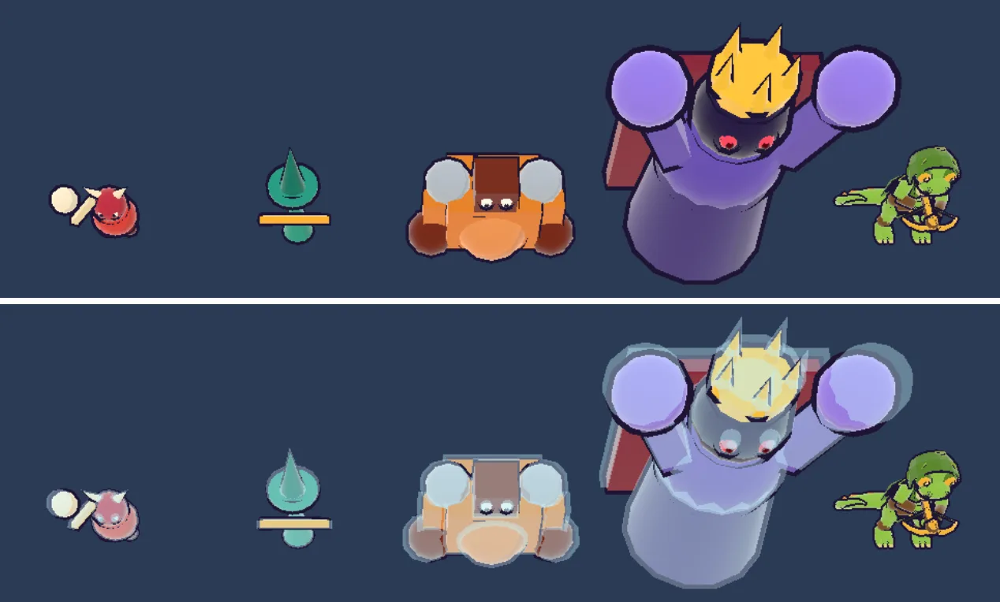
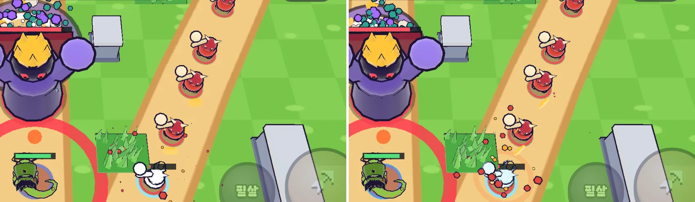
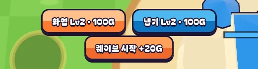

# 16회차: 전투 손맛, 냉기가 보이게

| 항목 | 값 |
| --- | --- |
| 시각 | 2026-11-10 14:41 ~ 14:56 KST (예약 회차) |
| 기준 | `d5f637d` |
| 레인 | 전투 손맛 (15회차 다음 후보) |
| 상태 | **완료** |
| 다음 레인 | 렌더 톤·모델 |

## 범위

15회차의 냉기탑은 적을 늦추지만, 화면에서는 발밑의 작은 하늘색 고리로만 보인다. 휴대폰에서 적이 많을 때는 누가 느려졌는지 읽기 어렵다. 효과가 보이지 않으면 냉기를 고를 이유도 느껴지지 않는다.

- **얼음 껍질**: 느려진 적의 몸 위에 같은 모양을 조금 크게(×1.08) 반투명 하늘색으로 덮는다. 종류마다 인스턴스 묶음 하나씩이고, 느려진 적이 화면에 있을 때만 그린다.
- **녹는 연출**: 둔화가 끝나기 0.25초 전부터 껍질이 깜빡인다. 언제 풀리는지 보인다. 인스턴스마다 투명도를 바꿀 수 없어서, 옅어지는 대신 깜빡이게 했다.
- **냉기 버튼 대비**: 하늘색 바탕을 더 진하게 해서 흰 글자가 읽히게 한다.
- 규칙은 바꾸지 않는다(표현만).

## 가설

같은 틱 화면에서 느려진 적이 한눈에 구분된다. 드로콜은 화면에 느려진 적의 종류 수만큼만 는다(최대 4).

## 수용 기준

- [x] 같은 시드·틱 전후 스크린샷(데스크톱·휴대폰 가로)에서 느려진 적이 구분됨을 직접 확인. 그 틱의 느려진 적 수를 함께 기록
- [x] 드로콜 변화를 기록: 화면에 있는 느려진 종류 수 이하
- [x] 냉기 버튼의 글자·바탕 명도 대비를 전후로 잰다(WCAG 대비비)
- [x] `test:rush`, `tsc`, `build`, `smoke:rush` 통과

## 바꾼 것

- **얼음 껍질(`render.ts`)**
  - 적 종류마다 인스턴스 묶음 `ice`를 더했다. 몸 모양을 ×1.08(높이 ×1.06)로 덮는다.
  - 재질은 하늘색(`#c4f2ff`), 불투명도 0.4, 깊이 기록 없음이다. 0.5로 시작했는데 적 종류 색이 너무 바래 0.4로 낮췄다.
  - 둔화가 0.25초 남으면 깜빡인다.
- **모델 시트 `?sheet=1&frost=1`**: 네 적 모두에 얼음 껍질을 씌워 크게 비교한다.
- **냉기 버튼**: 바탕을 `#c8f4ff/#4fc3ff`에서 `#4cb8ee/#0f74c0`으로 바꿨다.
- 규칙·테스트 변경 없음.

## 측정

**느려진 적을 찾느라 시간이 걸렸다.** 지금까지 쓴 비교 틱(시드 3, 틱 3409·7729)에는 느려진 적이 없다. 기본 봇은 싼 강화부터 하므로 바깥 냉기탑이 판 막바지에야 Lv2가 된다.

| 시드 | 판 끝 탑 | 처음 느려진 틱 | 동시에 느려진 최대 수 |
| --- | --- | --- | --- |
| 1, 2 | 화염 Lv2 ×2, 바깥 Lv1 ×2 | 없음 | 0 |
| 3 | 화염 Lv2 ×2, 냉기 Lv2 ×1 | 7891 | 1 |
| 4 | 화염 Lv2 ×2, 냉기 Lv2 ×1 | 7906 | 1 |
| 5 | 화염 Lv2 ×2, 냉기 Lv2 ×1 | 7724 | 1 |

그래서 비교 장면을 **시드 4, 틱 7962**(돌격병 1마리가 0.82초 남은 둔화)로 잡았다. 봇이 냉기를 거의 쓰지 않는다는 것도 발견이다(아래 다음).

**드로콜**
- 모델 시트(863×360): 18 → 22. 네 종류가 모두 느려지면 종류마다 1씩 는다. 삼각형은 23,920 → 28,076이다.
- 전투(시드 4, 틱 7962): 같은 코드로 두 번 찍어도 휴대폰 75/77, 데스크톱 78/79로 흔들렸다. 효과 고리는 메시 하나씩이고 실제 시간으로 사라지므로, 멈춘 틱에서도 남은 수가 다르다. 그래서 전투 장면의 드로콜 차이(전 73 → 후 75~77)는 얼음 껍질 효과를 따로 떼어 보여 주지 못한다. 깨끗한 측정은 모델 시트 쪽이다.

**냉기 버튼 대비(WCAG, 흰 글자 대 바탕)**

| | 위 절반 | 아래 절반 |
| --- | --- | --- |
| 전 `#c8f4ff / #4fc3ff` | 1.18 | 1.98 |
| 후 `#4cb8ee / #0f74c0` | 2.23 | **4.91** |
| 참고: 화염 `#ffc08a / #ff7a2f` | 1.60 | 2.60 |

글자는 흰 채움에 4px 잉크 외곽선이라 실제 판독은 외곽선이 맡는다. 위 수치는 흰 채움과 바탕의 대비만 잰 보조 지표다.

## 검증

- `npm run test:rush`: 42개 통과(규칙 변경 없음).
- `npx tsc --noEmit`, `npm run build`: 통과.
- `npm run smoke:rush`: 29/29 통과.
- 모델 시트, 전투 장면, 버튼 스크린샷을 직접 열어 확인했다.

## 다음

- **다음 레인: 렌더 톤·모델.** 후보는 마을 표지를 아이콘형으로 바꾸기, 또는 화염 범위 고리의 크기가 실제 1.3m와 맞는지 확인하기다.
- **발견: 봇이 냉기를 거의 쓰지 않는다.** 바깥 탑 강화가 판 막바지에만 일어난다. 봇은 밸런스 기준이라 바꾸면 설계 기둥 숫자가 움직인다. 바꾸려면 PvE 레인에서 테스트와 함께 바꾼다.
- 백로그 상위 3개
  1. (킹덤 메타) 마을 대장간: 분기 탑 강화와 연결
  2. (성능·모바일) 밀어내기 거리 제곱 거르기(9b). 실기기 게이트는 사용자 기기 필요
  3. (렌더 톤·모델) 마을 표지 아이콘형
