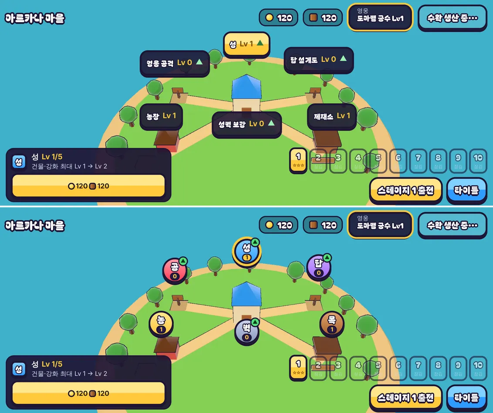
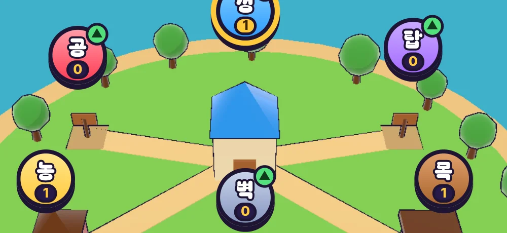

# 17회차: 렌더 톤·모델, 마을 표지를 아이콘 배지로

| 항목 | 값 |
| --- | --- |
| 시각 | 2026-11-10 15:43 ~ 15:49 KST (예약 회차) |
| 기준 | `d844633` |
| 레인 | 렌더 톤·모델 (백로그: 마을 표지 아이콘형) |
| 상태 | **완료** |
| 다음 레인 | 성능·모바일 |

## 범위

마을 화면의 건물 표지는 ‘영웅 공격 Lv 0 ▲’ 같은 긴 글자 알약이다. 휴대폰 가로에서는 섬과 건물을 크게 가린다(14회차 스크린샷). [아트 기준](../art-direction.md) 원칙 2(실루엣으로 구분)와 원칙 7(굵은 UI)에 맞게 **아이콘 배지**로 바꾼다.

- 표지는 둥근 아이콘 배지(카드의 글자 아이콘·색과 같은 것)와 레벨 숫자로 줄인다. 강화할 수 있으면 초록 ▲ 점을 단다.
- 건물 이름은 표지에서 뺀다. 고른 건물의 이름은 이미 아래 카드에 나온다. 고른 표지는 금색 테두리로 표시하고, 이름과 레벨은 접근성 이름(aria-label)으로 남긴다.
- 누르는 크기는 44px 이상을 유지한다.
- 규칙은 바꾸지 않는다.

## 측정

휴대폰 가로(863×360)와 데스크톱(1280×720)의 마을 화면에서 잰다.
- 표지 6개가 화면을 덮는 면적 합(%). 배지 밖으로 나온 레벨·▲ 표시까지 포함한 외곽 상자로 잰다
- 표지끼리 겹치는 쌍의 수
- 가장 작은 표지의 크기(px)

## 수용 기준

- [x] 휴대폰 가로에서 표지 면적 합이 절반 이하로 준다
- [x] 겹치는 쌍이 늘지 않는다. 모든 표지가 44×44px 이상이다
- [x] 전후 스크린샷을 직접 확인한다. 고른 표지와 강화 가능 표시가 구분된다
- [x] 스모크(표지 → 카드)와 `test:rush`, `tsc`, `build` 통과

## 결과

| | 휴대폰 가로 863×360 | 데스크톱 1280×720 |
| --- | --- | --- |
| 표지 면적 합 | 8.7% → **4.0%** | 3.3% → 1.3% |
| 겹치는 쌍 | 0 → 0 | 0 → 0 |
| 가장 작은 표지 | 76×44 → 44×44 | 85×44 → 44×44 |
| 표지 크기(외곽 상자) | 76~123 × 44 | 44~45 × 44~48 |

**고친 과정**
1. 첫 시안은 46px 배지에 레벨 알약과 ▲ 점을 배지 밖에 달았다. 휴대폰 면적이 5.4%로, 목표(4.35% 이하)에 못 미쳤다.
2. 배지를 44px로 줄이고 레벨을 배지 안 아래쪽으로 넣었다. 면적은 4.0%가 됐지만, 레벨 알약이 글자 아래를 가려 ‘공’이 ‘곰’처럼 보였다.
3. 글자를 위로 올리고 알약을 줄였다(글자 16px, 알약 높이 14px). 확대해서 여섯 글자를 모두 확인했다.

## 바꾼 것

- **`town.ts`**: 표지는 색 배지(카드 아이콘과 같은 색·글자: 성·농·목·공·탑·벽), 레벨 숫자, 강화 가능 ▲ 점으로 이루어진다. 접근성 이름은 ‘영웅 공격 Lv 0, 강화 가능’처럼 상태를 담는다.
- **`rush.css`**: 44px 원형 배지, 배지 안 레벨 알약, 오른쪽 위 초록 ▲ 점(위아래로 흔들림). 고른 표지는 금색 테두리와 금색 레벨 알약이다. 짧은 화면용 표지 규칙은 지웠다.
- 건물 이름은 표지에서 뺐다. 고른 건물 이름은 아래 카드에 나온다.

## 검증

- `npm run test:rush`: 42개 통과(규칙 변경 없음).
- `npx tsc --noEmit`, `npm run build`: 통과.
- `npm run smoke:rush`: 29/29 통과(표지 → 카드 포함).
- 휴대폰·데스크톱 마을 화면과 배지 확대를 직접 열어 확인했다.

## 한계

- 이름이 사라져서 처음 보는 사람은 어느 배지가 무엇인지 카드를 열어 봐야 안다. 글자 아이콘(성·농·목·공·탑·벽)이 그 역할을 하지만 사람 대상 확인은 아직이다.

## 다음

- **다음 레인: 성능·모바일.** 백로그 9b(밀어내기 거리 제곱 거르기)를 넣는다. 13회차에서 결과가 비트 단위로 같음을 이미 확인했다. `tools/rush-bench.ts`로 전후를 비교한다.
- 백로그 상위 3개
  1. (성능·모바일) 밀어내기 거리 제곱 거르기(9b). 실기기 게이트는 사용자 기기 필요
  2. (킹덤 메타) 마을 대장간: 분기 탑 강화와 연결
  3. (PvE 콘텐츠) 봇이 냉기를 쓰게 하기(16회차 발견), 테스트와 함께
