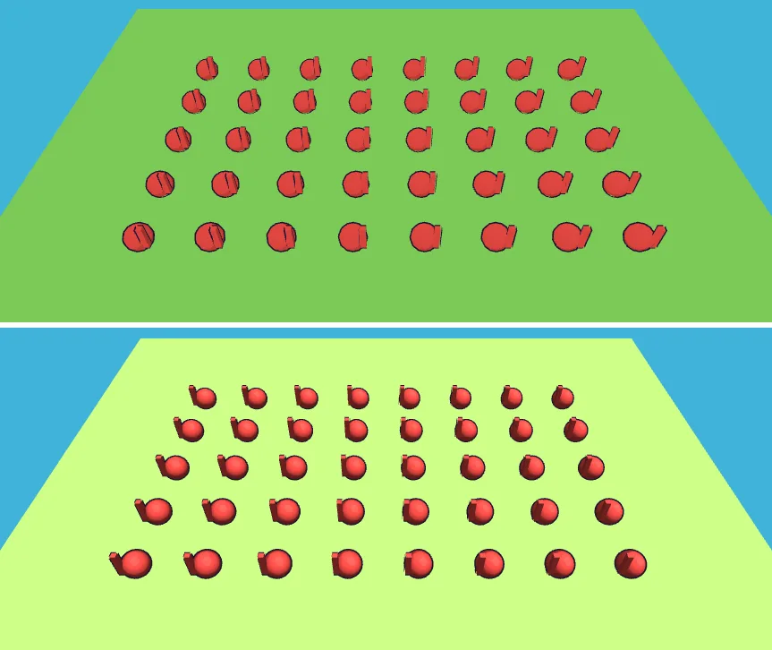

# 19회차: 엔진 스파이크, Babylon.js 9 대 Three.js

| 항목 | 값 |
| --- | --- |
| 시각 | 2026-11-10 17:42 ~ 17:46 KST (예약 회차) |
| 기준 | `4dac27f` |
| 레인 | 엔진 스파이크 ([조사 문서](../engine-research-2026-11.md) ‘시험’ 항목 중 Babylon.js) |
| 상태 | **완료**. 판정: Babylon.js **기각**(지금 단계), Three.js 유지 |
| 다음 레인 | 킹덤 메타 |

## 질문

브롤스타즈풍 3D 툰 톤(툰 3단 명암, 잉크 외곽선, 인스턴싱)을 Babylon.js 9(9.35.0)로 만들면 지금의 Three.js(0.186.1)보다 나은 점이 있는가? 옮길 가치가 있는가?

## 범위 (시간 제한, 제품 코드 변경 없음)

같은 **최소 장면**을 두 엔진으로 스크래치에서 만든다.
- 바닥 1장
- 적 모양(구 + 상자를 합친 메시) 40개를 인스턴싱
- 툰 명암과 외곽선

잴 것은 다음 넷이다.
1. **번들 크기**: esbuild로 트리 셰이킹 + 최소화한 크기와 gzip 크기
2. **드로콜**: 헤드리스 Chromium(SwiftShader)에서 한 프레임 기준
3. **툰·외곽선이 인스턴스에서 되는지**: 스크린샷을 직접 보고 확인
4. **옮기는 비용**: 지금 렌더 코드의 줄 수와, 엔진에 묶인 부분

## 가설

Babylon은 기능은 갖췄지만 최소 번들이 더 크고, 툰 외곽선을 인스턴스에 적용하려면 지금처럼 직접 만들어야 한다. 옮길 이유가 없다.

## 수용 기준

- [x] 두 엔진의 번들(최소화/gzip), 드로콜, 스크린샷 표
- [x] 판정(채택·보류·기각)과 재검토 조건을 [조사 문서](../engine-research-2026-11.md)에 반영
- [x] 제품 코드 변경 없음. `test:rush`, `tsc`, `build`, `smoke:rush` 통과

## 결과

같은 최소 장면이다. 바닥 1장에 적 모양(구 + 상자) 40개를 인스턴싱하고, 툰 명암과 외곽선을 넣었다. 소스는 [19-spike/](19-spike/)에 있다. 번들은 esbuild로 묶고 최소화했다(ESM, 트리 셰이킹, es2020).

| | Three.js 0.186.1 | Babylon.js 9.35.0 |
| --- | --- | --- |
| 인스턴싱 | `InstancedMesh` ×2(본체 + 외곽선) | thin instance ×1 |
| 툰 명암 | `MeshToonMaterial` + 3단 그라디언트 | `CellMaterial`(@babylonjs/materials) |
| 외곽선 | 뒷면을 법선 방향으로 미는 셰이더 직접 작성(지금 `look.ts`와 같은 방식) | `renderOutline = true`(내장). thin instance에서도 그려진다 |
| 최소 번들 (min / gzip) | **531.9 KB / 133.8 KB** | 1,642.3 KB / 387.6 KB (약 2.9배) |
| 드로콜 (한 프레임) | 3 | 4 |
| 30프레임까지 걸린 시간 | 0.9초 | 2.7초 |

- 30프레임 시간은 소프트웨어 렌더링(SwiftShader)이고 셰이더 컴파일이 섞여 있다. 그래서 근거로 쓰지 않는다.
- Babylon의 외곽선 내장은 장점이다. 다만 지금 Three.js 외곽선은 `look.ts`의 `outlineMaterial`(14줄)과 `hullGeometry`(법선 평균)로 이미 해결돼 있다.
- Babylon은 기본이 왼손 좌표계라, 같은 위치값에서 몽둥이 방향이 거울처럼 바뀌었다. 옮기려면 좌표 변환도 확인해야 한다.
- 참고: 지금 제품 빌드의 Three.js 청크는 `three-core` 248 KB와 `three-renderer` 358 KB다(최소화, gzip 전).

**옮기는 비용**
- 엔진에 묶인 코드: `render.ts` 906줄, `townScene.ts` 227줄, `look.ts` 110줄, `fx.ts` 102줄, `batch.ts` 34줄. 합계 1,379줄이다.
- 규칙 코어(`sim`·`data`·`bot`·`kingdom`·`stages`·`clock`·`quality`) 1,224줄은 엔진과 무관하다. 그대로 쓸 수 있다.
- 영웅 GLB 굽기, 인스턴스 묶음, 이펙트 문법, 품질 단계를 모두 다시 만들고 다시 검증해야 한다.

## 판정

- **Babylon.js: 기각(지금 단계).** 최소 번들이 gzip 기준 약 2.9배 크다. 모바일 웹뷰의 첫 로딩에 불리하다. 툰·외곽선·인스턴싱은 두 엔진 모두 되므로, 옮겨서 얻는 기능이 없다. 비용은 1,379줄을 다시 쓰고 다시 검증하는 일이다.
- **재검토 조건**
  - 물리 엔진, 고급 파티클, 노드 머티리얼 에디터처럼 Babylon에만 있는 기능이 꼭 필요해질 때
  - Three.js의 WebGPU 경로가 계속 막히고(07회차) Babylon의 WebGPU가 실기기에서 확실히 나을 때
  - 마을과 전투를 하나의 큰 장면 편집기로 만들 필요가 생길 때(Babylon Editor)
- 조사 문서의 남은 시험 항목은 PixiJS 8 / Phaser 4(2.5D 스프라이트 경로)다. 사용자가 3D 툰 톤을 정했으므로 우선순위를 낮춘다.

## 검증

- `npm run test:rush`: 42개 통과. 제품 코드는 바꾸지 않았다.
- `npx tsc --noEmit`, `npm run build`: 통과.
- `npm run smoke:rush`: 29/29 통과.
- 두 엔진의 장면 스크린샷을 직접 열어 확인했다.

## 다음

- **다음 레인: 킹덤 메타.** 후보는 마을 대장간이다. 탑 분기(화염 범위·냉기 시간)를 마을에서 강화하는 건물로, 15회차에서 남긴 일이다.
- 백로그 상위 3개
  1. (킹덤 메타) 마을 대장간: 분기 탑 강화
  2. (PvE 콘텐츠) 봇이 냉기를 쓰게 하기(16회차 발견), 테스트와 함께
  3. (성능·모바일) 실기기 게이트(사용자 기기 필요)
