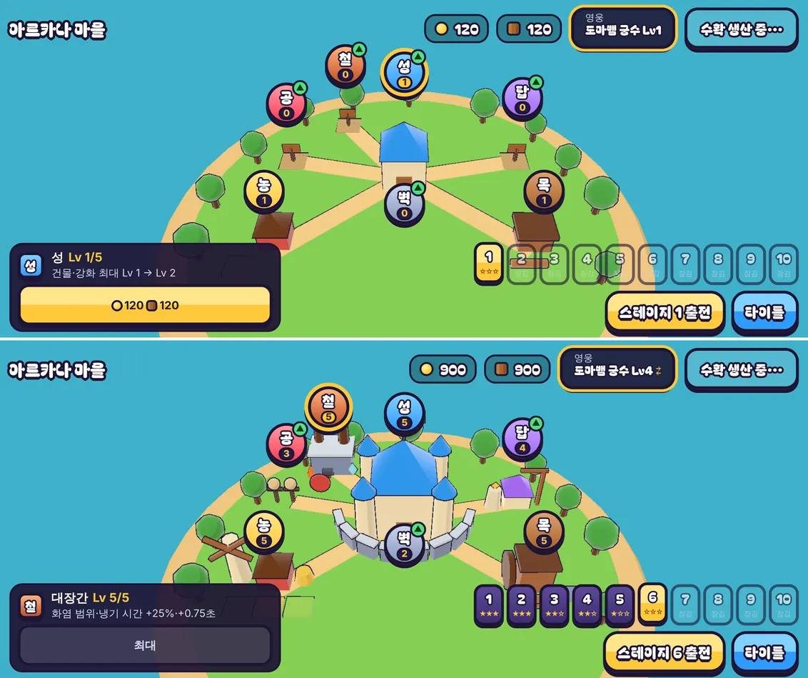

# 20회차: 킹덤 메타, 마을 대장간

| 항목 | 값 |
| --- | --- |
| 시각 | 2026-11-10 18:44 ~ 18:51 KST (예약 회차) |
| 기준 | `43cfba4` |
| 레인 | 킹덤 메타 (백로그 8번 남은 것: 분기 탑 강화와 마을 연결) |
| 상태 | **완료** |
| 다음 레인 | PvE 콘텐츠 |

## 범위

15회차의 탑 분기(화염·냉기)는 전투 안의 선택이고, 마을과 이어지지 않는다. 킹샷식 성장의 결을 따라, 마을에 **대장간**을 세워 두 분기를 함께 키운다.

- **규칙(`kingdom.ts`, 순수)**
  - 새 강화 `forge`(대장간)를 둔다. 레벨 0부터 시작하고, 다른 강화처럼 성 Lv까지 올릴 수 있다.
  - 비용은 다음 레벨 n에서 식량 50·n, 목재 60·n이다.
  - 예전 저장은 대장간 0으로 읽는다. 다른 값은 그대로 둔다.
- **효과(`sim.ts`, `data.ts`)**: 레벨당 화염 범위 피해 비율 +5%p(30% → Lv5 55%), 냉기 둔화 시간 +0.15초(1초 → Lv5 1.75초). `RushMods.forge`로 넘긴다. 기본값 0이면 지금과 결과가 같다.
- **마을 화면**
  - 섬 뒤쪽(성 뒤 왼쪽)에 대장간 건물이 생긴다. 3단계 모습이고, 2단계부터 화염·얼음 결정을 단다.
  - 표지 배지는 ‘철’이고, 카드에는 효과(지금 → 다음)를 보여 준다.

## 가설

강화가 다 찬 마을에서 대장간 0 대 5를 비교하면, 봇 기준 높은 스테이지에서 탑이 더 많이 처치하고 이기는 판이 늘거나 같다. 설계 기둥(기본 배율)은 그대로 통과한다.

## 수용 기준

- [x] 규칙 테스트: 성 상한, 비용, 예전 저장 호환(대장간 없음 → 0, 다른 값 유지), 전투 배율 전달
- [x] 효과 테스트: 대장간 Lv5에서 화염 범위 피해와 냉기 둔화 시간이 정해진 만큼 커진다
- [x] 봇 비교(대장간 0 대 5, 다른 강화 최대): 높은 스테이지 결과를 기록
- [x] 마을 화면 스크린샷(휴대폰 가로·데스크톱) 직접 확인: 대장간 건물·배지가 다른 것과 겹치지 않는다
- [x] `test:rush`, `tsc`, `build`, `smoke:rush` 통과

## 결과

**봇 비교 1: 다른 강화 최대(공격·탑 비용·마을 체력 Lv5), 스테이지 8~10 × 시드 1~4**
- 대장간 0과 5 모두 12판을 다 이겼다. 강화가 다 찬 마을에서는 이미 이기므로, 승패로는 차이가 보이지 않는다.

**봇 비교 2: 중간 마을(공격·탑 비용·마을 체력 Lv2), 스테이지 6~8 × 시드 1~6(18판)**

| 대장간 | 승리 | 남은 마을 체력(평균) | 판당 탑 피해 |
| ---: | ---: | ---: | ---: |
| 0 | 8/18 | 13.0% | 7,769 |
| 2 | 11/18 | 16.9% | 8,339 |
| 5 | 13/18 | 22.7% | 8,786 |

- 대장간이 오를수록 이기는 판, 남은 마을 체력, 탑 피해가 모두 커진다.
- 단, 대장간은 성 Lv까지만 오른다. 다른 강화가 Lv2인 마을이 실제로 가질 수 있는 대장간은 2 정도다. 그래서 실제 선택지는 0 → 2(8 → 11승)다. 5는 효과 크기를 보려고 넣은 가정이다.
- 봇은 바깥 탑을 막바지에야 냉기 Lv2로 올린다(16회차). 그래서 위 차이는 대부분 화염 쪽 효과로 보인다(확인하지 않았다).

## 바꾼 것

- **`kingdom.ts`**
  - 강화 `forge`를 더했다. 비용은 식량 50·n, 목재 60·n이고, 성 Lv까지 오른다. `kingdomMods`가 `forge` 레벨을 넘긴다.
  - 예전 저장에 대장간이 없으면 0으로 읽고, 다른 값은 그대로 둔다. 성 상한을 넘는 값은 깨진 저장으로 본다(다른 강화와 같은 규칙).
- **`data.ts`**: `FORGE = { splashShare: 0.05, slowTime: 0.15 }`(레벨당).
- **`sim.ts`**: `RushMods.forge`. 화염 범위 피해 비율과 냉기 둔화 시간에 더한다. 기본값 0이면 결과가 같다(설계 기둥·기존 테스트 그대로 통과).
- **마을 화면**
  - 섬 뒤 왼쪽 `(-4.3, -7.2)`에 대장간을 세웠다. 돌 대장간, 굴뚝 불빛, 모루로 이루어지고, 2단계부터 굴뚝 하나와 화염 결정·얼음 결정이 더 붙는다.
  - 처음 둔 자리 `(-3.4, -7.4)`는 다 자란 성과 ‘공’ 건물에 가려 옮겼다.
  - 배지는 ‘철’(주황·적갈색)이다. 카드에는 ‘화염 범위·냉기 시간 +25%·+0.75초’처럼 효과를 보여 준다.
- **원래 있던 버그 수정**: 성 Lv5에서 강화가 Lv5에 이르면 버튼이 ‘성 Lv 필요’로 나왔다. 이제 ‘최대’로 나온다. 영웅 훈련 버튼도 Lv10에서 같다.
- **테스트 2개 추가**(42 → 44): 대장간 규칙(상한·비용·예전 저장·배율), 효과(화염 범위 비율 30% → 55%, 냉기 1초 → 1.75초).
  - `stages.test`의 ‘강화 최대’ 배율에 `forge: 5`를 넣었다. 주석의 ‘모든 강화 Lv5’와 맞추려는 것이고, 테스트는 그대로 통과한다.
- **스모크 1개 추가**(29 → 30): 대장간 표지를 누르면 대장간 카드가 열린다.

**표지 측정**(17회차 도구, 휴대폰 가로): 표지 7개, 면적 4.4~4.7%(6개일 때 4.0%), 겹침 0, 가장 작은 표지 44×44.

## 검증

- `npm run test:rush`: 44개 통과(설계 기둥·스테이지·영웅 훈련 포함).
- `npx tsc --noEmit`, `npm run build`: 통과.
- `npm run smoke:rush`: 30/30 통과.
- 처음 마을과 다 자란 마을(대장간 Lv5)을 휴대폰 가로·데스크톱으로 찍어 직접 확인했다. 데스크톱 카드에서 ‘최대’ 표시도 확인했다.

## 다음

- **다음 레인: PvE 콘텐츠.** 백로그 15번 ‘봇이 냉기를 쓰게 하기’를 한다. 대장간 효과의 절반(냉기 시간)은 봇이 냉기를 거의 쓰지 않아 측정에 잡히지 않는다. 봇은 밸런스 기준이므로 설계 기둥·스테이지 테스트를 다시 맞춘다.
- 백로그 상위 3개
  1. (PvE 콘텐츠) 봇이 냉기를 쓰게 하기(테스트와 함께)
  2. (성능·모바일) 실기기 게이트(사용자 기기 필요)
  3. (킹덤 메타) 영웅 조각 보상(높은 별에 훈련 재료)
