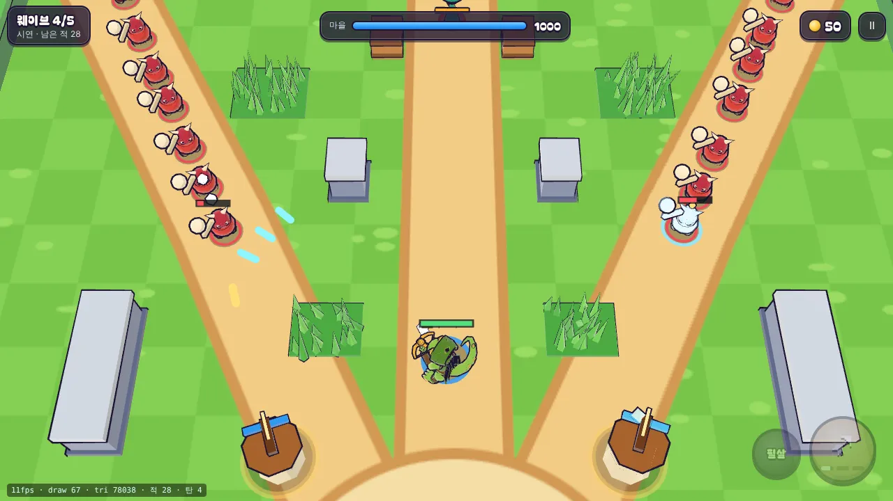

# 21회차: PvE 콘텐츠, 봇이 냉기를 쓰게

| 항목 | 값 |
| --- | --- |
| 시각 | 2026-11-10 19:42 ~ 19:47 KST (예약 회차) |
| 기준 | `f411e49` |
| 레인 | PvE 콘텐츠 (백로그 15번, 16회차 발견) |
| 상태 | **완료** |
| 다음 레인 | 전투 손맛 |

## 문제

봇(`guardBot`)은 밸런스 테스트와 자동 시연의 기준이다. 그런데 냉기탑을 거의 쓰지 않는다.
- 봇은 싼 강화부터, 가까운 탑부터 올린다. 그래서 판마다 Lv2 강화가 2~3번뿐이고, 먼저 오르는 것은 늘 안쪽 두 탑(화염)이다.
- 바깥 탑의 냉기 Lv2는 6판 중 3판에서만, 그것도 112초쯤(판 끝 30초 전)에야 나온다.
- 판당 적이 느려진 시간은 평균 1.0초다.

결과적으로 설계 기둥·스테이지·영웅 훈련 테스트가 냉기를 거의 거치지 않는다. 대장간(20회차)의 냉기 쪽 효과도 측정에 잡히지 않는다.

## 범위

- 봇의 분기 배치를 바꿔 **안쪽 두 탑을 화염 하나, 냉기 하나**로 한다. 봇이 먼저 올리는 탑에 냉기가 들어가게 된다.
- 규칙·수치는 바꾸지 않는다. 테스트 기준이 깨지면 기준이 아니라 원인을 먼저 본다.

## 가설

냉기 Lv2가 모든 판에서 판 중반(약 80~110초)에 나온다. 설계 기둥·스테이지·영웅 훈련 테스트는 그대로 통과한다.

## 수용 기준

- [x] 시드 1~6에서 냉기 Lv2가 모든 판에 나오고, 판당 느려진 시간이 지금(1.0초)보다 크게 는다
- [x] 설계 기둥(아무것도 안 함·영웅만·탑만 패배, 영웅+탑 2~4분 승리)과 스테이지·영웅 훈련·분기 테스트 통과
- [x] 자동 시연에서 냉기탑과 얼음 껍질이 보이는 장면을 스크린샷으로 직접 확인
- [x] `test:rush`, `tsc`, `build`, `smoke:rush` 통과

## 바꾼 것

`bot.ts`의 분기 배치를 `[화염, 화염, 냉기, 냉기]`에서 `[화염, 냉기, 화염, 냉기]`로 바꿨다(한 줄). 탑 순서는 안쪽 왼쪽, 안쪽 오른쪽, 바깥 왼쪽, 바깥 오른쪽이다. 봇이 먼저 올리는 안쪽 두 탑이 화염 하나, 냉기 하나가 된다. 규칙과 수치는 바꾸지 않았다.

`[냉기, 화염, 냉기, 화염]`(왼쪽이 냉기)도 같이 시험했다. 테스트 44개를 모두 통과했고, 판당 느려진 시간은 평균 13.7초, 첫 냉기는 94초였다. 거의 같아서 위 배치를 골랐다.

## 결과

**냉기 사용 (스테이지 1, 시드 1~6)**

| | 전 | 후 |
| --- | --- | --- |
| 냉기 Lv2가 나온 판 | 3/6 | **6/6** |
| 첫 냉기 Lv2 (평균) | 112초 | 98초(77~110초) |
| 판당 적이 느려진 시간 (평균) | 1.0초 | **14.7초** (11.9~18.7초) |
| 결과 | 6판 승, 144~146초 | 6판 승, 144~146초 |

**스테이지 곡선 (기본 배율, 시드 1~4, 승리 수와 남은 마을 체력 평균)**

| 스테이지 | 1 | 2 | 3 | 4 | 5 | 6 | 7~10 |
| --- | --- | --- | --- | --- | --- | --- | --- |
| 전 | 4 (100%) | 4 (94%) | 4 (73%) | 4 (63%) | 4 (15%) | 1 (4%) | 0 |
| 후 | 4 (99%) | 4 (93%) | 4 (75%) | 4 (55%) | 3 (16%) | 1 (0%) | 0 |

- 곡선 모양은 그대로다. 스테이지 4·5가 조금 어려워졌다. 냉기는 화염보다 한 발 피해가 낮고(×0.8 대 ×0.85) 범위 피해가 없다.
- 설계 기둥·스테이지·영웅 훈련·분기·대장간 테스트는 수치를 바꾸지 않고 모두 통과했다.
- 이제 밸런스 테스트가 냉기를 거친다. 다만 봇은 냉기탑 하나만 Lv2로 올리므로, 동시에 느려진 적은 적다(시드 1·3에서 재 보니 최대 1마리).

## 검증

- `npm run test:rush`: 44개 통과(설계 기둥 포함).
- `npx tsc --noEmit`, `npm run build`: 통과.
- `npm run smoke:rush`: 30/30 통과. 자동 시연에서 탑 4개를 짓는다.
- 자동 시연 장면을 직접 열어 냉기탑과 얼음 껍질을 확인했다.

## 다음

- **다음 레인: 전투 손맛.** 후보는 적이 많을 때 영웅 탄이 어디에 맞는지 읽히게 하는 것(피격 숫자 겹침 정리)이다. 다른 후보는 냉기 착탄 때 짧은 효과음 구분이다.
- 백로그 상위 3개
  1. (전투 손맛) 피해 숫자 겹침 정리, 분기별 효과음
  2. (성능·모바일) 실기기 게이트(사용자 기기 필요)
  3. (킹덤 메타) 영웅 조각 보상(높은 별에 훈련 재료)
