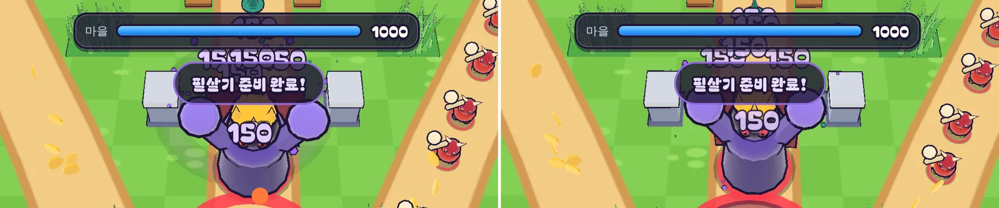

# 22회차: 전투 손맛, 피해 숫자 합치기

| 항목 | 값 |
| --- | --- |
| 시각 | 2026-11-10 20:42 ~ 21:03 KST (예약 회차) |
| 기준 | `00a17a9` |
| 레인 | 전투 손맛 (21회차 다음 후보) |
| 상태 | **완료** |
| 다음 레인 | 렌더 톤·모델 |

## 문제

맞힐 때마다 피해 숫자가 하나씩 뜬다.
- 궁수의 3갈래 화살이 한 적에 다 맞으면 ‘24’가 세 개 겹친다.
- 탑 범위 피해(화염)와 영웅 사격이 겹치는 웨이브 후반에는 숫자가 무더기로 쌓인다.
- 휴대폰에서는 무엇을 얼마나 맞혔는지 읽기 어렵다.

## 범위

- **같은 적, 같은 공격자 종류(영웅·필살기·탑)의 피해를 0.35초 안에서 한 숫자로 합친다.** 합쳐질 때마다 숫자가 커지고 한 번 튄다. 세 발이 다 맞으면 ‘72’가 한 번 커지는 식이다.
- 규칙(`sim.ts`)은 그대로 두고, `hit` 이벤트에 적 id만 더한다(표현용).
- 합치기 규칙은 순수 모듈 `pops.ts`로 두고 테스트한다.
- (진행 중 추가) 서로 다른 적이 몰린 곳에 범위 공격(필살기)이 맞으면 합칠 수 없다. 이때 숫자가 한 자리에 쌓였다. 그래서 최근 숫자와 겹칠 자리에 뜨는 새 숫자는 **위로 한 칸씩 올려 띄운다**.

## 측정

자동 시연과 같은 판(시드 3, `guardBot`)의 이벤트를 노드에서 다시 재생한다. 화면 투영 없이 세계 좌표로 센다.
- 판 전체에서 만들어진 숫자 수
- 동시에 떠 있는 숫자의 최대 수
- 겹침: 0.1초마다 표본을 떠서, 떠 있는 숫자끼리 겹치는 쌍의 수. 숫자가 화면에서 가로로 길기 때문에(휴대폰에서 약 1.7×1m), 가로 1.6m·세로 1.0m 타원 안에 있고 높이 차가 0.5m 미만이면 겹친다고 본다

## 수용 기준

- [x] 합치기 테스트: 같은 적·같은 종류·창 안은 합쳐지고, 다른 적·다른 종류·창 밖은 따로 뜬다
- [x] 같은 판에서 만들어진 숫자 수와 겹치는 쌍이 줄어든다(전후 표)
- [x] 전투 장면 스크린샷 직접 확인
- [x] `test:rush`, `tsc`, `build`, `smoke:rush` 통과

## 바꾼 것

- **`pops.ts`(새 파일, 순수)**
  - `addHit`: 같은 키(공격자 종류 + 적 id)의 숫자가 0.35초 안에 떠 있으면 거기에 더한다. 아니면 새 숫자를 만든다.
  - 새 숫자는 최근 0.3초 안에 뜬 숫자와 겹칠 자리면 0.6m씩 위로 올린다(최대 4칸). 겹침 판정은 가로 1.6m·세로 1.0m 타원이다.
- **`sim.ts`**: `hit` 이벤트에 적 `id`를 더했다. 표현용이며, 규칙과 `rushHash`는 그대로다.
- **`main.ts`**: 피해 숫자가 `addHit`를 쓴다. 숫자가 합쳐질 때마다 작게 한 번 튄다. 영웅 피격·코인 숫자는 지금처럼 따로 뜬다.
- **테스트 2개 추가**(44 → 46, `pops.test.ts`). `package.json`의 테스트 목록에 넣었으므로 `npm test` 전체(216개)도 돌렸다.

**고친 과정**
1. 합치기만 넣었을 때, 필살기가 몰린 적들에게 맞은 ‘150’ 여러 개가 여전히 한 줄로 뭉개졌다. 서로 다른 적이라 합칠 수 없었다. 그래서 위로 쌓기를 더했다.
2. 처음 쌓기 반경(원 0.7m)은 숫자 폭보다 좁아 가로로 겹친 숫자를 놓쳤다. 숫자 크기에 맞춘 타원으로 바꿨다.

## 결과

**같은 판 재생(시드 3·1, `guardBot`, 스테이지 1)**

| | 전 | 후 |
| --- | --- | --- |
| 만들어진 숫자 | 334 · 331 | **244 · 238** (약 −27%) |
| 동시에 떠 있는 최대 수 | 13 · 14 | 10 · 11 |
| 겹치는 쌍(0.1초 표본 합) | 1,641 · 1,640 | **152 · 146** (약 −91%) |

**화면(자동 시연, 시드 3, 속도 ×2, 보스 웨이브에서 피해가 가장 몰리는 틱 7975, 휴대폰 가로)**
- 전에는 필살기에 맞은 ‘150’들이 ‘1515050’처럼 뭉개졌다. 후에는 ‘150 150’으로 나뉘어 위로 쌓인다.
- 화면에 떠 있던 숫자 수는 전 11, 후 5~6이다(찍은 시점에 따라 다르다).
- 화면 위쪽 HUD 막대 뒤로 올라간 오래된 숫자는 아직 일부 겹친다. 위로 떠오르며 사라지는 동안 생기는 겹침이다.

## 검증

- `npm run test:rush`: 46개 통과(설계 기둥 포함). `npm test` 전체 216개 통과.
- `npx tsc --noEmit`, `npm run build`: 통과.
- `npm run smoke:rush`: 30/30 통과.
- 전투 장면을 직접 열어 확인했다.

## 다음

- **다음 레인: 렌더 톤·모델.** 후보는 상단 HUD(마을 체력 막대) 뒤로 숫자·효과가 가려지는 문제를 줄이는 것, 또는 영웅 두 명의 실루엣을 모델 시트로 점검하는 것이다.
- 백로그 상위 3개
  1. (렌더 톤·모델) HUD 뒤 가림 줄이기, 영웅 실루엣 점검
  2. (성능·모바일) 실기기 게이트(사용자 기기 필요)
  3. (킹덤 메타) 영웅 조각 보상(높은 별에 훈련 재료)
