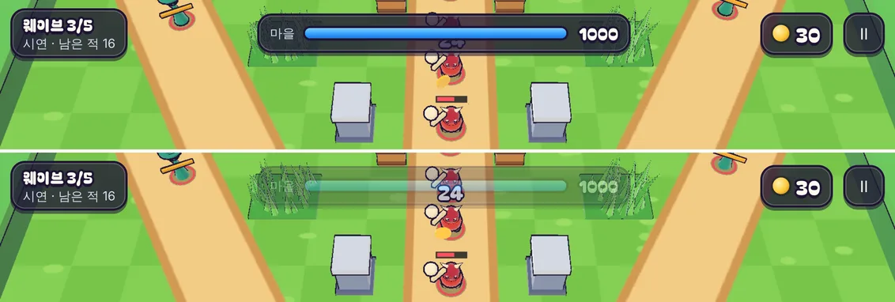

# 23회차: 렌더 톤·모델, 상단 HUD 뒤에 숨는 적

| 항목 | 값 |
| --- | --- |
| 시각 | 2026-11-10 21:42 ~ 21:48 KST (예약 회차) |
| 기준 | `22f55aa` |
| 레인 | 렌더 톤·모델 (22회차 다음 후보: HUD 뒤 가림) |
| 상태 | **완료** |
| 다음 레인 | 성능·모바일 |

## 문제

적은 화면 위쪽(세 길의 입구)에서 들어온다. 그런데 상단 HUD가 그 자리를 덮는다. 웨이브 알약(왼쪽), 마을 체력 막대(가운데, 최대 360px), 골드(오른쪽)다. 휴대폰 가로에서 보스와 새로 들어온 적이 막대 뒤에 가려진다(21·22회차 스크린샷).

## 범위

- **HUD 투명화**: 적의 화면 위치가 HUD 요소 안에 들어오면, 그 요소만 반투명(불투명도 0.35)해진다. 빠지면 다시 불투명해진다. 바뀔 때는 0.15초에 걸쳐 바뀐다. 보스는 몸이 크므로 머리 높이로 판정한다.
- 탭이 되어야 하는 일시정지 버튼은 투명해져도 눌린다(불투명도만 바꾼다).
- 규칙은 바꾸지 않는다.

## 측정

자동 시연(시드 3, 속도 ×2)을 휴대폰 가로로 돌리며 0.25초마다 표본을 뜬다.
- 화면 안 적 중 HUD 요소 아래에 있는 적의 비율
- 그중 **불투명한**(불투명도 0.6 이상) HUD에 가려진 적의 비율

## 수용 기준

- [x] 불투명한 HUD에 가려진 적의 비율이 크게 준다(전후 표)
- [x] 적이 없을 때는 HUD가 그대로 불투명하다(읽기 쉬움 유지)
- [x] 스크린샷으로 직접 확인
- [x] `test:rush`, `tsc`, `build`, `smoke:rush` 통과

## 바꾼 것

- **`main.ts`**
  - 매 프레임 살아 있는 적의 몸(반지름 ×1.2)과 머리(×2.6, 보스 ×3.6) 높이를 화면 좌표로 바꾼다.
  - 그 점이 상단 HUD 요소(웨이브·마을 체력·골드·일시정지) 상자 안에 들면 그 요소에 `see-through`를 붙인다. 상자 위·옆 8px, 아래 12px 여유를 둔다.
  - 전투(플레이·시연)에서만 동작한다. `?nofade`는 측정용으로 예전 동작을 낸다.
- **`rush.css`**: `see-through`는 불투명도 0.35이고, 0.15초에 걸쳐 바뀐다. 누르기는 그대로 된다.
- **디버그 손잡이**: `__rush.enemyScreen()`(적의 화면 좌표, 읽기 전용, 측정용).
- 규칙·테스트 변경 없음.

## 결과

**자동 시연(시드 3, 속도 ×2, 휴대폰 가로), 0.25초 표본 240개**

| | 화면 안 적(표본 합) | HUD 아래 | 불투명한 HUD에 가려짐 |
| --- | ---: | ---: | ---: |
| 전 (`?nofade`) | 652 | 62 (9.5%) | **62 (9.5%)** |
| 후 | 661 | 66 (10.0%) | **0 (0%)** |

- 화면 안 적의 약 10%가 상단 HUD 아래를 지난다. 전에는 모두 가려졌고, 후에는 그때마다 그 HUD가 반투명해져 하나도 가려지지 않았다.
- 적이 없으면 HUD는 불투명하다. 투명화는 적의 점이 상자(와 여유) 안에 있을 때만 일어난다.
- 반투명일 때도 마을 체력 숫자(1000)는 흐리게 읽힌다.

## 검증

- `npm run test:rush`: 46개 통과(규칙 변경 없음).
- `npx tsc --noEmit`, `npm run build`: 통과.
- `npm run smoke:rush`: 30/30 통과.
- 같은 장면의 전후 스크린샷을 직접 열어 확인했다.

## 다음

- **다음 레인: 성능·모바일.** 실기기 게이트는 여전히 사용자 기기가 필요하다. 컨테이너에서 할 수 있는 후보는 **첫 로딩 크기 줄이기**다. 지금 JS는 `three-renderer` 358 KB, `three-core` 248 KB이고, 영웅 GLB도 있다. 지연 로딩이나 압축 여부를 확인하고 바이트 수로 보고한다.
- 백로그 상위 3개
  1. (성능·모바일) 첫 로딩 바이트 줄이기. 실기기 게이트는 사용자 기기 필요
  2. (킹덤 메타) 영웅 조각 보상(높은 별에 훈련 재료)
  3. (렌더 톤·모델) 영웅 두 명 실루엣 점검(모델 시트)
