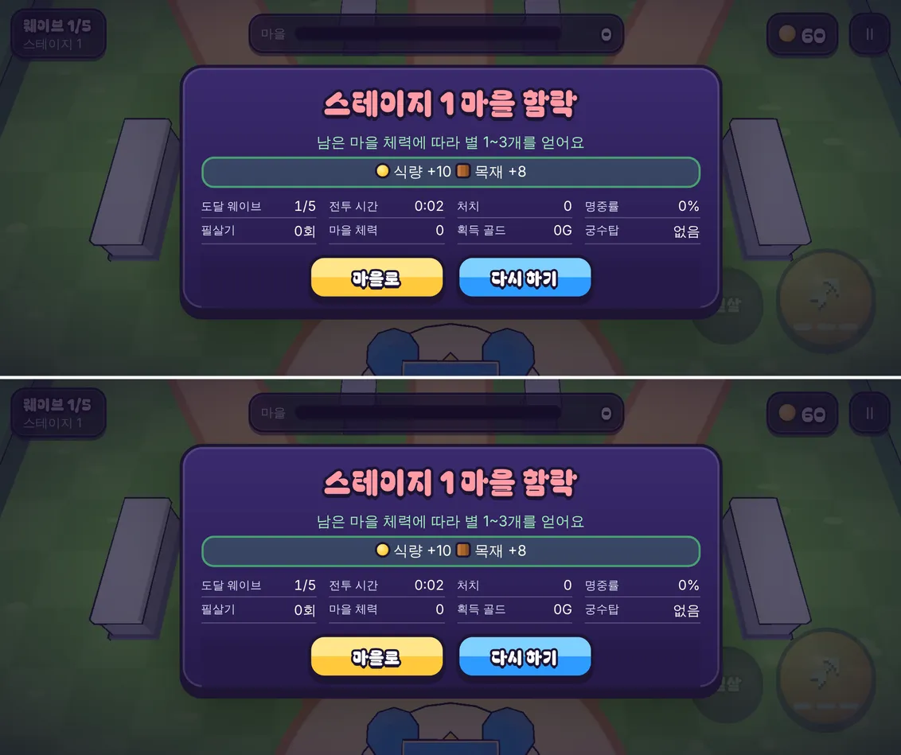

# 24회차: 성능·모바일, 첫 로딩 바이트

| 항목 | 값 |
| --- | --- |
| 시각 | 2026-11-10 22:42 ~ 22:49 KST (예약 회차) |
| 기준 | `d47369a` |
| 레인 | 성능·모바일 (실기기 없이 할 수 있는 것: 첫 로딩) |
| 상태 | **완료** |
| 다음 레인 | 엔진 스파이크 |

## 측정 (편집 전)

프로덕션 빌드(`vite preview`)를 휴대폰 가로로 열고, 타이틀 화면까지 받은 파일을 셌다.

| 파일 | 크기 | gzip(텍스트) |
| --- | ---: | ---: |
| `fonts/BagelFatOne-Regular.ttf` | **1,548.8 KB** | (압축 안 됨, TTF) |
| `three-renderer` JS | 349.9 KB | 85.5 KB |
| `gecko-ranger.glb` | 255.7 KB | — |
| `three-core` JS | 242.4 KB | 64.9 KB |
| `rush` JS | 86.4 KB | 31.9 KB |
| `three-tools` JS | 71.6 KB | 20.1 KB |
| 그 밖(CSS, HTML 등) | 30 KB | 9 KB |
| **합계 10개** | **2,585 KB** | **약 2,016 KB** |

**글꼴 하나가 첫 로딩의 60%다.** Bagel Fat One TTF는 한글 전체 글리프를 담고 있다. 러시 화면에서 쓰는 글자는 그중 일부다.

## 범위

- **러시 전용 부분 글꼴**: 러시 소스(`src/rush/*.ts`, `rush.html`, `rush.css`)에 나오는 글자와 ASCII 전체만 남긴 WOFF2를 만든다. 파일은 `src/rush/fonts/`에 두고, `rush.css`가 그것을 쓴다. Vite가 해시 붙은 에셋으로 내보낸다.
- 원본 TTF(`public/fonts/`)는 그대로 둔다. 아르카나 캠페인이 같은 파일을 쓴다.
- 만드는 도구는 `tools/rush-font-subset.py`(fontTools)다. 남긴 글자 목록을 `bagel-rush.chars.txt`로 저장한다.
- **글자 누락 방지 테스트**: 러시 소스에 나오는 비ASCII 글자가 모두 목록에 있는지 확인한다. 새 글자를 쓰면 테스트가 실패하므로, 도구를 다시 돌리게 된다.
- 라이선스: OFL 1.1, 예약 글꼴 이름이 없다. 부분 글꼴 옆에 OFL 원문을 함께 둔다.
- 영웅 GLB(256 KB)는 이번 범위에서 뺀다. `public/defense/` 에셋은 캠페인과 공유한다.

## 수용 기준

- [x] 타이틀까지 받는 바이트 전후 표. 글꼴이 크게 준다
- [x] 타이틀·마을·전투·결과 화면의 글자가 전과 같이 보인다(스크린샷 비교)
- [x] 누락 방지 테스트, `test:rush`, `tsc`, `build`, `smoke:rush` 통과

## 결과

**부분 글꼴**: 291자(ASCII 95자, 한글 185자, 기호 `·—…Ⅱ→⇄−▲★☆➶`)를 남겼다. **1,548.8 KB(TTF) → 47.3 KB(WOFF2)**, 97% 줄었다.

**타이틀까지 받는 바이트 (프로덕션 빌드, 휴대폰 가로)**

| | 전 | 후 |
| --- | ---: | ---: |
| 파일 수 | 10 | 10 |
| 원본 크기 합 | 2,585 KB | **1,084 KB** (−58%) |
| 전송 추정(텍스트는 gzip) | 약 2,016 KB | **약 515 KB** (−74%) |

- 이제 가장 큰 것은 `three-renderer` JS(gzip 85.5 KB)와 영웅 GLB(255.7 KB)다.
- 대체 글꼴 Jua(2.1 MB)는 받지 않았다. 타이틀 → 마을 → 전투 → 결과까지 확인했다. Jua는 표시 글꼴에 없는 글자가 나올 때만 내려받는다. 누락 방지 테스트가 그 경우를 막는다.

**글자 모양 비교 (같은 화면, 전후 픽셀 차이 40 초과 화소)**

| 화면 | 다른 화소 |
| --- | ---: |
| 타이틀 | 0 (0%) |
| 결과 | 0 (0%) |
| 마을 | 2,249 (0.11%). 강화 가능 ▲ 점이 위아래로 흔들리는 애니메이션의 시점 차이다. 글자는 같다(확대해서 확인) |

## 바꾼 것

- **`tools/rush-font-subset.py`(새 도구)**
  - 러시 소스(테스트 제외 `src/rush/*.ts`, `rush.html`, `rush.css`)의 비ASCII 글자와 ASCII로 Bagel Fat One 부분 글꼴(WOFF2)을 만든다. fontTools와 brotli가 필요하다.
  - 결과는 `src/rush/fonts/bagel-rush.woff2`, 글자 목록 `bagel-rush.chars.txt`, OFL 원문이다.
- **`rush.css`**: 표시 글꼴을 부분 글꼴로 바꿨다. Vite가 해시 붙은 에셋으로 내보낸다. 원본 TTF와 캠페인(`src/styles.css`)은 그대로다.
- **`font.test.ts`(테스트 1개 추가, 46 → 47)**: 러시 소스의 비ASCII 글자가 모두 부분 글꼴에 있어야 통과한다. 새 글자를 쓰면 실패하고, 도구를 다시 돌리라고 알려 준다. `package.json` 테스트 목록에 넣었으므로 `npm test` 전체(217개)도 돌렸다.

## 검증

- `npm run test:rush`: 47개 통과. `npm test` 전체 217개 통과.
- `npx tsc --noEmit`, `npm run build`: 통과.
- `npm run smoke:rush`: 30/30 통과.
- 프로덕션 빌드로 타이틀·마을·결과 화면을 전후 비교했다(위 표).

## 한계

- 사람이 입력하는 글자(이름 등)는 아직 없다. 생기면 부분 글꼴로는 안 되고, 다른 방식(기본 글꼴 사용 등)이 필요하다.
- 영웅 GLB(256 KB)는 캠페인과 공유하는 `public/defense/` 에셋이라 이번에 손대지 않았다. 러시 전용 사본을 압축할지는 사용자 확인 뒤 정한다.

## 다음

- **다음 레인: 엔진 스파이크.** 남은 시험 항목은 PixiJS 8 / Phaser 4(2.5D 스프라이트)다. 3D 툰 톤으로 정했으므로 가치가 낮다. 대신 **Capacitor 안드로이드 빌드 가능성**(컨테이너에 SDK가 있는지, 없다면 필요한 조건)을 시간 제한으로 확인하는 것을 후보로 둔다.
- 백로그 상위 3개
  1. (엔진 스파이크) Capacitor 안드로이드 빌드 가능성
  2. (킹덤 메타) 영웅 조각 보상(높은 별에 훈련 재료)
  3. (성능·모바일) 실기기 게이트(사용자 기기 필요). 영웅 GLB 압축(사용자 확인 필요)
