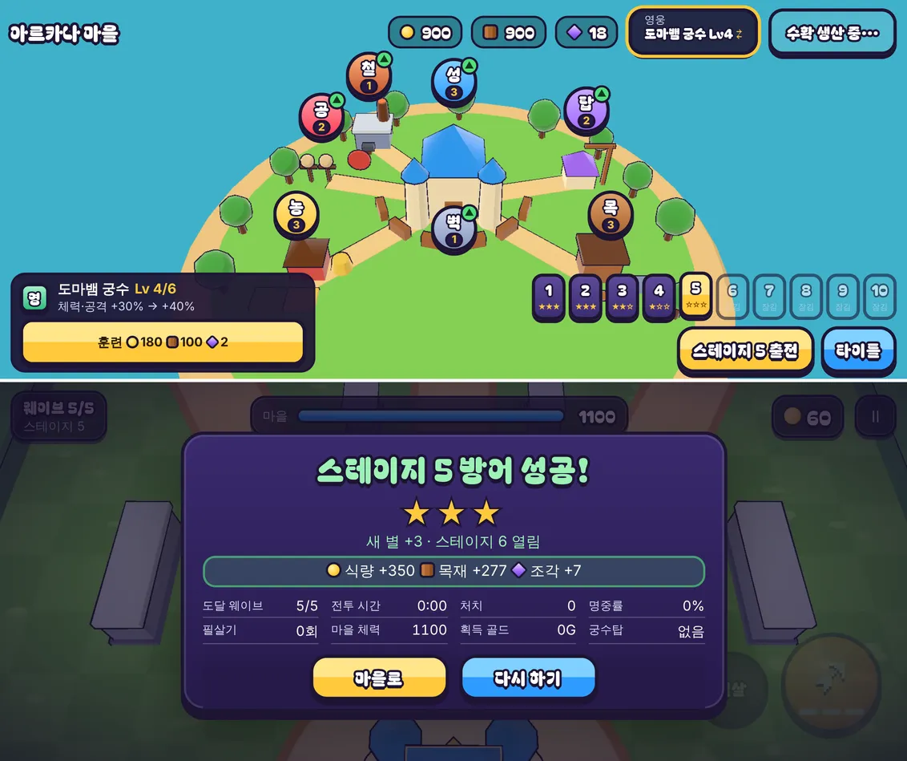

# 26회차: 킹덤 메타, 영웅 조각

| 항목 | 값 |
| --- | --- |
| 시각 | 2026-11-11 01:42 ~ 01:47 KST (예약 회차) |
| 기준 | `056ec13` |
| 레인 | 킹덤 메타 (백로그 4번 남은 것: 스테이지 조각 보상) |
| 상태 | **완료** |
| 다음 레인 | PvE 콘텐츠 |

## 문제

영웅 훈련(14회차)은 식량·목재만 든다. 그래서 스테이지를 진행하지 않고 생산만 모아도 영웅이 Lv10까지 오른다. 킹샷식 성장에서 영웅은 **전투로 얻는 재료**로 키운다. 지금은 스테이지 별과 영웅 성장이 이어져 있지 않다.

## 범위 (규칙은 `kingdom.ts`, 순수)

- 새 자원 **영웅 조각**(`shards`)을 둔다. 두 영웅이 함께 쓴다.
- **얻는 법**
  - 스테이지에서 새로 얻은 별 하나마다 2개(처음만)
  - 스테이지 3 이상에서 이기면 `floor(스테이지 / 3)`개(반복 가능, 스테이지 3~5는 1개, 6~8은 2개, 9~10은 3개)
- **쓰는 곳**: 영웅 훈련. 지금 레벨 l에서 l ≥ 3이면 조각 `l − 2`개가 더 든다. Lv1→2, 2→3은 조각 없이 된다. Lv10까지 한 영웅에 28개가 든다.
- **예전 저장**: 조각 칸이 없으면, 이미 얻은 별 수 × 2를 넣어 준다. 별을 얻은 사람이 손해 보지 않게 하려는 것이다.
- **화면**
  - 마을 자원 줄에 조각 수를 보여 준다.
  - 영웅 카드 훈련 버튼에 조각 비용을 보여 준다.
  - 결과 화면 보상에 조각을 보여 준다.

## 가설

생산만 모아서는 영웅이 Lv3까지만 오른다. 그 위로는 스테이지 별과 높은 스테이지 승리가 필요하다. 별 30개를 다 모으면 60개로 한 영웅을 Lv10(28개)까지, 다른 영웅도 상당히 키울 수 있다.

## 수용 기준

- [x] 규칙 테스트: 새 별·승리 조각, 같은 판 두 번 지급 안 함, 훈련 조각 비용과 부족 시 훈련 불가, 예전 저장 이전(별 × 2)
- [x] 설계 기둥·스테이지·영웅 훈련 테스트 통과(전투 규칙 변경 없음)
- [x] 마을·영웅 카드·결과 화면 스크린샷 직접 확인(휴대폰 가로에서 자원 줄이 넘치지 않음)
- [x] `test:rush`, `tsc`, `build`, `smoke:rush` 통과

## 바꾼 것

- **`kingdom.ts`**
  - `shards` 필드를 더했다.
  - `shardReward(stage, won, newStars)`는 새 별 × 2와 승리 시 `floor(stage / 3)`를 준다. `settleBattle`이 보상에 싣고, `grantReward`가 판 id당 한 번만 더한다.
  - `trainCost`가 조각 비용을 돌려준다(`max(0, l − 2)`). `canTrain`과 `train`은 조각도 확인하고 깎는다.
  - 예전 저장에 조각 칸이 없으면 별 합 × 2로 채운다.
- **마을 화면**: 자원 줄에 보라색 보석 아이콘과 조각 수를 둔다. 훈련 버튼은 조각이 들 때 `◆n`을 붙인다.
- **결과 화면**: 보상 줄에 ‘조각 +n’을 붙인다. 마을로 돌아올 때 보여 주는 문구에도 넣었다.
- **부분 글꼴**: 새 글자 ‘각’ 때문에 24회차의 누락 방지 테스트가 실패했다. 도구를 다시 돌려 292자, 48.6 KB가 됐다. 테스트가 의도대로 동작했다.
- **테스트 2개 추가**(47 → 49): 조각 획득·한 번 지급·훈련 비용·부족 시 불가, 예전 저장 이전. 기존 훈련 비용 테스트에 `shards: 0`을 더했다.

## 결과

| 항목 | 값 |
| --- | --- |
| 생산만으로 오르는 최대 레벨 | Lv3(조각 없이 가능한 마지막 레벨) |
| Lv1 → 10 조각 | 한 영웅 28개 |
| 별 30개를 다 모으면 | 60개(+ 스테이지 3 이상 승리마다 1~3개) |
| 예전 저장(별 3·3·2·1) | 조각 18개로 이전 |

- 화면 확인(휴대폰 가로)
  - 자원 줄은 식량·목재·조각·영웅·수확 다섯 칸으로, 넘치지 않는다.
  - 궁수 Lv4 카드의 훈련 버튼에 ‘◆2’가 나온다.
  - 스테이지 5를 별 3개로 이긴 결과에 ‘조각 +7’(새 별 3 × 2 + 승리 1)이 나온다.
- 전투 규칙은 바꾸지 않았다. 설계 기둥·스테이지·영웅 훈련 밸런스 테스트가 그대로 통과한다.
- 사람 플레이로 조각이 너무 빠듯한지·넉넉한지는 아직 확인하지 않았다.

## 검증

- `npm run test:rush`: 49개 통과.
- `npx tsc --noEmit`, `npm run build`: 통과.
- `npm run smoke:rush`: 30/30 통과.
- 마을·결과 화면을 직접 열어 확인했다.

## 다음

- **다음 레인: PvE 콘텐츠.** 후보는 높은 스테이지에 새 적 하나를 넣는 것이다. 예를 들어 방패병은 정면 화살을 막아 옆으로 돌아가거나 범위로 쳐야 한다. 스테이지 6~10에 새 판단을 만든다.
- 백로그 상위 3개
  1. (PvE 콘텐츠) 높은 스테이지 새 적(방패병 후보), 설계 기둥·스테이지 테스트 동반
  2. (성능·모바일) 실기기 게이트. 사용자 결정 둘(SDK 라이선스, 러시 앱 묶음 방식)이 먼저다
  3. (렌더 톤·모델) 영웅 두 명 실루엣 점검
