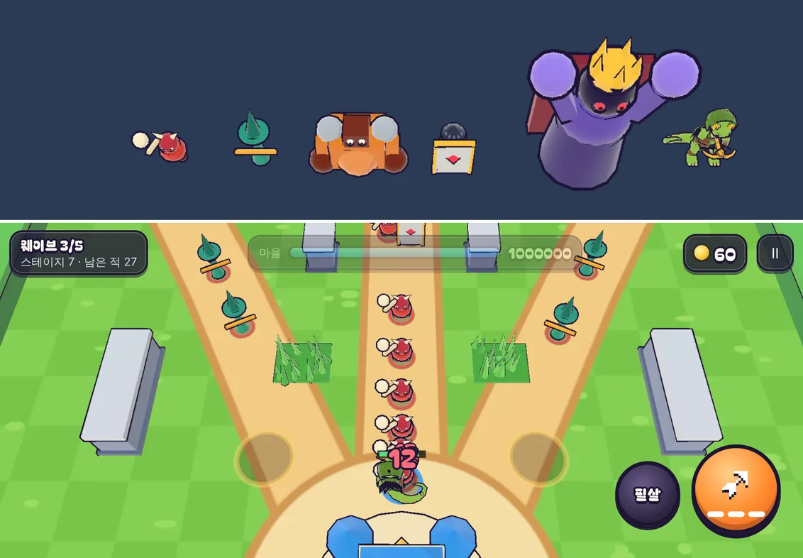

# 27회차: PvE 콘텐츠, 방패병

| 항목 | 값 |
| --- | --- |
| 시각 | 2026-11-11 02:45 ~ 02:59 KST (예약 회차) |
| 기준 | `0efa192` |
| 레인 | PvE 콘텐츠 (26회차 다음 후보) |
| 상태 | **완료** |
| 다음 레인 | 전투 손맛 |

## 문제

스테이지 6~10은 숫자(체력·수·피해)만 커진다. 새로 판단할 것이 없다.

## 범위

- **새 적: 방패병**(`shield`)
  - 체력 90(처음 150에서 낮춤, 아래), 속도 1.9, 반지름 0.5. 근접 공격이고, 넉백을 덜 받는다(0.6).
  - **정면(바라보는 방향 ±57°)에서 오는 영웅의 화살은 25% 피해만 준다.** 막힌 자리에 불꽃과 ‘막힘’이 뜬다.
  - 브론의 망치 휘두르기, 필살기, 탑 공격은 막지 못한다. 궁수는 옆이나 뒤로 돌아가거나 필살기·탑에 맡겨야 하고, 브론은 그냥 깬다. 영웅 선택에 이유가 생긴다.
- **스테이지 6 이상에서만** 웨이브 3~5에 나온다. 웨이브 묶음에 `minStage`를 두고, 전투에 스테이지 번호를 넘긴다.
- **모양**: 짙은 청회색 몸에 앞을 가리는 큰 은색 방패(금테). 모델 시트에 다섯 번째로 세운다.
- 설계 기둥(스테이지 1)과 스테이지 1~5는 그대로여야 한다.

## 가설

봇(궁수)은 정면으로만 쏘므로 스테이지 6 이상이 조금 어려워진다. 브론은 덜 어려워진다. 스테이지 테스트(강화 최대 마을은 스테이지 10 승리)는 유지된다.

## 수용 기준

- [x] 규칙 테스트
  - 정면 화살은 25%, 뒤에서 온 화살은 100% 피해다.
  - 휘두르기·필살기·탑은 막히지 않는다.
  - 방패병은 스테이지 6 이상에서만 나온다.
- [x] 설계 기둥·스테이지·영웅 훈련·분기·대장간 테스트 통과(깨지면 원인부터 본다)
- [x] 봇 기준 스테이지 6~10 승률 전후, 두 영웅 비교
- [x] 모델 시트·전투 스크린샷 직접 확인
- [x] `test:rush`, `tsc`, `build`, `smoke:rush` 통과

## 값 맞추기

처음 값(체력 150, 웨이브 3~5에 2·2+2·3마리)을 넣자 테스트 셋이 실패했다.
- **‘스테이지 1은 기본 게임과 같다’**: 난이도에 `stage` 칸이 생겨서다. 기대값에 `stage: 1`을 더했다. 스테이지 1에는 방패병이 나오지 않으므로 뜻은 같다.
- **‘강화 최대 마을이 스테이지 10을 이긴다’**: 졌다.
- **‘영웅 Lv10이 스테이지 7·8을 Lv1보다 3판 이상 더 이긴다’**: 실패했다.

방패병을 웨이브에 **더하는** 방식이라 적 수가 크게 늘었기 때문이다(브론도 스테이지 6 승리가 3/4 → 0/4). 체력과 수를 낮춘 세 가지를 같은 조건으로 돌렸다.

| 체력 · 수 · 정면 피해 | 강화 최대 st10 (궁/브) | st7·8 Lv1 → Lv10 승리 (궁 / 브) | Lv10만 st10 | 판정 |
| --- | --- | --- | --- | --- |
| **90 · 절반(1·1+1·2) · 25%** | 2/2 · 2/2 | 0 → 3 / 1 → 6 | 모두 짐 | **모두 통과, 채택** |
| 70 · 절반 · 25% | 2/2 · 2/2 | 0 → 3 / 2 → 5 | 모두 짐 | 통과 |
| 90 · 1/3 · 35% | 2/2 · 2/2 | 0 → 4 / 1 → 3 | 모두 짐 | 브론 +2로 기준(+3) 미달 |

## 결과 (채택값, 기본 배율, 시드 1~4)

| 스테이지 6 | 전 | 후 |
| --- | --- | --- |
| 궁수 | 1/4 | 0/4 |
| 브론 | 3/4 | 3/4 |

- 방패병은 궁수만 더 어렵게 한다. 정면 화살이 막히기 때문이다(채택 전 시험에서 궁수 봇이 스테이지 5~8 16판에 화살 227번이 막혔다). 브론은 휘두르기라 영향이 없다. 영웅을 고를 이유가 생겼다.
- 스테이지 1~5와 설계 기둥은 그대로다. 방패병은 스테이지 6부터 나온다.
- 봇은 옆으로 돌아가지 않는다. 사람은 옆이나 뒤에서 쏘거나 필살기를 쓸 수 있으므로, 사람 기준 난이도는 봇보다 낮을 수 있다. 확인하지 않았다.

## 바꾼 것

- **`data.ts`**
  - 적 종류 `shield`: 체력 90, 정면 피해 25%, 정면 판정 ±1 rad.
  - 웨이브 묶음에 `minStage`를 더했다. 웨이브 3~5에 방패병 1·1+1·2마리가 스테이지 6부터 나온다.
- **`sim.ts`**
  - 난이도에 `stage`를 더했다. `groupCount`는 `minStage`가 더 높으면 0을 돌려준다.
  - 영웅 화살이 맞을 때 방패 판정을 한다. 막히면 `block` 이벤트를 낸다.
- **`stages.ts`**: `stageDifficulty(n)`이 `stage`를 넘긴다.
- **표현**
  - 방패병 모델: 청회색 몸, 은색 탑 방패, 금테, 빨간 보석.
  - 막힐 때 은빛 불꽃과 ‘막힘’ 숫자가 뜬다.
  - 모델 시트는 다섯 적을 세운다.
  - 처치 조각 색을 더했다.
- **부분 글꼴**: ‘막힘’의 ‘힘’ 때문에 누락 테스트가 실패했다. 도구를 다시 돌렸다(293자, 48.8 KB).
- **테스트 2개 추가**(49 → 51): 정면 25%·뒤 100%(첫 화살 피해로 비교), 스테이지 6부터 등장, 브론 휘두르기는 막히지 않음.

## 검증

- `npm run test:rush`: 51개 통과(설계 기둥·스테이지·영웅 훈련·분기·대장간 포함).
- `npx tsc --noEmit`, `npm run build`: 통과.
- `npm run smoke:rush`: 30/30 통과.
- 모델 시트와 스테이지 7 전투 화면을 직접 열어 확인했다. 전투 장면은 웨이브 3으로 건너뛰고 마을 체력을 올려 찍었다. 봇 없이 영웅이 서 있으면 웨이브 1에서 지기 때문이다.

## 다음

- **다음 레인: 전투 손맛.** 후보는 방패에 막힐 때 소리를 구분하는 것, 그리고 궁수가 방패병 옆으로 돌 수 있게 조준 보조가 방패병의 정면을 피하도록 하는 것이다.
- 백로그 상위 3개
  1. (전투 손맛) 막힘 효과음, 자동 조준이 방패 정면 피하기
  2. (성능·모바일) 실기기 게이트. 사용자 결정 둘이 먼저다
  3. (렌더 톤·모델) 영웅 두 명 실루엣 점검
