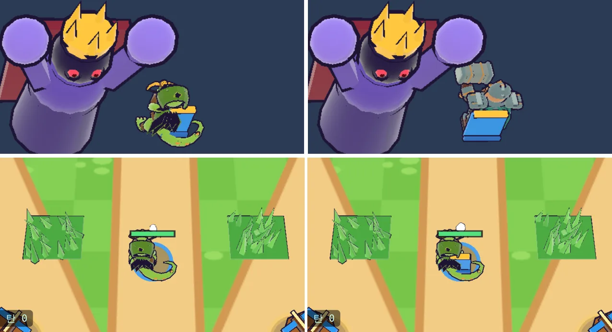

# 29회차: 렌더 톤·모델, 영웅에게 팀 색 망토

| 항목 | 값 |
| --- | --- |
| 시각 | 2026-11-11 04:42 ~ 04:53 KST (예약 회차) |
| 기준 | `1b625ab` |
| 레인 | 렌더 톤·모델 (28회차 다음 후보: 영웅 실루엣 점검) |
| 상태 | **완료** |
| 다음 레인 | 성능·모바일 |

## 점검 (편집 전)

모델 시트에 `?hero=bron`을 더해 두 영웅을 다섯 적 옆에 세웠다(휴대폰 가로). 주색은 채도·명도 0.35 이상 화소의 hue 중앙값이고, 팀 파랑은 hue 190~235°의 비율이다.

| | 주색 hue | 팀 파랑 | 채도 있는 화소 | 외곽 상자 |
| --- | ---: | ---: | ---: | --- |
| 궁수(도마뱀 GLB) | 84 (초록) | 0% | 60.4% | 162×128 |
| 브론(드워프 GLB) | **26** (주황·갈색) | 0% | **21.8%** | 186×116 |
| 거한(적) | **25** (호박) | 0% | 64.7% | 214×142 |

- **브론의 주색이 적 거한과 거의 같다**(26 대 25). 몸이 칙칙하고(채도 22%) 크기도 비슷하다. 근접전에서 거한과 섞이면 아군인지 적인지 읽기 어렵다.
- 두 영웅 모두 몸에 팀 색(아군 파랑 `#2f9bff`)이 없다. [아트 기준](../art-direction.md) 원칙 5(팀 색 고정)는 발밑 고리와 체력바에만 적용돼 있다.

## 범위

- 두 영웅의 등에 **팀 파랑 망토**를 단다. 잉크 외곽선이 있고, 바라보는 방향을 따라 돈다. 금색 어깨 고리를 단다.
- 위에서 보는 카메라라 등 쪽 면이 크게 보인다. 영웅마다 모델 비율에 맞춰 위치와 크기를 정한다.
- GLB 파일(캠페인 공유)은 바꾸지 않는다. 렌더에서 부품을 붙인다.
- 규칙은 바꾸지 않는다. `?sheet=1&hero=bron`은 측정 도구로 남긴다.

## 수용 기준

- [x] 두 영웅의 팀 파랑 비율이 0%에서 눈에 띄게 오른다. 브론의 주색이 거한과 갈린다
- [x] 모델 시트와 전투 화면 스크린샷 직접 확인(망토가 영웅을 가리지 않음)
- [x] 드로콜 변화 기록(망토는 영웅 하나에 붙으므로 +2 이하)
- [x] `test:rush`, `tsc`, `build`, `smoke:rush` 통과

## 바꾼 것

- **`render.ts`**
  - 영웅마다 망토 하나를 굽는다. 팀 파랑 판, 짙은 파랑 밑단, 금색 어깨 고리로 이루어지고, 잉크 외곽선 0.035다.
  - 망토는 `heroBody`에 붙어 바라보는 방향을 따라 돈다. 지금 영웅의 망토만 보인다.
  - 자리와 크기는 `CAPE` 표에 있다(궁수 x −0.3·높이 1.2·폭 0.7, 브론 x −0.4·높이 1.15·폭 0.95). 모델 시트에서 맞췄다.
- **`main.ts` 모델 시트**
  - `?hero=bron`(브론으로), `?back=1`(영웅이 카메라 반대쪽을 봄. 전투에서 위쪽 적을 볼 때와 같다)을 더했다.
  - 영웅을 x 9.4로 옮겼다. 브론의 망치가 보스와 붙어 측정이 섞였기 때문이다.
- 규칙·테스트 변경 없음. GLB 파일은 바꾸지 않았다.

## 결과 (모델 시트, 휴대폰 가로)

| | 팀 파랑 전 → 후(정면) | 후(등, 전투 방향) | 주색 hue(등) |
| --- | --- | --- | --- |
| 궁수 | 0% → 6.2% | 9.5% | 84 (초록 유지) |
| 브론 | 0% → 0.1% | **22.6%** | **208 (파랑)**. 거한 25와 갈림 |

- 정면(카메라를 볼 때)에서는 망토가 몸 뒤에 가려 거의 안 보인다. 전투에서 영웅은 주로 위쪽(적이 오는 쪽)을 보므로, 카메라에는 등이 보인다. 브론은 등 쪽에서 파랑이 주색이 되어 적 거한과 색으로 갈린다.
- 드로콜은 +2다(망토 본체와 외곽선). 같은 틱 전투(시드 3, 틱 3409)에서 데스크톱 63 → 65, 휴대폰 61 → 63이다.
- 전투 화면에서 궁수 등에 파란 망토와 금색 고리가 보인다(아래 그림).

## 검증

- `npm run test:rush`: 52개 통과.
- `npx tsc --noEmit`, `npm run build`: 통과.
- `npm run smoke:rush`: 30/30 통과.
- 모델 시트(정면·등)와 전투 화면을 직접 열어 확인했다.

## 한계

- 망토는 판 하나라 바람에 날리거나 접히지 않는다. 정식 GLB(백로그 3번)를 만들 때 모델 안에 넣는 것이 낫다.
- 정면에서는 여전히 영웅 몸에 파랑이 적다. 발밑 파란 고리와 초록 체력바가 그 역할을 한다.

## 다음

- **다음 레인: 성능·모바일.** 실기기 게이트는 사용자 결정(SDK 라이선스, 러시 앱 묶음 방식)을 기다린다. 컨테이너에서 할 수 있는 것으로는 마을 화면의 드로콜·삼각형 측정과 줄이기를 후보로 둔다(마을은 건물·나무·장식이 많다).
- 백로그 상위 3개
  1. (성능·모바일) 마을 화면 드로콜. 실기기 게이트는 사용자 결정이 먼저다
  2. (킹덤 메타) 일일 보상 또는 훈련소(조각 교환)
  3. (PvE 콘텐츠) 새 영웅 셋째, 또는 보스 패턴 하나 더
