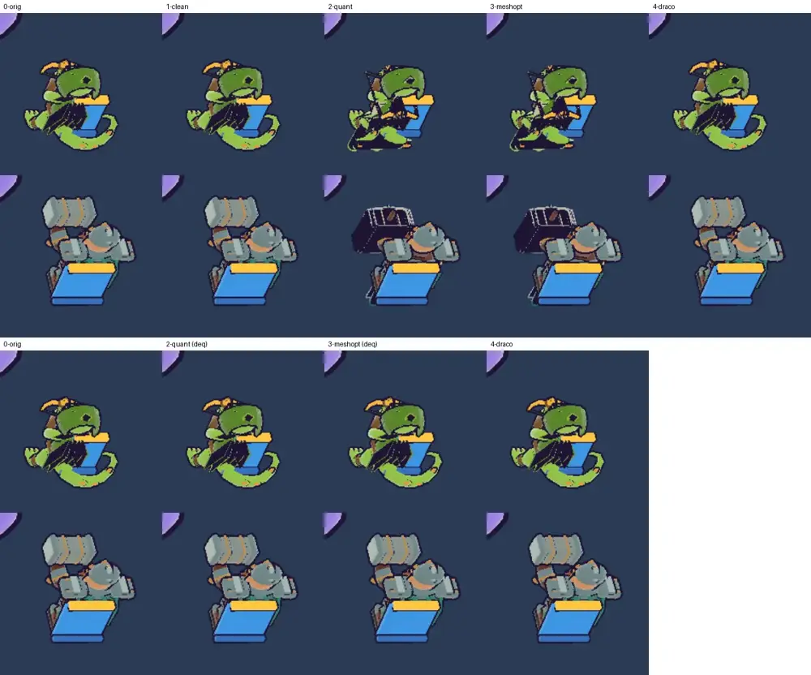

# 31회차: 엔진 스파이크, 영웅 GLB 압축 시험(측정만)

| 항목 | 값 |
| --- | --- |
| 시각 | 2026-11-11 06:41 ~ 06:52 KST (예약 회차) |
| 기준 | `6960080` |
| 레인 | 엔진 스파이크 (30회차 다음 후보) |
| 상태 | **완료** (측정만, 저장소 변경은 문서뿐) |
| 다음 레인 | 킹덤 메타 |

## 문제

러시는 영웅 모델 두 개를 GLB로 불러온다. 둘 다 캠페인과 함께 쓰는 `public/defense/` 에셋이다.

| 영웅 | 파일 | 크기 |
| --- | --- | ---: |
| 궁수 | `prototypes/gecko-ranger.glb` | 255.7 KB |
| 브론 | `dwarf-guardian.glb` | **1,295.2 KB** |

- 24회차 이후 첫 화면 전송량(약 515 KB)에서 궁수 GLB가 가장 큰 덩어리다. 브론을 고르면 1.3 MB를 더 받는다.
- 두 파일 모두 텍스처가 없다. 크기는 거의 float32 꼭짓점 데이터(위치·법선·UV)다. UV는 텍스처가 없으니 쓰이지 않는다.
- 러시 전용 압축 사본을 만들지는 사용자 결정으로 남아 있다(24회차). 이번 회차는 그 결정에 쓸 숫자만 잰다.

## 범위

- **측정만 한다.** `public/defense/` 파일과 캠페인 코드는 바꾸지 않는다. 압축 사본은 스크래치에만 만든다. 러시 코드도 커밋하지 않는다. 디코더를 붙여 보는 시험은 작업 트리에서만 하고 되돌린다.
- 변형(두 영웅 모두, glTF-Transform 4로 만듦)
  0. 원본
  1. 정리: 안 쓰는 데이터 버리기, UV 빼기, 중복 합치기, 같은 꼭짓점 용접. 디코더가 필요 없다
  2. 1 + 양자화(`KHR_mesh_quantization`). three.js가 그대로 읽는다
  3. 1 + meshopt(`EXT_meshopt_compression`, 양자화 포함). `MeshoptDecoder`가 필요하다
  4. 1 + Draco(`KHR_draco_mesh_compression`). `DRACOLoader`와 wasm 디코더가 필요하다
- 잴 것
  - 파일 크기(원본, gzip, brotli). 디코더를 더해야 하면 그 크기도 더한다.
  - 화면 차이: 실제 게임 모델 시트(`?sheet=1&back=1`, `&hero=bron`)에서 같은 URL 요청을 변형 파일로 바꿔 찍고, 원본과 화소 차이를 센다.
  - 러시의 굽기 코드(부품 합치기, 외곽선 껍데기)가 양자화된 꼭짓점에서도 맞게 도는지 본다.

## 가설

UV를 빼면 약 25%가 준다. meshopt와 양자화를 함께 쓰면 브론은 1.3 MB에서 300 KB 아래로 줄어든다. Draco는 파일이 더 작지만, 디코더(wasm 수백 KB)가 영웅 두 개의 이득보다 커서 맞지 않는다.

## 수용 기준

- [x] 두 영웅 × 변형 5개의 크기 표(원본·gzip·brotli, 디코더 포함 합계)
- [x] 변형마다 모델 시트 화소 차이와 스크린샷 직접 확인. 굽기 코드가 깨지는 변형은 기록한다
- [x] 사용자 결정용 추천 하나와 그 비용(바꿀 파일, 더할 코드)
- [x] 저장소 변경은 문서뿐. `test:rush`, `tsc`, `build`, `smoke:rush` 통과

## 결과 1: 크기 (KB)

| 변형 | 궁수 원본 | gzip | brotli | 브론 원본 | gzip | brotli |
| --- | ---: | ---: | ---: | ---: | ---: | ---: |
| 0 원본 | 255.7 | 78.4 | 47.3 | 1,295.2 | 292.3 | 156.0 |
| 1 정리(UV 빼기 등) | 177.5 | 67.7 | 48.2 | 996.0 | 241.2 | 145.2 |
| 2 양자화 | 141.8 | 61.3 | 41.2 | 688.2 | 203.3 | 124.1 |
| 3 meshopt | **73.4** | 33.3 | 30.2 | **282.0** | 123.0 | 109.2 |
| 4 Draco | 52.6 | 33.6 | 31.4 | 128.8 | 80.6 | 75.2 |

디코더(한 번만 받음)

| 디코더 | 원본 | gzip |
| --- | ---: | ---: |
| meshopt (`meshopt_decoder.module.js`, wasm 내장) | 28.6 | 7.5 |
| Draco (`DRACOLoader.js` + `draco_wasm_wrapper.js` + `draco_decoder.wasm`) | 263.6 | 78.8 |

디코더를 더한 합계

| | meshopt 원본 / gzip | Draco 원본 / gzip |
| --- | --- | --- |
| 궁수만(첫 화면) | **102.0 / 40.8** | 316.2 / 112.4 |
| 두 영웅 다 | **384.0 / 163.8** | 445.0 / 193.0 |

- GLB는 gzip이 잘 먹는다(브론 1,295 → 292 KB). 면마다 같은 법선이 되풀이되는 로우폴리 모델이라서다. 그래서 **서버가 GLB를 gzip으로 보내는지에 따라** 이득이 크게 다르다. 웹 호스트 설정은 아직 정하지 않았다. Capacitor 앱은 GLB를 APK(zip) 안에 넣으므로 gzip 열에 가깝다.
- Draco는 파일만 보면 가장 작다. 하지만 디코더가 263.6 KB(gzip 78.8 KB)라, 영웅 두 개로는 meshopt보다 합계가 크다. 디코더 파일을 따로 두어야 하고(워커가 경로로 불러옴), 그러면 `public/` 쪽에 파일이 는다.

## 결과 2: 화면 차이 (모델 시트, 휴대폰 가로, 원본과 다른 화소 수)

| 변형 | 궁수 | 브론 | 비고 |
| --- | ---: | ---: | --- |
| 원본 다시 찍기(잡음) | 0 | 0 | 시트는 결정적이다 |
| 1 정리 | **0** | **0** | 화소 하나 다르지 않다 |
| 2 양자화 | 6,353 | 6,984 | **깨짐** (아래) |
| 3 meshopt | 6,353 | 6,984 | **깨짐** (아래) |
| 4 Draco | 30 | 40 | 경계 화소 몇 개 |
| 2 양자화 + 되돌리기 | 41 | 30 | 시험 패치 |
| 3 meshopt + 되돌리기 | 41 | 30 | 시험 패치 |

- **찾은 것: 러시의 굽기 코드는 float32 꼭짓점을 가정한다.** 양자화된 GLB(2, 3)는 위치·법선이 정수(Int16·Int8, 정규화)로 온다. 굽기(`bakeMatrices`)가 행렬을 곱한 결과를 같은 정수 배열에 다시 쓰면서 −1~1 밖의 값이 잘린다. 그래서 망치·쇠뇌 같은 굽힌 부품이 검은 덩어리로 나온다(아래 그림 위쪽 2·3열). Draco는 로더가 float32로 풀어 주므로 괜찮다.
- 불러온 직후 위치·법선을 float32로 되돌리는 단계(약 8줄)를 작업 트리에서 시험했다. 그러자 양자화·meshopt 모두 원본과 30~41화소만 달랐다(그림 아래쪽). 경계 화소 몇 개라 눈으로는 구분되지 않는다.
- meshopt 궁수로 시연 전투를 돌렸다. 사격 동작(`heroAnim`)이 돌고, 오류가 없다(브라우저의 진동 차단 경고만 있음). 디코딩 시간은 소프트웨어 렌더링 컨테이너라 주장하지 않는다.

## 추천 (사용자 결정용)

**meshopt 사본 + float32 되돌리기**를 추천한다. 캠페인 파일은 그대로 둔다.

| | 지금 | meshopt 채택 시 |
| --- | ---: | ---: |
| 궁수 GLB | 255.7 KB | 73.4 KB (−71%) |
| 브론 GLB | 1,295.2 KB | 282.0 KB (−78%) |
| 첫 화면 전송 추정(24회차 방식, GLB는 압축 없이 셈) | 약 515 KB | **약 340 KB** (−34%) |

- **바꿀 것**
  - 러시 전용 압축 사본 두 개를 `src/rush/models/`에 두고 `?url`로 불러온다(24회차 부분 글꼴과 같은 방식). `public/defense/` 원본은 그대로 둔다.
  - `render.ts`에 디코더 연결 2줄과 float32 되돌리기 약 8줄을 넣는다.
  - 사본 만드는 도구 `tools/rush-glb.mjs`를 둔다(원본이 바뀌면 다시 돌림). glTF-Transform은 개발 의존성이 된다. 새 의존성은 `package.json`(공유 파일)을 바꾸므로 사용자 확인이 필요하다. 의존성 없이 스크래치에서 만든 사본만 넣는 방법도 있다.
- **더 작은 대안**: 변형 1(정리)만 쓴다. 디코더도, 코드 변경도 없이 경로만 바꾸면 된다. 화면은 화소 하나 다르지 않다. 궁수 −31%, 브론 −23%다.
- Draco는 추천하지 않는다. 디코더가 영웅 두 개의 이득보다 크다.

## 바꾼 것

- 저장소 변경은 이 기록과 그림뿐이다. 러시 코드, 캠페인 파일, `public/defense/`는 바꾸지 않았다.
- 시험 패치(디코더 연결, float32 되돌리기)는 작업 트리에서만 쓰고 되돌렸다. 패치와 변형 파일, 스크린샷은 스크래치에 있다.

## 검증

- `npm run test:rush`: 52개 통과.
- `npx tsc --noEmit`, `npm run build`: 통과.
- `npm run smoke:rush`: 30/30 통과.
- 비교 그림과 meshopt 시연 전투 화면을 직접 열어 확인했다.

## 다음

- **다음 레인: 킹덤 메타.** 후보는 일일 보상, 또는 훈련소(남는 조각을 다른 자원으로 바꾸기)다.
- 사용자 결정 넷째: 영웅 GLB를 **meshopt 사본(추천)**, **정리 사본만**, **그대로** 중 무엇으로 할지. 앞의 결정 셋(SDK 라이선스, 러시 앱 묶음 방식, 사본을 만들지)과 함께 기다린다.
- 백로그 상위 3개
  1. (킹덤 메타) 일일 보상 또는 훈련소(조각 교환)
  2. (PvE 콘텐츠) 보스 패턴 하나 더, 또는 셋째 영웅
  3. (성능·모바일) 영웅 GLB 사본 적용. 사용자 결정 뒤에 한다
