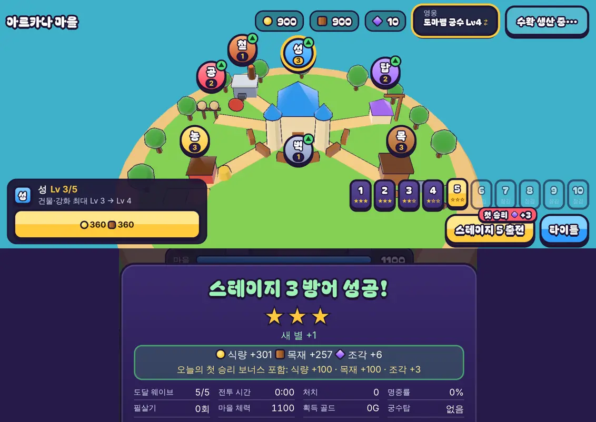

# 32회차: 킹덤 메타, 오늘의 첫 승리 보상

| 항목 | 값 |
| --- | --- |
| 시각 | 2026-11-11 07:42 ~ 07:48 KST (예약 회차) |
| 기준 | `2f8b63f` |
| 레인 | 킹덤 메타 (31회차 다음 후보: 일일 보상 또는 훈련소) |
| 상태 | **완료** |
| 다음 레인 | PvE 콘텐츠 |

## 문제

마을로 돌아올 이유는 지금 두 가지다. 하나는 2시간이면 차는 생산 창고이고, 다른 하나는 아직 별을 다 못 딴 스테이지다. 별을 다 따고 나면 영웅 조각은 스테이지 3 이상 승리로 1~3개씩만 들어온다. 매일 한 판 할 이유가 없다.

킹샷식 게임은 매일 들어올 이유를 작은 일일 보상으로 만든다. 다만 이 게임은 기다리는 시간을 두지 않기로 했다(08회차). 그래서 접속만으로 주는 보상이 아니라 **전투 한 판과 묶는다.**

훈련소(조각 교환)는 이번에 고르지 않았다. 조각을 다른 자원으로 바꾸면 조각이 전투에서 나온다는 26회차의 연결이 약해진다.

## 범위

- **오늘의 첫 승리 보상**: 하루 처음 이긴 전투(스테이지 무관)에 식량 +100, 목재 +100, 영웅 조각 +3을 더 준다.
  - 날짜는 기기의 현지 날짜다. 규칙은 `kingdom.ts`에서 순수하게 둔다(날짜 번호를 인자로 받음).
  - 지면 쓰지 않는다. 같은 판은 두 번 받지 않는다(기존 판 id 확인).
  - 시계를 되돌리면(저장된 날보다 이른 날) 주지 않는다.
- **저장**: 마지막으로 받은 날 `dailyWin`. 예전 저장은 0(오늘 받을 수 있음)으로 채운다.
- **화면**
  - 마을의 출전 버튼에 받을 수 있을 때만 작은 표시 ‘첫 승리 ◆3’를 단다.
  - 결과 화면 보상 줄 아래에 ‘오늘의 첫 승리 보너스 포함’과 그 양을 보여 준다.
- 전투 규칙은 바꾸지 않는다.

## 가설

보상은 조각 3개로 작다. 한 영웅을 Lv10까지 올리는 데 조각 28개가 들므로, 매일 한 판씩 이기면 9~10일에 영웅 하나만큼 조각이 쌓인다. 별 보상(전체 60개)을 바꾸지 않으면서 다 깬 뒤에도 매일 들어올 이유가 생긴다.

## 수용 기준

- [x] 규칙 테스트: 그날 첫 승리에만 지급, 같은 날 두 번째 승리·패배는 지급 안 함, 다음 날 다시 지급, 시계 되돌림은 지급 안 함, 같은 판 id 두 번 지급 안 함, 예전 저장 이전
- [x] 설계 기둥·스테이지·영웅 훈련 테스트 통과(전투 규칙 변경 없음)
- [x] 마을(표시 있음)·결과(보너스 줄) 스크린샷 직접 확인, 휴대폰 가로에서 넘치지 않음
- [x] `test:rush`, `tsc`, `build`, `smoke:rush` 통과

## 바꾼 것

- **`kingdom.ts`** (규칙, 순수)
  - `DAILY_WIN`은 식량 100, 목재 100, 조각 3이다.
  - `dayIndex(now, offsetMin)`는 현지 날짜 번호를 돌려준다. `offsetMin`은 `Date#getTimezoneOffset()` 값이다.
  - `dailyReady(k, day)`는 오늘이 마지막으로 받은 날보다 뒤일 때만 참이다. 시계를 되돌리면 거짓이다.
  - `settleBattle(…, day?)`: 이긴 판이고 오늘 받을 수 있으면, 보상에 보너스를 더하고 `daily`에 그 양을 싣는다. 지급되면 `dailyWin`을 오늘로 적는다. 이미 지급한 판 id는 보너스도 받지 않는다. `day`를 넘기지 않으면(도구·봇) 예전과 같다.
  - 예전 저장에는 `dailyWin`이 없으므로 0(오늘 받을 수 있음)으로 채운다. 깨진 값도 0이다.
- **`town.ts`**
  - `today()`는 기기 현지 날짜 번호다.
  - 받을 수 있으면 출전 버튼 오른쪽 위에 빨간 표시 ‘첫 승리 ◆+3’을 단다. 읽기 프로그램용 이름도 붙였다.
- **`main.ts`**: 결과를 정산할 때 `today()`를 넘긴다. 보상 줄 아래에 ‘오늘의 첫 승리 보너스 포함: …’을 노란 글씨로 보여 준다. 마을로 돌아올 때의 문구에도 표시한다.
- **`rush.css`**: 표시 모양과 보너스 줄.
- **부분 글꼴**: 새 글자 8개(너·늘·리·승·오·의·첫·포) 때문에 누락 방지 테스트가 실패했다. 도구를 다시 돌려 301자, 48.7 KB가 됐다.
- **테스트 2개 추가**(52 → 54)
  - 그날 첫 승리, 패배, 같은 판 id, 같은 날 두 번째 승리, 다음 날, 시계 되돌림, 현지 날짜 경계(서울 23:30 UTC는 다음 날)를 확인한다.
  - 예전 저장 이전과 왕복.
- **스모크 1개 추가**(30 → 31): 새 마을에서 출전 버튼에 표시가 보인다.
- 전투 규칙은 바꾸지 않았다.

## 결과

예전 형식 저장(별 3·3·2·1, 조각 10, `dailyWin` 없음)으로 브라우저에서 확인했다(휴대폰 가로·데스크톱).

| 순서 | 보상 | 출전 버튼 표시 |
| --- | --- | --- |
| 마을 처음 | — | 있음 |
| 스테이지 3 승리(오늘 첫 승리) | 식량 +301 · 목재 +257 · 조각 **+6**(새 별 1 × 2 + 승리 1 + 보너스 3). 아래 줄에 보너스 내역 | — |
| 같은 날 다시 승리 | 식량 +163 · 목재 +127 · 조각 +1. 보너스 줄 없음 | — |
| 마을로 돌아옴 | — | 없음 |

- 휴대폰 가로에서 표시는 출전 버튼 위 가장자리에 걸치고, 스테이지 칩 아랫줄에 닿지만 글자를 가리지 않는다. 결과 카드의 보너스 줄은 한 줄로 들어간다.
- 매일 한 판 이기면 조각이 하루 3개씩 쌓인다. 영웅 하나 Lv1 → 10(조각 28개)을 보너스만으로 채우면 10일이다. 별로 얻는 조각(최대 60개)은 그대로다.
- 사람이 하루 단위로 얼마나 다시 들어오는지는 확인할 수 없다(실사용 기록 없음).

## 검증

- `npm run test:rush`: 54개 통과(설계 기둥·스테이지·영웅 훈련 포함).
- `npx tsc --noEmit`, `npm run build`: 통과.
- `npm run smoke:rush`: 31/31 통과.
- 마을(표시 있음·없음)과 결과 화면을 휴대폰 가로·데스크톱에서 직접 열어 확인했다.

## 한계

- 기기 시계를 앞으로 돌리면 보너스를 더 받을 수 있다. 생산 창고와 같은 한계다. 혼자 하는 PvE라 막지 않았다.
- 날짜가 바뀌는 순간 마을 화면을 열어 두면, 표시는 1초 안에 다시 나타난다(마을 화면은 1초마다 다시 그림).

## 다음

- **다음 레인: PvE 콘텐츠.** 후보는 보스 패턴 하나 더(예: 마지막 웨이브 보스가 체력 절반에서 부하를 부름)다. 스테이지 6~10에서 보스전에 새 판단을 만든다.
- 백로그 상위 3개
  1. (PvE 콘텐츠) 보스 패턴 하나 더, 또는 셋째 영웅
  2. (전투 손맛) 보스 패턴에 맞는 경고 표시·소리
  3. (성능·모바일) 영웅 GLB 사본 적용. 사용자 결정 뒤에 한다(31회차)
