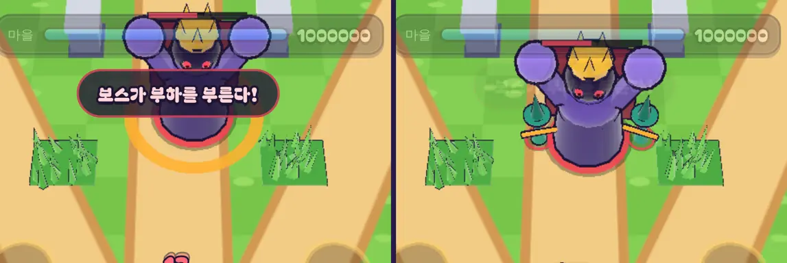

# 33회차: PvE 콘텐츠, 보스가 체력 절반에서 부하를 부름

| 항목 | 값 |
| --- | --- |
| 시각 | 2026-11-11 08:46 ~ 08:56 KST (예약 회차) |
| 기준 | `e5e2588` |
| 레인 | PvE 콘텐츠 (32회차 다음 후보: 보스 패턴 하나 더) |
| 상태 | **완료** (부하 수를 4에서 3으로 낮춤, 아래) |
| 다음 레인 | 전투 손맛 |

## 문제

보스는 패턴이 하나다. 다가와서 바닥에 빨간 원을 그리고 0.9초 뒤 내려친다(내려찍기). 스테이지 6~10에서도 같고, 체력과 피해만 커진다. 보스전에서 새로 판단할 것이 없다.

## 범위

- **새 패턴: 부르짖음**
  - 보스 체력이 절반 아래로 처음 내려가면, 그 자리에서 1초 동안 멈추고 포효한다. 이때 화면에 경고 원이 나오고 ‘보스가 부하를 부른다!’ 알림이 뜬다.
  - 포효가 끝나면 보스 둘레에 부하(투척병) 4마리가 나타난다. 부하는 보스가 가던 길을 따라간다. (값 맞추기에서 3마리로 낮춤)
  - 한 판에 한 번만 한다. 내려찍기를 준비하는 중이면, 그것이 끝난 뒤에 한다.
- **스테이지 6 이상에서만** 한다(방패병과 같은 문). 설계 기둥(스테이지 1)과 스테이지 1~5는 그대로여야 한다.
- 만들어지는 판단
  - 필살기를 아껴 두었다가 부하가 나올 때 쓴다.
  - 화염탑(범위)을 보스 길목에 둔다.
  - 1초 멈춤 동안 보스를 몰아친다.
- **표현**: 기존 경고 원과 잉크 충격파, 효과음을 다시 쓴다. 새 모델은 만들지 않는다.

## 가설

보스전 막바지에 적이 4마리 더 생기므로 스테이지 6~10이 조금 어려워진다. 부하가 투척병(원거리)이면 영웅이 맞으면서 보스를 쳐야 한다. 강화 최대 마을의 스테이지 10 승리(시드 1~8 중 6판 이상)와 영웅 Lv10 테스트는 유지된다. 깨지면 부하 수나 종류를 줄인다.

## 수용 기준

- [x] 규칙 테스트
  - 스테이지 6에서 체력 절반 아래로 내려가면 포효 1초 뒤 부하가 나온다(채택 3마리).
  - 한 번만 한다.
  - 스테이지 5 이하에서는 하지 않는다.
  - 포효 중에는 움직이지도 공격하지도 않는다.
- [x] 설계 기둥·스테이지·영웅 훈련·분기·방패 테스트 통과(깨지면 원인부터 본다)
- [x] 봇 기준 스테이지 6~10 승률 전후, 두 영웅 비교
- [x] 보스전 스크린샷 직접 확인(포효 경고, 부하 등장)
- [x] `test:rush`, `tsc`, `build`, `smoke:rush` 통과

## 값 맞추기

봇(`guardBot`)으로 같은 조건을 돌렸다. ‘강화 최대 st10’은 시드 1~8, ‘st7·8’은 시드 1~6 × 스테이지 7·8(12판), ‘Lv5 st6~10’은 스테이지마다 시드 1~4 승리 수다.

| 부하 | 궁수: 강화 최대 st10 | 궁수: st7·8 Lv1 → Lv10 | 브론: 강화 최대 st10 | 브론: st7·8 Lv1 → Lv10 | Lv5 st6~10 (궁 / 브) |
| --- | --- | --- | --- | --- | --- |
| 없음(전) | 6/8 | 0 → 4 | 8/8 | 1 → 6 | 4/0/0/0/0 · 4/2/0/0/0 |
| 투척병 4 | 6/8 | 0 → **2** (기준 +3 미달) | 8/8 | 1 → 6 | 같음 |
| **투척병 3 (채택)** | 6/8 | 0 → 3 | 8/8 | 1 → 6 | 같음 |
| 돌격병 4 | 6/8 | 0 → 3 | 8/8 | 1 → 5 | 같음 |
| 돌격병 3 | 6/8 | 0 → 1 | 8/8 | 1 → 6 | 3/0/0/0/0 · 같음 |
| 투척병 2 | 6/8 | 0 → 4 | 8/8 | 1 → 6 | 같음 |

- 처음 값(투척병 4)은 ‘영웅 Lv10이 스테이지 7·8을 Lv1보다 3판 이상 더 이긴다’를 궁수에서 깼다(+2). 3마리로 낮추자 통과했다.
- 표의 결과는 매끄럽지 않다. 돌격병 4는 통과하는데 돌격병 3은 더 나쁘다. 12판짜리 봇 판은 작은 변화에도 시드마다 결과가 뒤집힌다(14·28회차와 같음). 그래서 채택값도 기준에 딱 걸쳐 있다(+3). 다음에 스테이지 6 이상을 바꾸면 이 테스트가 먼저 깨질 수 있다.
- 바뀐 것은 궁수 Lv10의 스테이지 7·8 승리(4 → 3)뿐이다. 브론은 휘두르기로 부하를 함께 치므로 영향이 없다. 강화 최대 스테이지 10과 스테이지 1~5는 그대로다.
- 봇 판 112판 중 42판에서 부르짖음이 일어났다(보스를 절반까지 깎은 판).

## 바꾼 것

- **`data.ts`**: 보스에 `summon`을 더했다(체력 50%, 포효 1초, 투척병 3마리, 반지름 1.9m, 스테이지 6부터).
- **`sim.ts`**
  - 적에 `roarT`(남은 포효 시간)와 `rallied`(이미 불렀는지)를 더했다.
  - 내려찍기 준비가 끝난 뒤, 체력이 기준 아래면 한 번 포효를 시작한다(`roar` 이벤트). 포효 중에는 움직이지도 공격하지도 않는다.
  - 포효가 끝나면 `rally()`가 보스 둘레에 같은 간격으로 부하를 놓는다(난수 없음). 부하는 보스의 길과 지점을 이어받는다(`summon` 이벤트). 포효 중 쓰러지면 부르지 않는다.
- **표현**
  - 포효는 기존 경고 원을 주황으로 그린다. 피해가 없는 경고라 내려찍기의 빨강과 구분했다.
  - 부를 때 주황 잉크 고리, 먼지, 작은 화면 흔들림을 넣었다.
  - 알림 ‘보스가 부하를 부른다!’, 진동, 효과음(`surge`, `cast`)을 붙였다. 공용 `src/lib/sound.ts`는 바꾸지 않았다.
- **부분 글꼴**: ‘부·른’ 때문에 누락 테스트가 실패했다. 도구를 다시 돌려 303자, 48.9 KB다.
- **테스트 1개 추가**(54 → 55). 아래를 모두 확인한다.
  - 스테이지 6에서 절반에 포효한다. 포효 중에는 제자리이고 부하가 없다.
  - 포효가 끝나면 부하 3마리가 나온다(종류·체력·길 확인). 부하는 보스 몸 밖에 놓인다.
  - 한 번만 한다. 스테이지 5에서는 하지 않는다. 포효 중 쓰러지면 부하가 없다.

## 결과

- 스테이지 7 웨이브 5에서 보스를 절반으로 깎아 직접 확인했다. 포효 중에는 주황 원과 알림이 보이고, 1초 뒤 투척병 3마리가 보스 둘레에 선다.
- 셋 중 하나는 보스 뒤(위쪽)에 서서 큰 보스 몸에 가려 잘 안 보인다. 부하가 곧 흩어지므로 두지만, 다음에 손볼 후보로 적는다.
- 스크린샷은 보스를 영웅 가까이 옮기고 나머지 적을 지운 장면이다. 실제 판에서는 다른 적과 섞인다.

## 검증

- `npm run test:rush`: 55개 통과(설계 기둥·스테이지·영웅 훈련·분기·방패 포함).
- `npx tsc --noEmit`, `npm run build`: 통과.
- `npm run smoke:rush`: 31/31 통과.
- 포효·부하 등장 장면을 휴대폰 가로에서 직접 열어 확인했다.

## 다음

- **다음 레인: 전투 손맛.** 후보는 보스 부르짖음을 더 잘 읽히게 하는 것이다. 예를 들어 포효 때 보스가 몸을 부풀리는 동작, 부하가 보스 앞쪽 반원에 서도록 자리 바꾸기가 있다.
- 백로그 상위 3개
  1. (전투 손맛) 부르짖음 읽기 쉽게: 포효 동작, 부하 자리
  2. (PvE 콘텐츠) 셋째 영웅
  3. (성능·모바일) 영웅 GLB 사본 적용. 사용자 결정 뒤에 한다(31회차)
