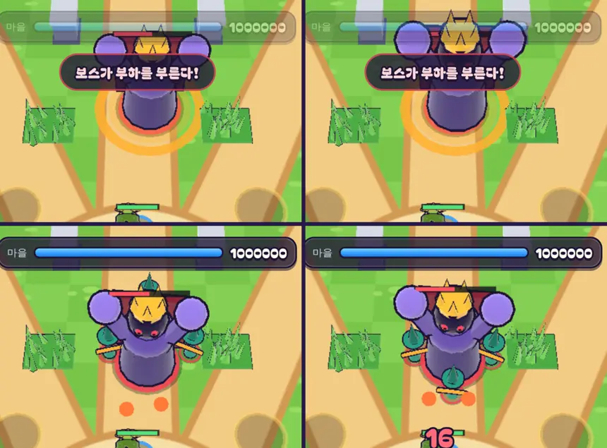

# 34회차: 전투 손맛, 부르짖음 읽기 쉽게

| 항목 | 값 |
| --- | --- |
| 시각 | 2026-11-11 09:42 ~ 09:49 KST (예약 회차) |
| 기준 | `ce7eee9` |
| 레인 | 전투 손맛 (33회차 다음 후보) |
| 상태 | **완료** (부하 자리 기준을 ‘바라보는 쪽’에서 ‘마을 쪽’으로 바꿈, 아래) |
| 다음 레인 | 렌더 톤·모델 |

## 문제

33회차의 보스 부르짖음은 두 군데가 잘 읽히지 않았다.

1. **포효 중인 보스가 그냥 서 있는 것처럼 보인다.** 주황 경고 원과 알림은 뜨지만, 보스 몸은 걷다 멈춘 모습 그대로다. 알림은 화면 위쪽에 떠서 눈이 보스에서 떨어진다.
2. **부하 하나가 보스 몸에 가려진다.** 부하 셋을 보스 둘레에 같은 간격(120°)으로 놓는다. 그래서 하나는 보스 뒤쪽에 선다. 카메라는 남쪽 위에서 보므로, 보스가 마을 쪽(남쪽)으로 걸을 때 뒤쪽은 큰 보스 몸에 가린다.

## 범위

- **포효 동작**(표현만): 포효하는 1초 동안 보스가 점점 부풀고(최대 약 1.18배) 위로 펴지며, 몸이 잘게 떨린다. 내려찍기 준비 동작(납작하게 웅크림)과 반대 모양이라 둘이 구분된다.
- **부하 자리**(규칙): 둘레 전체가 아니라 **보스가 바라보는 쪽 앞 반원**(바라보는 방향 ±52°)에 늘어놓는다. 보스는 마을이나 영웅 쪽을 보므로 부하가 카메라 쪽에 선다. 수와 종류(투척병 3)는 그대로다.
- 부하 자리는 규칙 변경이다. 밸런스 테스트를 다시 확인한다.

## 가설

부하가 보스 앞, 마을과 영웅 쪽에 서므로 조금 더 빨리 싸움에 들어온다. 수가 같아서 밸런스 변화는 작다. 영웅 훈련 테스트는 33회차에 기준에 딱 걸쳐 있었으므로(+3) 깨질 수 있다. 깨지면 원인을 기록하고 펼친 각을 조정한다.

## 측정

- **가려짐**: 봇 판(스테이지 6~10)에서 부하가 나타나는 순간, 보스 뒤 가림 구역(보스보다 북쪽이고 좌우 거리가 보스 반지름 안)에 선 부하의 비율을 전후로 센다.
- **포효 동작**: 같은 장면의 스크린샷에서 포효 중 보스의 화면 크기를 전후로 비교한다.

## 수용 기준

- [x] 가림 구역에 선 부하 비율이 0%에 가깝게 준다
- [x] 포효 중 보스가 눈에 띄게 부풀고(스크린샷), 내려찍기 준비 동작과 구분된다
- [x] 규칙 테스트: 부하는 앞 반원에 선다. 설계 기둥·스테이지·영웅 훈련 테스트 통과
- [x] `test:rush`, `tsc`, `build`, `smoke:rush` 통과

## 바꾼 것

- **부하 자리(`sim.ts`, `data.ts`)**
  - 부하는 보스에서 1.9m 떨어진, **마을 쪽을 가운데로 둔 호**(`arc` 1.8 rad, ±52°)에 같은 간격으로 선다. 셋이면 마을 쪽 하나와 양옆 ±52°다.
  - 처음에는 범위대로 ‘보스가 바라보는 쪽’을 가운데로 했다. 그러자 가림이 26.4%에서 4.6%로 줄었다. 남은 것은 보스가 북쪽의 영웅을 쫓아 위를 볼 때였다.
  - 마을 쪽으로 바꾸자 0%가 됐다. 마을은 늘 보스보다 남쪽(카메라 쪽)에 있다. 그리고 부하가 행군을 앞장선다는 뜻도 분명해서 이것을 채택했다.
- **포효 동작(`render.ts`, 표현만)**: 포효하는 1초 동안 보스가 폭 1 → 1.12배, 높이 1 → 1.18배로 점점 커지고, 좌우로 잘게 떤다(±0.07m). 포효가 끝나 부하가 나오는 순간 원래 크기로 돌아온다. 내려찍기 준비 동작(폭 1.1·높이 0.88로 웅크림)과 반대 모양이다.
- **테스트**: 33회차 부르짖음 테스트에 ‘부하가 마을 쪽 호 안에 선다’ 확인을 더했다(테스트 수 55 그대로).

## 결과

**가려짐 (봇, 강화 최대, 스테이지 6~10 × 시드 1~6 × 두 영웅, 부르짖음 58번, 부하 174마리)**

| 부하 자리 | 보스 뒤 가림 구역에 선 부하 |
| --- | --- |
| 둘레 같은 간격(33회차, 전) | 46 / 174 (26.4%) |
| 바라보는 쪽 호 | 8 / 174 (4.6%) |
| **마을 쪽 호 (채택)** | **0 / 174 (0%)** |

가림 구역은 부하가 나타난 순간 보스보다 북쪽(카메라에서 더 멂)이고 좌우 거리가 보스 반지름(1.15m) 안인 곳이다.

**포효 중 보스 화면 크기 (같은 장면, 포효가 0.3초 안 남았을 때, 휴대폰 가로)**

| | 보라 화소 외곽 상자 | 보라 화소 수 |
| --- | --- | --- |
| 전 | 423 × 299 | 30,766 |
| 후 | 459 × 344 | 38,245 (×1.24) |

**밸런스 (33회차와 같은 봇 조건)**

| | 궁수: 강화 최대 st10 | 궁수: st7·8 Lv1 → Lv10 | 브론: 강화 최대 st10 | 브론: st7·8 Lv1 → Lv10 | Lv5 st6~10 (궁 / 브) |
| --- | --- | --- | --- | --- | --- |
| 33회차(둘레) | 6/8 | 0 → 3 | 8/8 | 1 → 6 | 4/0/0/0/0 · 4/2/0/0/0 |
| 34회차(마을 쪽) | 6/8 | 0 → **4** | 8/8 | 1 → 6 | **3**/0/0/0/0 · 4/2/0/0/0 |

- 영웅 훈련 테스트의 여유가 +3에서 +4로 돌아왔다. Lv5 궁수 스테이지 6은 한 판 줄었다(4 → 3). 시드마다 뒤집히는 범위 안이다.

## 검증

- `npm run test:rush`: 55개 통과(설계 기둥·스테이지·영웅 훈련 포함).
- `npx tsc --noEmit`, `npm run build`: 통과.
- `npm run smoke:rush`: 31/31 통과.
- 같은 장면의 전후 스크린샷을 직접 열어 확인했다. 전 화면은 이번 변경을 잠시 빼고(git stash) 찍었다.

## 한계

- 보스가 화면 위쪽에 있으면 알림 ‘보스가 부하를 부른다!’가 보스 몸 일부를 가린다(전후 같음). 알림은 화면 위 가운데 고정이다.
- 포효 동작은 몸 전체의 크기·떨림뿐이다. 팔을 드는 동작은 없다(보스는 부품을 구운 모델이라 관절이 없음).

## 다음

- **다음 레인: 렌더 톤·모델.** 후보는 위 한계의 알림 겹침이다. 보스 경고처럼 장면에 붙은 알림은 보스 머리 위 말풍선으로 띄우거나, 알림 자리를 보스와 겹치지 않는 쪽으로 옮긴다.
- 백로그 상위 3개
  1. (렌더 톤·모델) 보스 알림이 보스를 가리지 않게
  2. (PvE 콘텐츠) 셋째 영웅
  3. (성능·모바일) 영웅 GLB 사본 적용. 사용자 결정 뒤에 한다(31회차)
