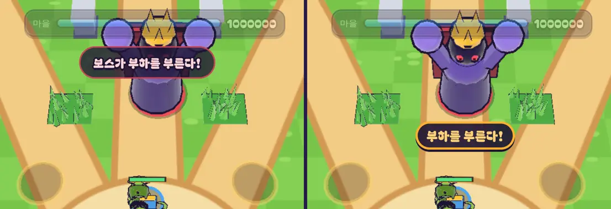

# 35회차: 렌더 톤·모델, 보스 경고를 보스에 붙이기

| 항목 | 값 |
| --- | --- |
| 시각 | 2026-11-11 10:42 ~ 10:50 KST (예약 회차) |
| 기준 | `9ca9dcc` |
| 레인 | 렌더 톤·모델 (34회차 다음 후보) |
| 상태 | **완료** |
| 다음 레인 | 성능·모바일 |

## 문제

보스가 부르짖을 때 알림 ‘보스가 부하를 부른다!’는 화면 위 가운데 고정 자리(알림 띠)에 뜬다. 보스는 북쪽에서 내려오므로 화면 위쪽에 있을 때가 많다. 그래서 알림이 부풀어 오르는 보스 몸(34회차)을 가린다. 경고가 경고 대상을 가리는 셈이다.

## 범위

- 부르짖음 경고를 **보스에 붙인 말풍선**으로 띄운다.
  - 자리는 보스 발밑 앞쪽(카메라 쪽)이다. 화면에서는 보스 바로 아래가 되고, 포효 동안 그 자리에 머문다.
  - 글은 ‘부하를 부른다!’, 주황 테두리로 경고 원과 같은 색을 쓴다.
  - 포효가 끝나 부하가 나오면 사라진다.
- 보스가 화면 밖이면 지금처럼 위쪽 알림 띠에 ‘보스가 부하를 부른다!’를 띄운다.
- 효과음·진동·경고 원은 그대로다. 규칙은 바꾸지 않는다.

## 가설

보스 아래쪽은 보스와 마을·영웅 사이라 비어 있는 때가 많다. 위쪽 알림 띠보다 보스를 훨씬 덜 가리고, 눈이 보스에 머문 채로 경고를 읽을 수 있다.

## 측정

34회차와 같은 장면(스테이지 7, 보스를 절반으로 깎음, 포효가 0.3초 안 남았을 때)에서 보스 몸 화소(보라) 수를 센다. 경고를 숨긴 화면과 비교해, 경고가 가린 보스 화소 수를 전후로 비교한다.

## 수용 기준

- [x] 경고가 가린 보스 화소가 전보다 크게 준다(목표: 0에 가깝게)
- [x] 휴대폰 가로·데스크톱 스크린샷 직접 확인(말풍선이 화면 안, 읽힘)
- [x] 보스가 화면 밖이면 위쪽 알림 띠로 대신한다(스모크나 수동 확인)
- [x] `test:rush`, `tsc`, `build`, `smoke:rush` 통과

## 바꾼 것

- **`main.ts`**
  - `roar` 이벤트에서 보스가 화면 안이면 말풍선 ‘부하를 부른다!’를 띄운다(`bossCallout`). 화면 밖이면 예전처럼 위쪽 알림 띠에 ‘보스가 부하를 부른다!’를 띄운다.
  - 말풍선은 매 프레임 보스 발밑 앞쪽(보스 반지름 + 0.4m, 카메라 쪽)의 화면 위치를 따라간다(`updateCallout`). 보스의 포효가 끝나거나, 보스가 쓰러지거나, 새 판이 되면 스스로 사라진다.
- **`rush.css`**: 말풍선은 짙은 남색 바탕에 주황 테두리(경고 원과 같은 색)와 노란 글씨다.
- 효과음·진동·경고 원·규칙은 바꾸지 않았다. 새 글자가 없어 부분 글꼴은 그대로다.

## 결과

34회차와 같은 장면(스테이지 7 웨이브 5, 보스를 영웅 북쪽 5.5m에 두고 절반으로 깎음)이다. 포효 자세(남은 0.3초)를 붙잡아 두고, 경고가 보이는 화면과 숨긴 화면을 찍었다. 숨긴 화면에서 경고 상자 안에 든 보스 보라 화소를 셌다.

| 화면 | 전: 위쪽 알림 띠가 가린 보스 화소 | 후: 말풍선이 가린 보스 화소 |
| --- | ---: | ---: |
| 휴대폰 가로 | **18,265** (화면 전체 보라 화소의 30.0%) | **0** |
| 데스크톱 1280×720 | 0 (보스가 알림 띠보다 아래) | 0 |

- 휴대폰 가로에서는 보스가 화면 위쪽에 걸리므로, 전에는 알림 띠가 보스 몸통 한가운데를 덮었다. 이제 말풍선은 보스 바로 아래, 보스와 영웅 사이의 빈 땅에 뜬다.
- 말풍선은 주황 경고 원의 앞쪽 가장자리 일부에 걸친다. 원의 나머지와 보스 몸은 다 보인다.
- 보스를 북쪽 17m(화면 밖)에 두면 위쪽 알림 띠가 대신 떴다(휴대폰·데스크톱 모두).

## 검증

- `npm run test:rush`: 55개 통과(규칙 변경 없음).
- `npx tsc --noEmit`, `npm run build`: 통과.
- `npm run smoke:rush`: 31/31 통과.
- 휴대폰 가로·데스크톱의 전후 화면, 그리고 보스가 화면 밖일 때를 직접 확인했다. 전 화면은 이번 변경을 잠시 빼고(git stash) 찍었다.

## 한계

- 다른 위쪽 알림(웨이브 시작, 마지막 웨이브·보스 출현 등)은 그대로 알림 띠에 뜬다. 보스 출현 알림 때 보스는 아직 화면 밖 북쪽이라 겹치지 않는다.
- 영웅이 보스 바로 앞에 붙어 있으면 말풍선이 영웅 머리 근처에 겹칠 수 있다. 1초뿐이라 두었다.

## 다음

- **다음 레인: 성능·모바일.** 후보는 전투 중 매 프레임 하는 DOM 레이아웃 읽기다. 반투명 HUD(23회차)가 HUD 상자와 적 화면 위치를 매 프레임 재고, 피해 숫자·말풍선도 매 프레임 자리를 옮긴다. 휴대폰에서 레이아웃 계산이 겹치지 않는지 세어 보고 줄인다.
- 백로그 상위 3개
  1. (성능·모바일) 전투 중 프레임당 DOM 레이아웃 읽기·쓰기 수 줄이기
  2. (PvE 콘텐츠) 셋째 영웅
  3. (성능·모바일) 영웅 GLB 사본 적용. 사용자 결정 뒤에 한다(31회차)
