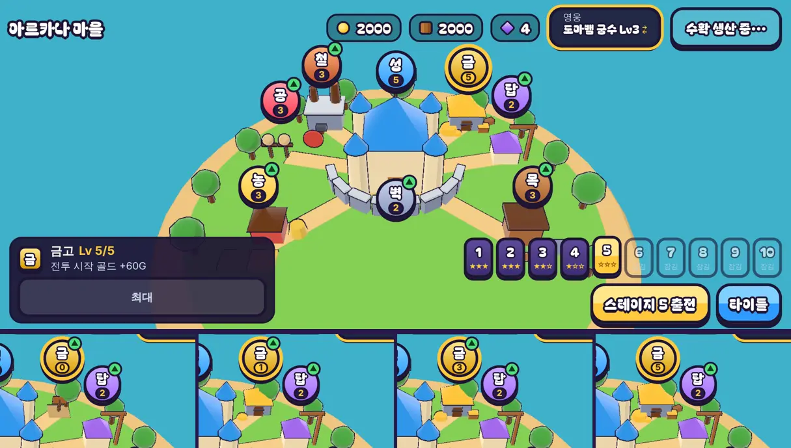

# 38회차: 킹덤 메타, 금고(전투 시작 골드)

| 항목 | 값 |
| --- | --- |
| 시각 | 2026-11-11 13:42 ~ 13:50 KST (예약 회차) |
| 기준 | `50a1daa` |
| 레인 | 킹덤 메타 (37회차 다음 후보) |
| 상태 | **완료** (테스트 둘을 손봄, 아래) |
| 다음 레인 | PvE 콘텐츠 |

## 문제

마을 강화 넷(영웅 공격, 탑 설계도, 성벽 보강, 대장간)은 모두 전투의 **중반 이후**를 강하게 한다. 전투 시작은 언제나 골드 60이다. 첫 탑(60G)을 세우고 나면 웨이브 1 내내 다음 탑을 세울 돈이 없다. 킹샷식 마을에서 경제 건물은 전투 준비를 앞당긴다. 지금은 그런 선택지가 없다.

## 범위

- **새 마을 강화: 금고**(`vault`). 레벨마다 전투 시작 골드가 +12G다. 성 레벨이 상한이므로 Lv5에서 +60G, 시작 골드가 두 배가 된다.
  - 비용은 레벨 n일 때 식량 60n, 목재 50n이다(다른 강화와 비슷한 크기).
  - 규칙: `RushMods`에 `startGold`(더하는 골드)를 더한다. 강화 없는 전투(`NO_MODS`)와 설계 기둥(스테이지 1)은 그대로다.
- **예전 저장**: 금고 칸이 없으면 0으로 시작한다(대장간 20회차와 같은 방식).
- **마을 화면**
  - 3D 마을의 성 뒤 오른쪽(대장간의 맞은편)에 금고 건물을 세운다. 레벨에 따라 3단계 모습이고, 금화 더미가 커진다.
  - 표지 배지 ‘금’과 카드(‘전투 시작 골드 +nG’)를 단다.
- 전투 화면은 바뀌지 않는다(시작 골드 숫자만 다름).

## 가설

시작 골드가 늘면 첫 웨이브 전에 탑을 하나 더 세울 수 있다. 그래서 마을 체력이 덜 깎이고 별을 더 받는다. 강화 최대 마을(다른 강화 모두 최대)에서 금고를 더하면 스테이지 6~10 봇 승리가 조금 늘지만, 강화 없는 스테이지 10은 여전히 진다.

## 수용 기준

- [x] 규칙 테스트: 금고 레벨이 시작 골드에 더해짐, 성이 상한, 비용, 예전 저장 이전, 강화 없는 전투는 그대로
- [x] 설계 기둥·스테이지·영웅 훈련 테스트 통과
- [x] 봇 기준 금고 0 → 5 승률 비교(강화 최대 조건, 스테이지 6~10)
- [x] 마을 화면(3D 금고, 표지, 카드) 스크린샷 직접 확인, 휴대폰 가로에서 표지가 다른 표지·HUD와 겹치지 않음
- [x] `test:rush`, `tsc`, `build`, `smoke:rush` 통과

## 바꾼 것

- **`kingdom.ts`**
  - 강화 `vault`를 더했다. `VAULT_GOLD = 12`, 비용은 레벨 n일 때 식량 60n·목재 50n, 상한은 성 레벨이다.
  - `kingdomMods`가 `startGold = 12 × 금고 레벨`을 싣는다.
  - 예전 저장에 금고 칸이 없으면 0으로 채운다. 성 레벨보다 높으면 깨진 저장으로 본다(대장간과 같음).
- **`sim.ts`**: `RushMods.startGold`(선택 칸, 없으면 0)를 더했다. 시작 골드는 `ECONOMY.startGold + startGold`다. 강화 없는 전투와 설계 기둥은 그대로다.
- **마을**
  - `townScene.ts`: 성 뒤 오른쪽(대장간 맞은편, x 4.3·z −7.2)에 금고 자리를 두었다.
    - Lv0은 빈터 팻말이다.
    - 1단계(Lv1)는 돌 보물고, 금 지붕, 쇠띠 문, 금화 더미다.
    - 2단계(Lv2~3)는 상자와 더 큰 더미를 더한다.
    - 3단계(Lv4~5)는 지붕 위 금 장식과 더미·상자 하나씩을 더 단다.
  - `town.ts`: 표지 배지 ‘금’과 카드 ‘전투 시작 골드 +nG → +mG’를 더했다. `rush.css`에 금색 배지 색을 더했다.
  - 새 글자가 없어 부분 글꼴은 그대로다(‘금’, ‘고’, ‘시작’은 이미 있음).
- **테스트**
  - 1개 추가(55 → 56): 비용, 성 상한, 시작 골드 반영, 강화 없는 전투는 그대로, 예전 저장 이전, 상한 초과 저장.
  - 기존 테스트 둘을 손봤다. 아래 ‘테스트 손본 것’에 적었다.

## 결과

**봇(`guardBot`), 시드 1~8, 스테이지별 승리 수와 전체 별**

| 조건 | 궁수 승리 (스테이지별) | 궁수 별 | 브론 승리 | 브론 별 | 웨이브 1 시작 때 탑 수 |
| --- | --- | ---: | --- | ---: | --- |
| 강화 없음, st1~5, 금고 0 | 8/8/8/8/7 | 89 | 8/8/8/8/8 | 100 | 1.00 |
| 강화 없음 + 금고 5(+60G), st1~5 | 8/8/8/8/8 | **102** | 8/8/8/8/8 | **106** | **2.00** |
| 강화 최대, st6~10, 금고 0 | 8/8/8/8/6 | 74 | 8/8/8/8/8 | 90 | 1.00 |
| 강화 최대 + 금고 5, st6~10 | 8/8/8/8/**8** | **87** | 8/8/8/8/8 | **100** | 1.00 |

- 가설대로 시작 골드가 늘면 별(남은 마을 체력)이 늘었다.
  - 강화 없는 마을에 금고만 Lv5로 붙이면 첫 웨이브 전에 탑이 둘 선다.
  - 강화 최대 마을은 이미 탑 할인(−40%)이 있어 첫 탑 수는 같다. 남은 골드로 더 일찍 올린다.
- 강화 최대 궁수의 스테이지 10 승리가 6/8 → 8/8이 됐다. 금고까지 다 올린 마을에게 스테이지 10은 이제 거의 확실한 승리다. 최종 단계로서는 자연스럽다고 보고 값을 두었다.
- ‘강화 없는 스테이지 10은 진다’(영웅 Lv10만으로)는 그대로다(금고가 없으므로).
- 강화 없음 + 금고 5는 실제로 나올 수 없는 조합이다(금고 Lv5는 성 Lv5가 필요). 금고 효과만 떼어 보려고 쟀다.

## 테스트 손본 것

- `kingdom.test.ts`
  - ‘새 마을은 전투를 바꾸지 않는다’의 기대값에 `startGold: 0`을 더했다. 뜻은 같다.
  - ‘영웅 레벨은 고른 영웅에만’의 마을 리터럴에 `vault: 0`을 더했다. 타입 때문이다.
- `stages.test.ts`의 `MAXED`(강화 최대)에는 금고를 **일부러 넣지 않았다**. 넣으면 궁수가 스테이지 10을 8/8로 이겨서, 28회차에 맞춘 ‘6/8 이상’ 확인이 아무것도 알려 주지 못한다. 주석에 그 이유를 적었다.

## 화면 확인

- 휴대폰 가로·태블릿(1024×768)에서 금고 표지는 다른 표지나 상단 막대와 겹치지 않는다.
- 데스크톱 1280×720에서는 금고 표지가 자원 막대 아래 가장자리에 54px² 닿는다. 성 표지(66px²)와 대장간 표지(198px²)도 전부터 같은 정도로 닿아 있었다. 데스크톱 상단 막대와 표지 높이를 함께 손볼 일로 남긴다.
- 카드에서 금고를 Lv1 → 2로 올리고 전투에 들어가면 시작 골드가 84(= 60 + 24)로 HUD에 나왔다.

## 검증

- `npm run test:rush`: 56개 통과(설계 기둥·스테이지·영웅 훈련 포함).
- `npx tsc --noEmit`, `npm run build`: 통과.
- `npm run smoke:rush`: 31/31 통과.

## 다음

- **다음 레인: PvE 콘텐츠.** 후보는 셋째 영웅이다. 궁수(원거리 3갈래)·브론(근접 휘두르기)과 다른 역할을 맡는다. 예를 들어 탑을 고치거나 적을 묶는 지원형이다. 크기가 커서 한 회차에 규칙·밸런스까지만 하고, 모델은 다음 회차로 나눌 수 있다.
- 백로그 상위 3개
  1. (PvE 콘텐츠) 셋째 영웅(규칙·밸런스 먼저)
  2. (렌더 톤·모델) 데스크톱 마을 표지가 상단 막대에 닿는 것 정리
  3. (성능·모바일) 영웅 GLB 사본 적용. 사용자 결정 뒤에 한다(31회차)
