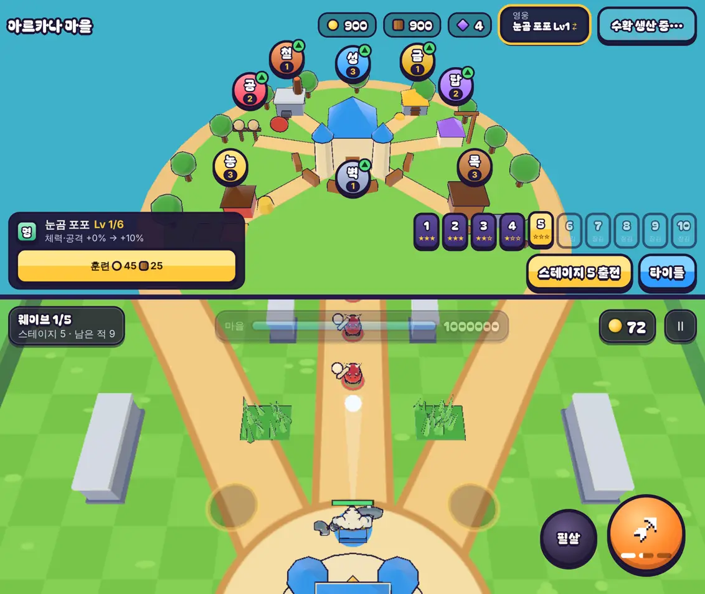

# 39회차: PvE 콘텐츠, 셋째 영웅 ‘눈곰 포포’

| 항목 | 값 |
| --- | --- |
| 시각 | 2026-11-11 14:42 ~ 14:54 KST (예약 회차) |
| 기준 | `e4276f4` |
| 레인 | PvE 콘텐츠 (38회차 다음 후보) |
| 상태 | **완료** (절차 어긋남 하나, 아래) |
| 다음 레인 | 전투 손맛 |

> **절차 어긋남**: 이번 회차는 범위·가설·수용 기준을 편집 **전에** 이 파일에 적지 않았다. 구현을 마친 뒤 기록을 썼다. 아래 범위와 가설은 시작할 때 세운 계획 그대로다. 다음 회차부터 다시 먼저 적는다.

## 문제

영웅은 둘이다. 궁수는 원거리 3갈래 화살이고, 브론은 근접 휘두르기다. 둘 다 한 번에 앞쪽 적을 친다. 무리를 묶거나 늦추는 영웅이 없다. 방패병(27회차)에게는 궁수가 약하고 브론은 상관없어, 셋째 선택지가 있으면 고를 이유가 더 생긴다.

## 범위

- **새 영웅 ‘눈곰 포포’**(`bear`, 군중 제어형)
  - 공격 `lob`(눈덩이): 사거리 8m 안의 한 점으로 0.55초에 걸쳐 포물선으로 던진다. 떨어진 자리 반지름 1.6m 안의 적 모두에게 피해 44를 주고, 1.2초 동안 늦춘다(냉기 탑과 같은 이동 65%, 보스 85%).
  - 위에서 떨어지므로 방패병이 막지 못한다. 맞힌 적 하나마다 필살기가 찬다.
  - 자동 조준은 사거리 안 가장 가까운 적이 있는 자리에 던진다. 손 조준은 그 방향 6m(사거리의 3/4) 지점에 던진다.
  - 탄 2발, 재장전 1.3초, 체력 620, 속도 4.9다.
  - 필살기 ‘눈보라’: 8m 안의 한 점에 반지름 3.6m, 피해 110, 3초 늦춤.
- **합류**: 스테이지 4에서 별을 얻으면 합류한다(브론은 스테이지 2). 영웅 버튼은 합류한 영웅 사이를 돈다. 아직 합류하지 않은 영웅을 건너뛰면 합류 조건을 알려 준다.
- **모델**: 캠페인 에셋 `public/defense/models/prototypes/polar-bear.glb`를 읽기만 해서 쓴다(파일은 바꾸지 않음). 팀 파랑 망토를 단다(29회차 방식).
- **표현**
  - 눈덩이는 흰 공으로 낮은 포물선을 그린다.
  - 떨어질 때 옅은 하늘색 고리와 눈가루가 인다.
  - 손 조준 미리보기는 6m까지 가는 가는 쐐기다.

## 가설

포포는 무리 피해와 늦춤으로 탑과 잘 맞는다. 혼자 싸우는 힘은 궁수와 브론 사이다. 강화 최대 마을의 스테이지 10은 이기고, 영웅 Lv10만으로는 스테이지 10을 지며, 훈련 효과(스테이지 7·8 Lv1 → Lv10 +3판 이상)는 다른 영웅처럼 있어야 한다.

## 수용 기준

- [x] 규칙 테스트: 눈덩이 피해·범위·늦춤, 방패에 안 막힘, 필살기 충전
- [x] 영웅 훈련 테스트에 포포를 더해 통과(Lv10 +3판 이상, Lv10만으로 스테이지 10 패배)
- [x] 봇 기준 세 영웅 비교
- [x] 모델 시트·마을·전투 스크린샷 직접 확인
- [x] `test:rush`, `tsc`, `build`, `smoke:rush` 통과

## 값 맞추기 (봇, 강화 없음 시드 1~4, 강화 최대 시드 1~8)

| 영웅 | 스테이지 1~5 승리 | 별(1~5) | 스테이지 6·7·8 승리 | 강화 최대 st10 | st7·8 Lv1 → Lv10 | Lv10만 st10 |
| --- | --- | ---: | --- | --- | --- | --- |
| 궁수 | 4/4/4/4/3 | 44 | 0/0/0 | 6/8 | 0 → 4 | 모두 짐 |
| 브론 | 4/4/4/4/4 | 50 | 3/1/0 | 8/8 | 1 → 6 | 모두 짐 |
| 포포 피해 34 (처음 값) | 4/4/4/4/**1** | 37 | 0/0/0 | 8/8 | 0 → **1** | 모두 짐 |
| 포포 피해 40, 탄 3 | 4/4/4/4/3 | 41 | 1/0/0 | 8/8 | 0 → 4 | 모두 짐 |
| 포포 피해 40, 반지름 1.9, 재장전 1.1 | 4/4/4/4/4 | 50 | 3/0/0 | 8/8 | 2 → 8 | 모두 짐 |
| **포포 피해 44 (채택)** | 4/4/4/4/4 | **45** | 2/0/0 | 8/8 | **1 → 6** | 모두 짐 |

- 처음 값(피해 34)은 혼자 싸우는 힘이 너무 약했다(스테이지 5 1/4, 훈련 효과 +1).
- 피해만 44로 올리자 궁수(별 44)와 브론(50) 사이(45)가 됐다. 훈련 효과(+5)와 ‘Lv10만으로는 스테이지 10 패배’도 지켰다. 다른 셋째 후보는 브론과 같거나 넘어서 버렸다.
- 강화 최대 마을에서는 늦춤이 탑과 맞물려 스테이지 10을 8/8로 이긴다.

## 바꾼 것

- **`data.ts`**: `HeroKind`에 `bear`, 공격 종류 `lob`, 선택 칸 `lobTravel`·`lobSlow`·`superSlow`, 포포 수치.
- **`sim.ts`**
  - 탄 주인 `lob`을 더했다. 날아가다 떨어지면 반지름 안 적 모두에게 `hurtEnemy(…, 'hero')`와 `slowT`를 준다. 상자도 친다. `snow` 이벤트를 낸다.
  - 포포의 필살기는 맞힌 적을 3초 늦춘다(`superSlow`).
  - 자동 조준은 가장 가까운 적의 자리에 던진다.
- **`kingdom.ts`**
  - `HERO_JOINS`(합류 스테이지: 궁수 0, 브론 2, 포포 4)로 `heroUnlocked`를 일반화했다.
  - 영웅 레벨에 `bear`를 더했다. 예전 저장은 Lv1에서 시작한다.
  - 저장된 영웅이 아직 합류 전이면 궁수로 돌린다.
- **`town.ts`**: 영웅 버튼이 세 영웅을 돈다. 합류 전 영웅을 건너뛰면 ‘스테이지 n에서 별을 얻으면 합류해요’를 알려 준다.
- **`render.ts`**
  - 포포 모델 경로와 망토 자리를 더했다.
  - 눈덩이 배치(흰 공, 낮은 포물선)와 착지 고리·눈가루를 더했다.
  - 손 조준 쐐기를 더했다.
- **`main.ts`**: 모델 시트 `?hero=bear`.
- **부분 글꼴**: ‘눈·곰’ 때문에 다시 돌렸다(305자, 49.1 KB).
- **테스트**
  - 1개 추가(56 → 57): 방패병 정면과 옆 돌격병이 같은 피해를 받는다. 범위 밖 적은 멀쩡하다. 맞은 적은 늦춰지고, 필살기가 2칸 찬다.
  - 영웅 훈련 테스트 반복에 포포를 더했다.
  - 영웅 레벨 기대값 셋에 `bear: 1`을 더했다. 새 칸이고 뜻은 같다.
  - `stages.test.ts` 도우미의 영웅 타입을 넓혔다.

## 화면 확인

- 마을에서 영웅 버튼을 두 번 누르면 브론 → 포포로 바뀐다(‘눈곰 포포 Lv1’).
- 전투에서 눈덩이가 흰 공으로 날아가고, 맞은 돌격병이 늦춰졌다(`slowT` 확인).
- 모델 시트에서 곰 모델은 궁수와 키가 비슷하다(3.48 대 3.39). 위에서 보는 카메라라 작아 보인다.

## 한계

- 곰 GLB는 손에 회색 장비(대포처럼 보임)를 들고 있어 ‘눈덩이 던지기’와 모양이 딱 맞지 않는다. 사격 동작 클립도 맞춰 보지 않았다. 정면에서 망토가 옆으로 비어져 보인다. 다음 렌더 회차에서 손볼 거리다.
- 사람이 손으로 던질 때의 손맛(포물선 높이, 착지 표시)은 아직 확인하지 않았다. 손 조준은 언제나 6m 지점에 떨어진다.

## 검증

- `npm run test:rush`: 57개 통과(설계 기둥·스테이지·영웅 훈련 포함).
- `npx tsc --noEmit`, `npm run build`: 통과.
- `npm run smoke:rush`: 31/31 통과.

## 다음

- **다음 레인: 전투 손맛.** 후보는 포포의 손 조준이다. 끌어서 거리까지 정하게 하고(필살기처럼), 착지 지점 원을 미리 보여 준다.
- 백로그 상위 3개
  1. (전투 손맛) 포포 손 조준: 거리 조절과 착지 원
  2. (렌더 톤·모델) 포포 모델 손질(장비, 망토 자리, 던지기 동작)
  3. (성능·모바일) 영웅 GLB 사본 적용. 사용자 결정 뒤에 한다(31회차)
