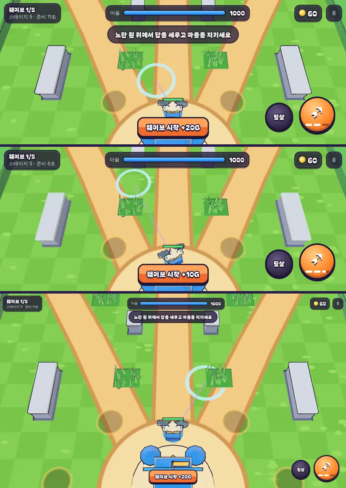

# 40회차: 전투 손맛, 포포의 손 조준(거리와 착지 원)

| 항목 | 값 |
| --- | --- |
| 시각 | 2026-11-11 15:42 ~ 15:48 KST (예약 회차) |
| 기준 | `98b352d` |
| 레인 | 전투 손맛 (39회차 다음 후보) |
| 상태 | **완료** |
| 다음 레인 | 렌더 톤·모델 |

## 문제

포포(39회차)의 눈덩이는 범위 공격인데, 손으로 조준하면 방향만 고를 수 있다. 눈덩이는 언제나 그 방향 6m 지점에 떨어진다. 가까운 무리나 먼 무리를 노릴 수 없다. 조준 미리보기도 가는 쐐기뿐이라, 어디에 떨어질지 보이지 않는다. 브롤스타즈식 투척형 영웅의 손맛은 ‘끌어서 떨어질 자리를 정하고, 그 원을 보는 것’이다.

## 범위

- **거리 조준**
  - 터치: 공격 버튼을 끄는 길이가 던질 거리다(필살기 조준과 같은 방식). 최대로 끌면 사거리 8m다.
  - 마우스: 커서 자리에 떨어진다. 사거리를 넘으면 사거리에서 멈춘다.
  - 너무 가까우면 1.5m에 떨어진다. 탭(자동 조준)은 그대로 가장 가까운 적의 자리다.
- **규칙 쪽**: 공격 명령(`fire`)의 벡터를 ‘방향’에서 ‘영웅 기준 위치(m)’로 넓힌다. 화살·휘두르기는 지금처럼 방향만 쓰므로 바뀌지 않는다. 포포만 길이를 거리로 쓴다.
- **착지 원 미리보기**: 포포를 조준하는 동안 떨어질 자리에 눈덩이 범위(반지름 1.6m) 원과 영웅에서 그 자리까지의 선을 보여 준다. 필살기 조준 원과 구분되게 옅은 하늘색으로 한다.

## 가설

봇은 자동 조준만 쓰므로 밸런스 테스트는 그대로다. 화살·휘두르기의 손 조준은 방향만 쓰므로 그대로다. 사람은 원하는 무리에 눈덩이를 떨어뜨릴 수 있다.

## 수용 기준

- [x] 규칙 테스트: 포포의 손 조준이 4m를 주면 4m에, 20m를 주면 사거리 8m에, 0.5m를 주면 1.5m에 떨어진다. 궁수의 화살 방향은 벡터 길이와 상관없다
- [x] 착지 원 스크린샷 직접 확인(터치 끌기, 마우스)
- [x] 설계 기둥·스테이지·영웅 훈련 테스트 통과
- [x] `test:rush`, `tsc`, `build`, `smoke:rush` 통과

## 바꾼 것

- **`sim.ts`**
  - 공격 명령의 벡터는 이제 ‘영웅 기준 위치(m)’다. 화살·휘두르기는 지금처럼 방향만 쓴다.
  - 포포의 손 조준은 그 길이를 거리로 쓴다(`lobReach`: 1.5m ~ 사거리). 자동 조준은 그대로다.
- **`input.ts`**
  - 터치로 공격 버튼을 끌면, 끈 길이(최대 70px)를 영웅 사거리 비율로 바꿔 위치를 보낸다(필살기 조준과 같은 방식).
  - 마우스 클릭은 커서 자리를 그대로 보낸다.
  - 조준 미리보기는 포포일 때 `lob`(위치)이고, 다른 영웅은 지금처럼 `fire`(방향)다.
- **`render.ts`**
  - 포포를 조준하는 동안, 떨어질 자리에 하늘색 원(반지름 1.6m, 눈덩이 범위)과 영웅에서 그 자리까지의 선을 그린다.
  - 거리는 시뮬레이션과 같은 `lobReach` 규칙으로 계산한다. 탄이 없으면 원이 옅어진다.
  - 39회차의 가는 쐐기는 뺐다.
- **테스트 1개 추가**(57 → 58): 4m를 주면 4m에, 20m를 주면 8m에, 0.5m를 주면 1.5m에 떨어진다. 궁수 화살은 벡터 길이와 상관없이 같다.

## 결과 (브라우저, 스테이지 5, 포포)

| 조작 | 떨어진 거리 |
| --- | ---: |
| 터치, 짧게 끌기(약 27px) | 3.07m |
| 터치, 길게 끌기(70px 넘음) | 8.00m (사거리) |
| 마우스, 커서 클릭 | 4.92m |

- 세 경우 모두 조준하는 동안 착지 원과 선이 보였고, 눈덩이가 그 자리에 떨어졌다.
- 봇은 자동 조준만 써서 밸런스 테스트 결과는 그대로다.

## 검증

- `npm run test:rush`: 58개 통과(설계 기둥·스테이지·영웅 훈련 포함).
- `npx tsc --noEmit`, `npm run build`: 통과.
- `npm run smoke:rush`: 31/31 통과. 궁수의 끌기 조준 사격도 그대로 통과했다.

## 다음

- **다음 레인: 렌더 톤·모델.** 후보는 포포 모델 손질이다. 곰 GLB의 회색 장비(대포처럼 보임)를 감추거나 눈덩이로 바꾸고, 망토 자리를 맞추고, 던질 때 몸짓을 준다.
- 백로그 상위 3개
  1. (렌더 톤·모델) 포포 모델 손질
  2. (렌더 톤·모델) 데스크톱 마을 표지가 상단 막대에 닿는 것 정리(38회차)
  3. (성능·모바일) 영웅 GLB 사본 적용. 사용자 결정 뒤에 한다(31회차)
