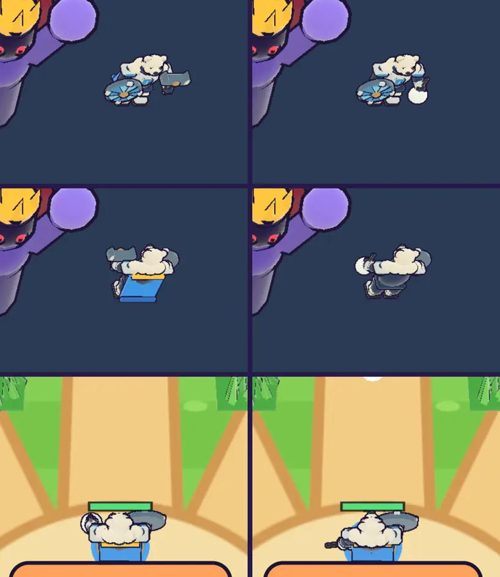

# 41회차: 렌더 톤·모델, 포포 모델 손질(망치 → 눈덩이)

| 항목 | 값 |
| --- | --- |
| 시각 | 2026-11-11 16:42 ~ 16:49 KST (예약 회차) |
| 기준 | `aeb656d` |
| 레인 | 렌더 톤·모델 (40회차 다음 후보) |
| 상태 | **완료** (망토 가설은 틀려서 망토를 유지, 아래) |
| 다음 레인 | 성능·모바일 |

## 문제

포포(39회차)는 캠페인 에셋 `polar-bear.glb`를 그대로 쓴다. 이 모델은 ‘북극곰 수호자’로, 오른손에 긴 망치(손잡이·쇠머리·상아 마개), 왼손에 얼음 방패를 든다. 공격 동작 클립(`polar-bear-attack`, 1초)은 망치를 휘두른다.

- 포포는 눈덩이를 던지는데 손에는 망치가 있다. 39회차 기록의 ‘대포처럼 보이는 회색 장비’가 이 망치다. 역할과 모양이 어긋난다.
- 이 모델은 몸에 이미 팀 파랑(‘Team blue ice’ 가슴 문장, 어깨판)이 있다. 그런데 29회차 방식의 망토를 하나 더 달았다. 정면에서 망토가 옆으로 비어져 보인다.

## 범위 (표현만, GLB 파일은 바꾸지 않음)

- **망치를 숨기고 눈덩이를 쥐게 한다.**
  - 불러올 때 망치 노드(`hammer`) 아래의 손잡이·쇠머리·마개 메시를 굽기 전에 뺀다.
  - 같은 노드에 흰 눈덩이 부품을 붙인다.
  - 공격 동작 클립이 그 노드를 휘두르므로, 던질 때 눈덩이가 머리 위로 크게 돌아 던지는 몸짓이 된다.
- **망토**: 모델 자체의 팀 파랑 비율을 재서, 충분하면 포포의 망토를 뺀다. 부족하면 자리를 맞춘다.
- 다른 영웅과 규칙은 바꾸지 않는다.

## 가설

망치가 빠지면 정면·등 모습이 눈덩이를 든 곰으로 읽힌다. 모델의 파랑 부품만으로도 팀 파랑 비율이 궁수·브론 망토 수준(등에서 9~23%)에 가깝다.

## 수용 기준

- [x] 모델 시트(정면·등)와 전투 장면에서 망치가 보이지 않고 손에 눈덩이가 보인다(스크린샷 직접 확인)
- [x] 던질 때 눈덩이가 동작 클립을 따라 움직인다(동작 중 스크린샷)
- [x] 망토 결정의 근거(팀 파랑 비율 전후)를 기록
- [x] `test:rush`, `tsc`, `build`, `smoke:rush` 통과

## 모델 구조 (glTF-Transform로 노드 트리 확인)

- `body` 아래에 `guard-arm`(왼팔: 얼음 방패), `hammer-arm` → `hammer-forearm` → `hammer`(오른손), `head`가 있다. `body`·두 팔·`hammer`·`head`가 동작 클립 대상이다.
- `hammer` 노드 아래 메시는 다섯이다.
  - 손 구슬(22), 남색 손목띠(23)
  - 놋쇠 손잡이(24), 쇠 망치머리(25), 상아 마개(26)
- 39회차에서 ‘정면에서 망토가 옆으로 비어져 보인다’고 적은 파란 원반은 망토가 아니라 **왼손의 얼음 방패**였다(잘못 읽음).

## 바꾼 것 (`render.ts`만, GLB 파일은 그대로)

- `HERO_DROP`: 포포를 구울 때 망치의 손잡이·머리·마개(노드 이름 `Polar_bear_surface_24·25·26`, 불러올 때 공백이 밑줄로 바뀜)를 뺀다.
- `HERO_PROPS`: 같은 `hammer` 노드에 흰 눈덩이(반지름 0.42, 모델 단위)를 굽는다. 공격 클립이 이 노드를 휘두르므로, 던질 때 팔과 눈덩이가 머리 위에서 앞으로 돈다.
- 망토는 **유지**했다(아래 측정). 망토 표를 잠깐 선택 칸으로 바꿨다가 되돌렸다.

## 결과 (모델 시트, 휴대폰 가로, 29회차 방식: 팀 파랑 = hue 190~235° 비율)

| 포포 | 팀 파랑 (등) | 팀 파랑 (정면) |
| --- | ---: | ---: |
| 전 (망치 + 망토) | 25.5% | 11.8% |
| 망치 빼고 망토도 뺌 (시험) | **3.6%** | 11.8% |
| **후 (망치 빼고 망토 유지, 채택)** | 27.3% | — |

- **가설이 틀렸다.** 모델의 팀 파랑(가슴 문장, 어깨판)은 정면 쪽에 있다. 전투에서 카메라가 주로 보는 등에서는 3.6%뿐이었다. 그래서 망토를 남겼다. 등에서 궁수 9.5%, 브론 22.6%(29회차)와 비슷하거나 많다.
- 정면·등 모두 망치가 사라지고 오른손에 흰 눈덩이가 보인다. 손목띠(남색 짧은 막대)는 남겼다.
- 전투에서 공격 버튼을 누르면 클립이 돌고(`heroAnim` 참), 팔이 앞으로 휘둘리며 눈덩이가 날아간다.

## 한계

- 손의 눈덩이는 팔 부품에 구워져 있어, 던진 뒤에도 손에 남는다. 날아가는 눈덩이와 손의 눈덩이가 잠깐 둘로 보인다. 던지는 순간부터 다음 장전까지 손의 눈덩이를 숨기려면, 따로 메시로 떼어야 한다(드로콜 +2).
- 공격 클립은 원래 망치 내려치기라, 던지기로는 조금 아래로 휘두른다.

## 검증

- `npm run test:rush`: 58개 통과(규칙 변경 없음).
- `npx tsc --noEmit`, `npm run build`: 통과.
- `npm run smoke:rush`: 31/31 통과.
- 모델 시트(정면·등)와 전투(서 있음·던짐)를 직접 열어 확인했다.

## 다음

- **다음 레인: 성능·모바일.** 후보는 영웅 셋의 GLB 로딩이다. 포포가 들어와 영웅 모델이 셋(궁수 256 KB, 브론 1,295 KB, 포포 416 KB)이 됐다. 지금은 고른 영웅만 받지만, 마을에서 영웅을 바꾸고 바로 출전하면 전투가 자리표 모델로 시작할 수 있다. 미리 받기(마을에서 고를 때)를 재 보고 정한다. GLB 압축 사본은 여전히 사용자 결정을 기다린다(31회차).
- 백로그 상위 3개
  1. (성능·모바일) 영웅 모델 미리 받기(마을에서 영웅을 고를 때)
  2. (렌더 톤·모델) 손의 눈덩이를 던진 뒤 숨기기, 데스크톱 마을 표지 정리(38회차)
  3. (성능·모바일) 영웅 GLB 사본 적용. 사용자 결정 뒤에 한다(31회차)
