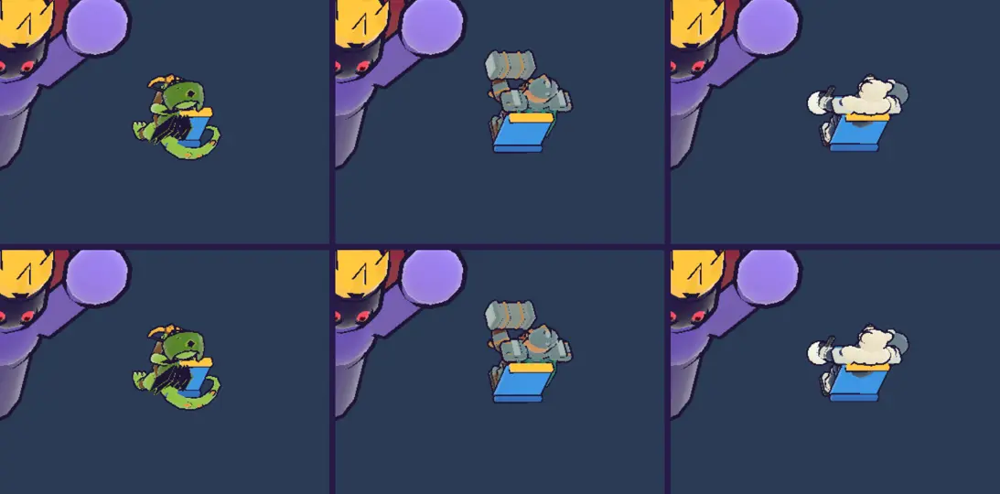

# 43회차: 성능·모바일, 영웅 GLB를 러시 전용 meshopt 사본으로

| 항목 | 값 |
| --- | --- |
| 시각 | 2026-11-11 18:14 ~ 18:21 KST (사용자 진행 지시 뒤 바로 시작) |
| 기준 | `33bb646` |
| 레인 | 성능·모바일 (2026-11-11 결정 적용. 레인 순서상 다음은 엔진 스파이크였지만, 사용자가 결정을 정하고 진행을 지시해 먼저 한다) |
| 상태 | **완료** |
| 다음 레인 | 엔진 스파이크 (원래 순서로 돌아감) |

## 문제

영웅 모델은 캠페인과 함께 쓰는 원본 GLB를 그대로 받는다(궁수 255.7 KB, 브론 1,295.2 KB, 포포 416.3 KB). 31회차 측정에서 meshopt 사본은 화면이 거의 같고 크기가 크게 준다. 2026-11-11 결정은 ‘러시 전용 meshopt 사본을 만든다’이다.

## 범위

- **사본 만드는 도구** `tools/rush-glb.sh`
  - `npx`로 glTF-Transform CLI(버전 고정)를 돌린다. `package.json`은 바꾸지 않는다.
  - 순서: 안 쓰는 데이터·꼭짓점 속성 버리기(텍스처가 없어 UV도 빠짐) → 중복 합치기 → 용접 → meshopt(높음).
- **사본** `src/rush/models/*.glb`(세 영웅). 캠페인 원본 `public/defense/`는 그대로다.
- **불러오기**(`render.ts`)
  - 사본을 Vite 에셋(`?url`)으로 불러온다.
  - `GLTFLoader`에 three 내장 `MeshoptDecoder`를 붙인다.
  - 굽기 전에 양자화된 위치·법선을 float32로 되돌린다(31회차 시험에서 확인한 깨짐 방지).
- 포포의 부품 손질(41회차: 망치 빼기, 눈덩이)이 사본에서도 같은 노드 이름으로 동작해야 한다.

## 가설

화면은 31회차처럼 원본과 수십 화소 안에서 같다. 사본 크기 합은 약 1,967 KB → 약 450 KB다. 느린 회선(42회차 측정)에서 브론의 자리표 시간이 크게 준다.

## 수용 기준

- [x] 세 영웅 모델 시트 화소 차이(원본 대 사본)가 31회차 수준(수십 화소)이다. 포포 망치가 빠지고 눈덩이가 보인다
- [x] 전투에서 공격 동작(`heroAnim`)이 돈다
- [x] 빌드 산출물의 GLB 크기 합 전후, 42회차 방식 느린 회선 자리표 시간 전후
- [x] `test:rush`, `tsc`, `build`, `smoke:rush` 통과

## 바꾼 것

- **`tools/rush-glb.sh`**: `npx -y @gltf-transform/cli@4.5.1`로 세 원본에서 사본을 만든다. 단계는 `prune --keep-attributes false`(UV 빠짐) → `dedup` → `weld` → `meshopt --level high`다. `package.json`은 바꾸지 않았다.
- **`src/rush/models/`**: `gecko-ranger.glb`, `dwarf-guardian.glb`, `polar-bear.glb`(사본). 캠페인 원본은 그대로이고, 러시는 이제 원본을 받지 않는다.
- **`render.ts`**
  - 사본을 `?url`로 불러온다(빌드 때 해시 붙은 에셋).
  - 공용 로더에 three 내장 `MeshoptDecoder`를 붙였다.
  - 불러온 직후 `toFloat32`로 위치·법선을 float32로 되돌린다. 굽기에서 정수 배열에 다시 쓰다 잘리는 문제(31회차) 때문이다.
  - 포포의 망치 빼기·눈덩이(41회차)는 노드 이름이 사본에도 그대로라 고칠 것이 없었다(노드 트리로 확인).

## 결과

**크기 (빌드 산출물)**

| 영웅 | 원본 | 사본 | 줄어든 비율 |
| --- | ---: | ---: | ---: |
| 궁수 | 255.7 KB | 75.2 KB | −71% |
| 브론 | 1,295.2 KB | 288.7 KB | −78% |
| 포포 | 416.3 KB | 116.9 KB | −72% |
| 합 | 1,967.2 KB | 480.8 KB | −76% |

- 디코더 때문에 `three-tools` 덩어리가 73.3 → 99.8 KB(gzip 20.6 → 27.9 KB, **+7.3 KB**)로 커졌다.
  - 이 덩어리는 러시와 캠페인의 모델 작업실(`model-lab.html`)만 받는다. 캠페인 본 화면(`index.html`, `arcade.html`)은 받지 않는다.
  - 공용 `vite.config.ts`의 덩어리 규칙(three 예제는 모두 `three-tools`)을 바꾸지 않으려고 그대로 두었다. 모델 작업실은 7.3 KB를 더 받는다.
- 첫 화면 전송 추정(24회차 방식): 약 515 KB → **약 342 KB**(−34%). 31회차 예상과 같다.

**화면 (모델 시트 등 쪽, 원본 대 사본, 다른 화소 수)**

| 영웅 | 휴대폰 가로 | 데스크톱 |
| --- | ---: | ---: |
| 궁수 | 41 | 12 |
| 브론 | 30 | 25 |
| 포포 | 19 | 5 |

경계 화소 몇 개라 눈으로는 구분되지 않는다. 포포는 사본에서도 망치가 없고 눈덩이를 든다(아래 그림). 포포의 던지기 동작도 돈다(`heroAnim` 참).

**느린 회선 자리표 시간 (42회차와 같은 방법: 1.6 Mbps, 마을 2초 뒤 출전)**

| 영웅 | 42회차(원본, 미리 받기) | 43회차(사본, 미리 받기) |
| --- | ---: | ---: |
| 브론 | 11.7 s | **1.15 s** |
| 포포 | 2.6 s | **0.22 s** |
| 궁수 | 0.01 s | 0.02 s |

## 검증

- `npm run test:rush`: 58개 통과.
- `npx tsc --noEmit`, `npm run build`: 통과.
- `npm run smoke:rush`: 31/31 통과(‘궁수 사격 동작이 구운 모델에서 돈다’ 포함).
- 원본 화면은 이번 변경을 잠시 빼고(git stash) 같은 조건으로 찍었다.

## 다음

- **다음 레인: 엔진 스파이크.** 후보는 웹 배포용 서비스 워커 캐시 시험이다(42회차 계획). 측정만 한다.
- 백로그 상위 3개
  1. (엔진 스파이크) 서비스 워커 캐시 시험(측정만)
  2. (렌더 톤·모델) 손의 눈덩이를 던진 뒤 숨기기, 데스크톱 마을 표지 정리
  3. (킹덤 메타) 다음 마을 성장 거리(예: 영웅별 전용 강화)
