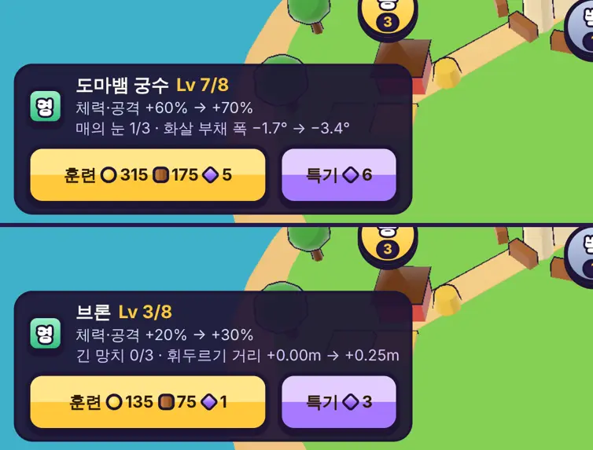

# 45회차: 킹덤 메타, 영웅 특기(영웅마다 한 갈래)

| 항목 | 값 |
| --- | --- |
| 시각 | 2026-11-11 19:42 ~ 19:52 KST (예약 회차) |
| 기준 | `61ebe3f` |
| 레인 | 킹덤 메타 (44회차 다음 후보) |
| 상태 | **완료** (궁수·브론 특기를 바꿈, 아래) |
| 다음 레인 | PvE 콘텐츠 |

## 문제

영웅을 키우는 길은 훈련(레벨, 14·26회차)뿐이다. 훈련은 세 영웅 모두 체력·공격이 같은 비율로 오른다. 그래서 영웅마다 성격이 커지지 않는다. 킹샷식 영웅 성장에는 영웅마다 고유 스킬을 올리는 갈래가 있다. 조각(전투에서만 얻음)을 훈련과 나눠 쓰는 선택도 생긴다.

## 범위

- **영웅 특기**: 영웅마다 하나, Lv0~3.
  - 궁수 ‘매의 눈’: 화살 사거리 레벨당 +0.8m(9.5 → 최대 11.9m)
  - 브론 ‘큰 휘두르기’: 휘두르기 반각 레벨당 +0.12 rad(0.96 → 최대 1.32)
  - 포포 ‘눈사태’: 눈덩이 범위 레벨당 +0.25m(1.6 → 최대 2.35m)
- **비용**: 다음 특기 레벨 n에 영웅 조각 3n개(합 18개)다. 그 영웅의 훈련 레벨이 2n+1 이상이어야 한다(Lv3·5·7). 훈련과 조각을 나눠 쓴다.
- **규칙**
  - 전투에 고른 영웅의 특기 레벨을 넘긴다(`RushMods.talent`, 선택 칸). `heroDef`가 특기를 반영한 수치를 돌려준다.
  - 봇과 조준 미리보기도 같은 수치를 쓴다.
- **저장**: 영웅별 특기 레벨. 예전 저장은 0이다.
- **화면**: 마을 영웅 카드에 특기 줄(이름, 효과 지금 → 다음, 올리기 버튼 ‘◆n’ 또는 ‘훈련 Lv 필요’ / ‘최대’)을 더한다.
- 설계 기둥(강화 없는 스테이지 1)과 기존 밸런스 테스트(특기 없는 조건)는 그대로여야 한다.

## 가설

특기 3은 영웅의 장점을 키운다(궁수는 더 멀리서, 브론은 더 넓게, 포포는 더 넓은 범위). 봇 기준 스테이지 7~8 승리가 조금 는다. 조각 합 18개는 별 보상(60개)과 일일 보상으로 몇 주 안에 모을 수 있는 양이다.

## 수용 기준

- [x] 규칙 테스트: 비용·훈련 레벨 조건·조각 차감·최대 3, 특기가 사거리·각도·범위를 바꿈, 특기 0은 지금과 같음, 예전 저장 이전
- [x] 설계 기둥·스테이지·영웅 훈련 테스트 통과
- [x] 봇 기준 특기 0 → 3 비교(세 영웅)
- [x] 마을 영웅 카드 스크린샷 직접 확인(휴대폰 가로에서 넘치지 않음)
- [x] `test:rush`, `tsc`, `build`, `smoke:rush` 통과

## 값 맞추기 (봇, 훈련 Lv7, 스테이지 5~8 × 시드 1~6)

범위대로 처음 넣은 특기는 봇 기준으로 궁수·브론에게 이득이 없었다.

| 특기 3 | 궁수 별 | 브론 별 | 포포 별 |
| --- | --- | --- | --- |
| 없음(0) | 18 | 21 | 23 |
| 처음 안: 사거리 +2.4m / 반각 +0.36 / 범위 +0.75m | 16 | 20 | **31** |
| **채택: 부채 폭 −0.09 rad / 휘두르기 거리 +0.75m / 범위 +0.45m** | **20** | **26** | **30** |

- 사거리와 휘두르기 각도는 봇의 싸움 방식(경계선에서 가까운 적부터)에서 결과를 바꾸지 못했다. 사람에게는 안전 거리라는 이득이 있지만, 측정할 수 없는 이득에 조각을 쓰게 할 수는 없었다.
- 그래서 바꿨다.
  - 궁수 ‘매의 눈’: 3갈래 화살의 부채를 좁힌다(0.13 → 0.04 rad). 멀리 있는 한 적에게 세 발이 더 많이 맞는다.
  - 브론 ‘긴 망치’: 휘두르기 거리를 늘린다(2.8 → 3.55m).
  - 포포 ‘눈사태’: 레벨당 범위를 0.25 → 0.15m로 낮췄다.
- 세 영웅 모두 별이 늘고, 영웅 Lv10만으로는 스테이지 10을 여전히 진다(시드 1~4).

## 바꾼 것

- **`data.ts`**: `TALENTS`(이름, 바꾸는 수치, 레벨당 값, 표시 이름), `TALENT_MAX = 3`, `heroStats(kind, talent)`(특기를 반영한 수치. 영웅·레벨마다 한 객체를 재사용한다).
- **`sim.ts`**: `RushMods.talent`(선택 칸)를 더했다. `heroDef(s)`는 `heroStats`를 돌려준다. 그래서 공격·봇·조준이 모두 같은 수치를 쓴다.
- **`kingdom.ts`**
  - 영웅별 `talent`와 `talentCost`(다음 레벨 n: 조각 3n개, 훈련 Lv 2n+1 필요)를 더했다. `canLearnTalent`, `learnTalent`도 더했다.
  - `kingdomMods`가 고른 영웅의 특기를 넘긴다.
  - 예전 저장은 0이고, 범위 밖 값은 0~3으로 자른다.
  - `clone`이 특기도 복사한다(빠뜨리면 원래 마을 객체가 바뀌는 버그였다. 테스트로 막음).
- **`render.ts`**: 조준 부채와 눈덩이 착지 원이 특기 수치를 따른다. 부채는 수치가 바뀔 때만 다시 만든다.
- **`town.ts`, `rush.css`**
  - 영웅 카드에 특기 줄(‘매의 눈 1/3 · 화살 부채 폭 −1.7° → −3.4°’)을 더했다. 훈련 버튼 옆에 보라 ‘특기 ◆n’ 버튼이 있다.
  - 훈련 레벨이 모자라면 버튼에 ‘특기 Lv5↑’가 뜬다.
  - 처음에는 두 버튼을 반씩 나눴더니, 휴대폰에서 훈련 버튼의 조각 비용(◆)이 말줄임으로 잘렸다. 그래서 2:1로 나눴다.
- **부분 글꼴**: 새 글자 때문에 다시 돌렸다(319자, 50.7 KB).
- **테스트**
  - 1개 추가(58 → 59): 비용·훈련 조건·조각 차감·최대 3, 원래 객체 불변, 세 영웅 수치 변화, 특기 0은 원래 객체, 예전 저장·범위 밖 값.
  - ‘새 마을은 전투를 바꾸지 않는다’ 기대값에 `talent: 0`을 더했다.

## 화면 확인

- 궁수 카드에서 특기를 배우면 조각이 20 → 14, 특기가 1 → 2로 바뀌었다. 문구도 ‘−3.4° → −5.2°’로 바뀌었다.
- 영웅을 브론으로 바꾸고 출전하면 전투에 `talent: 0`이 넘어간다(브론은 아직 특기 없음).
- 데스크톱과 휴대폰 가로에서 카드가 넘치지 않는다.

## 검증

- `npm run test:rush`: 59개 통과(설계 기둥·스테이지·영웅 훈련 포함, 특기 없는 조건이라 그대로).
- `npx tsc --noEmit`, `npm run build`: 통과.
- `npm run smoke:rush`: 31/31 통과.

## 다음

- **다음 레인: PvE 콘텐츠.** 후보는 다 깬 뒤 할 거리다. 스테이지 10까지 별을 다 따면 반복할 이유가 일일 보상과 조각뿐이다. 예를 들어 ‘끝없는 웨이브’ 모드(웨이브마다 강해지고 최고 기록을 남김)를 둔다.
- 백로그 상위 3개
  1. (PvE 콘텐츠) 다 깬 뒤 반복 도전 모드
  2. (렌더 톤·모델) 손의 눈덩이를 던진 뒤 숨기기, 데스크톱 마을 표지 정리
  3. (전투 손맛) 특기 효과가 전투에서 보이게(예: 궁수 부채가 좁아진 것이 조준선에 드러남은 됨, 브론 거리 표시)
