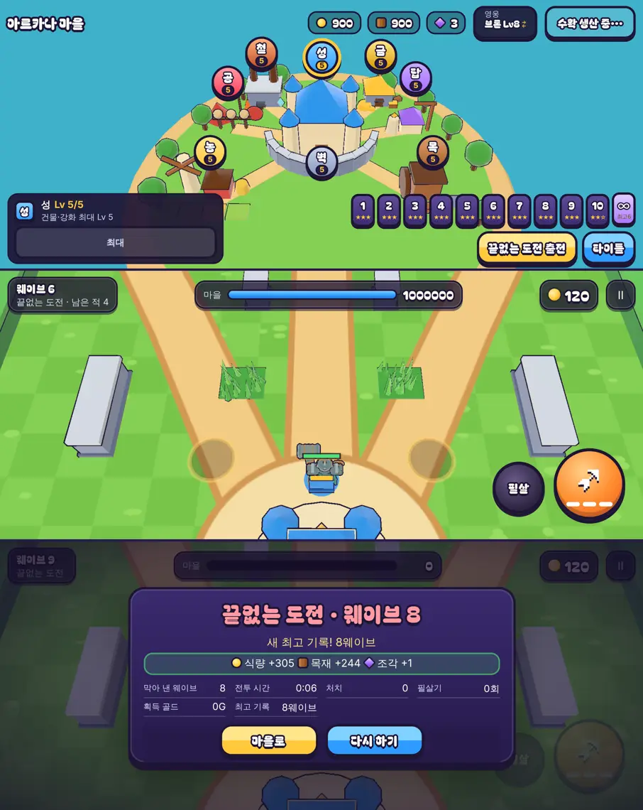

# 46회차: PvE 콘텐츠, 끝없는 도전

| 항목 | 값 |
| --- | --- |
| 시각 | 2026-11-11 20:42 ~ 20:50 KST (예약 회차) |
| 기준 | `c294295` |
| 레인 | PvE 콘텐츠 (45회차 다음 후보) |
| 상태 | **완료** (난이도 증가를 ‘더함’ 대신 ‘곱함’으로, 아래) |
| 다음 레인 | 전투 손맛 |

## 문제

스테이지는 10개다. 별을 다 따면 다시 할 이유가 일일 보상(32회차)과 높은 스테이지 조각뿐이다. 마을과 영웅(훈련·특기)을 키운 결과를 시험할 곳이 없다.

## 범위

- **새 모드 ‘끝없는 도전’**: 스테이지 10에서 별을 얻으면 열린다. 마을 스테이지 줄 끝에 ‘∞’ 칩으로 고른다.
  - 스테이지 10 난이도로 시작한다(방패병, 보스 부르짖음 포함). 다섯 웨이브(보스 포함)를 한 바퀴로 계속 되풀이한다.
  - 한 바퀴 돌 때마다 적이 강해진다: 체력 +35%, 수 +20%, 피해 +15%(바퀴마다 더함 → 구현은 곱함, 아래).
  - 이기는 끝이 없다. 마을이 무너지면 끝난다.
- **기록과 보상**
  - 마을에 최고 기록(막아 낸 웨이브 수)을 남긴다.
  - 보상: 식량·목재는 막아 낸 웨이브 수에 비례한다(스테이지 10 배율). 조각은 5웨이브마다 1개다.
  - 새 최고 기록이면 결과 화면에 알린다.
- **화면**
  - 전투 위쪽 웨이브 표시를 ‘웨이브 n · 끝없는 도전’으로 바꾼다.
  - 결과 제목을 ‘끝없는 도전 · 웨이브 n’으로 하고, 최고 기록을 보여 준다.
- 스테이지 1~10과 설계 기둥은 그대로다.

## 가설

강화 최대 마을과 훈련된 영웅의 봇은 5웨이브(한 바퀴)를 넘기고, 2~3바퀴 사이에서 무너진다. 그래서 키운 만큼 기록이 오르는 목표가 생긴다.

## 수용 기준

- [x] 규칙 테스트
  - 끝없는 도전은 5웨이브 뒤에도 이어진다.
  - 바퀴마다 적 체력·수가 오른다.
  - 승리로 끝나지 않는다.
  - 스테이지 전투는 그대로 5웨이브에서 이긴다.
- [x] 봇 기준 도달 웨이브(강화 없음, 강화 최대)
- [x] 마을(∞ 칩)·전투 웨이브 표시·결과 화면 스크린샷 직접 확인
- [x] `test:rush`, `tsc`, `build`, `smoke:rush` 통과

## 바꾼 것

- **`sim.ts`**
  - `Difficulty.endless`를 더했다. 웨이브 계획은 `waveDef(s) = WAVES[s.wave % 5]`라 다섯 웨이브를 되풀이한다.
  - 끝없는 도전에서는 다섯째 웨이브를 막아도 이기지 않고 다음 웨이브로 간다.
  - 새 바퀴가 시작될 때 `s.diff`를 곱해 올린다(`ENDLESS_LAP`: 체력 ×1.35, 수 ×1.2, 피해 ×1.15). 범위에 적은 ‘더함’ 대신 **곱함**으로 했다. 적 체력·수·피해를 쓰는 모든 곳이 `s.diff`를 보므로 고칠 곳이 한 군데이고, 바퀴가 쌓일수록 확실히 끝난다.
  - 스테이지 전투는 그대로다(`wave < 5`라 `waveDef`가 예전과 같다).
- **`kingdom.ts`**
  - `endlessBest`(최고 기록)를 더했다.
  - `ENDLESS_STAGE = 11`이다. `stageUnlocked`가 11번(스테이지 10의 별로 열림)까지 받는다.
  - `settleEndless`: 식량·목재는 막아 낸 웨이브 수 × 스테이지 10 배율이다. 조각은 5웨이브마다 1개다. 판 id당 한 번만 지급하고 최고 기록을 갱신한다.
  - 예전 저장의 최고 기록은 0이다.
- **`main.ts`**
  - ∞를 고르고 출전하면 스테이지 10 난이도에 `endless`를 켠다.
  - 웨이브 표시는 ‘웨이브 n’, 아래 줄은 ‘끝없는 도전 · 남은 적’이다. 보스 웨이브 알림은 ‘웨이브 n · 보스 출현!’이다.
  - 결과 화면은 끝없는 도전 전용이다(제목, 새 최고 기록 또는 최고 기록, 보상, 막아 낸 웨이브·최고 기록 통계).
- **`town.ts`, `rush.css`**
  - 스테이지 줄 끝에 보라 ‘∞’ 칩을 둔다. 별 대신 ‘최고 n’, 잠겼을 때는 ‘잠김’을 보여 준다.
  - 출전 버튼은 ‘끝없는 도전 출전’이다.
- **부분 글꼴**: 323자, 51.2 KB.
- **테스트 2개 추가**(59 → 61)
  - 다섯째 웨이브 뒤에도 이어지고, 한 바퀴 뒤 난이도가 `ENDLESS_LAP`만큼 오르며, 이기지 않는다. 스테이지 전투는 여전히 5웨이브에서 이긴다.
  - 정산: 잠김·열림, 웨이브별 보상, 5웨이브당 조각, 최고 기록, 한 번만 지급, 예전 저장.

## 결과

**봇 도달 웨이브 (시드 1~4, 막아 낸 웨이브 수와 걸린 시간)**

| 마을 | 궁수 | 브론 | 포포 |
| --- | --- | --- | --- |
| 강화 없음 | 2 2 2 3 (2분) | 3 3 3 3 (2분) | 2 1 2 3 (1~2분) |
| 강화 최대 | 8 4 3 8 (2~5분) | 9 9 8 9 (5~6분) | 8 9 8 9 (5~6분) |
| 강화 최대 + 영웅 Lv10 + 특기 3 + 금고 5 | 9 9 9 9 (6분) | 11 12 11 11 (7분) | 9 9 9 9 (6분) |

- 키운 만큼 기록이 오른다. 강화 없는 마을은 2~3웨이브, 다 키운 마을은 9~12웨이브(둘째 바퀴의 보스 앞뒤)다.
- 한 판이 1~7분 안에 끝난다.
- 가설(2~3바퀴 = 10~15웨이브)보다 조금 짧다. 봇은 손 조준과 위치 선정을 하지 않으므로, 사람은 더 멀리 갈 수 있다(확인하지 않음).

**화면 (휴대폰 가로)**

- 휴대폰 가로에서 스테이지 칩 11개가 화면 안에 들어간다(오른쪽 끝 853 / 화면 863px).
- 웨이브 8에서 마을을 무너뜨리자 보상(식량 +305, 목재 +244, 조각 +1)과 새 최고 기록 8이 저장됐다.
- 전투 화면 장면은 둘째 바퀴로 바로 건너뛰어 찍었다. 그래서 그 장면의 난이도 수치는 오르기 전 값이다. 바퀴마다 오르는 것은 규칙 테스트가 확인한다.

## 검증

- `npm run test:rush`: 61개 통과(설계 기둥·스테이지·영웅 훈련 포함).
- `npx tsc --noEmit`, `npm run build`: 통과.
- `npm run smoke:rush`: 31/31 통과.

## 다음

- **다음 레인: 전투 손맛.** 후보는 끝없는 도전의 바퀴 전환이 느껴지게 하는 것이다. 지금은 바퀴가 바뀌어도 알림이 없다. 예를 들어 ‘2바퀴째 · 적이 강해졌다!’ 알림과 짧은 화면 효과를 넣는다.
- 백로그 상위 3개
  1. (전투 손맛) 끝없는 도전 바퀴 전환 알림
  2. (렌더 톤·모델) 손의 눈덩이를 던진 뒤 숨기기, 데스크톱 마을 표지 정리
  3. (킹덤 메타) 끝없는 도전 기록 보상(예: 최고 기록 구간별 1회 보상)
