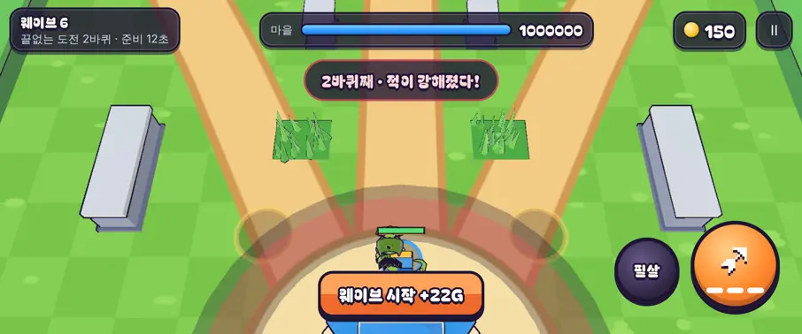

# 47회차: 전투 손맛, 끝없는 도전의 바퀴 전환 알림

| 항목 | 값 |
| --- | --- |
| 시각 | 2026-11-11 21:42 ~ 21:47 KST (예약 회차) |
| 기준 | `e843d9e` |
| 레인 | 전투 손맛 (46회차 다음 후보) |
| 상태 | **완료** |
| 다음 레인 | 렌더 톤·모델 |

## 문제

끝없는 도전(46회차)은 다섯 웨이브마다 적이 강해진다(체력 ×1.35, 수 ×1.2, 피해 ×1.15). 그런데 바퀴가 바뀌어도 화면에 아무 표시가 없다. 보통 웨이브 방어 알림 다음에 ‘웨이브 6 시작’이 나올 뿐이다. 플레이어는 갑자기 적이 단단해졌다고만 느낀다. 위험이 커지는 순간이 읽혀야 다음 바퀴를 준비할 수 있다.

## 범위

- **규칙**: 새 바퀴가 시작될 때 `lap` 이벤트(바퀴 번호)를 낸다. 난이도 계산은 바꾸지 않는다.
- **알림**: ‘n바퀴째 · 적이 강해졌다!’ 알림(위험 색), 진동, 경고 효과음을 낸다.
- **화면 효과**: 마을 둘레에 큰 붉은 잉크 고리를 그리고, 짧게 화면을 흔든다. 웨이브 표시 칸이 잠깐 붉게 깜빡인다.
- **상시 표시**: 웨이브 아래 줄에 바퀴를 보여 준다(‘끝없는 도전 2바퀴 · 남은 적 n’). 첫 바퀴는 지금처럼 바퀴 번호 없이 둔다.
- 스테이지 전투에는 영향이 없다.

## 가설

알림과 상시 표시로 바퀴 전환을 놓치지 않는다. 준비 시간(12초)에 알림이 뜨므로, 탑을 올리거나 필살기를 아낄 판단을 할 수 있다.

## 수용 기준

- [x] 규칙 테스트: `lap`은 다섯째 웨이브마다 한 번(2, 3바퀴째), 스테이지 전투에서는 나오지 않음
- [x] 바퀴 전환 순간 스크린샷 직접 확인(알림, 고리, 깜빡임, 아래 줄 바퀴 표시)
- [x] `test:rush`, `tsc`, `build`, `smoke:rush` 통과

## 바꾼 것

- **`sim.ts`**: 끝없는 도전에서 새 바퀴의 난이도를 올린 직후 `lap` 이벤트(2, 3, …바퀴)를 낸다. 같은 틱의 웨이브 방어 이벤트 뒤에 나온다.
- **`main.ts`**
  - `lap` 알림 ‘n바퀴째 · 적이 강해졌다!’는 위험 색이고 2.6초 동안 뜬다(`toast`에 시간 인자를 더함). 같은 틱의 ‘웨이브 5 방어 성공’ 알림을 덮는다.
  - 진동과 경고 효과음(`surge`)을 낸다.
  - 웨이브 칸에 `lap-flash`(붉게 세 번 깜빡임)를 준다.
  - 웨이브 아래 줄은 2바퀴부터 ‘끝없는 도전 n바퀴 · …’다.
- **`render.ts`**: `lap` 때 마을 둘레에 반지름 7m 붉은 잉크 고리를 그리고 화면을 흔든다(동작 줄이기 설정이면 흔들지 않음).
- **`rush.css`**: 깜빡임 애니메이션이다. 동작 줄이기 설정이면 끈다.
- **부분 글꼴**: ‘퀴’ 등 때문에 다시 돌렸다(325자, 51.5 KB).
- **테스트 1개 추가**(61 → 62): 끝없는 도전에서 `lap`이 웨이브 5·10 시작에 2·3으로 한 번씩 나온다. 스테이지 전투에서는 한 번도 나오지 않는다.

## 결과

- 첫 바퀴의 보스 웨이브를 바로 끝내 두 번째 바퀴로 넘겨 찍었다(휴대폰 가로·데스크톱).
  - 알림 문구, 웨이브 칸 깜빡임(클래스 확인), 아래 줄 ‘끝없는 도전 2바퀴’가 모두 나왔다.
  - 적 체력 배율은 2.1 → 2.835(×1.35)로 올랐다.
- 알림은 준비 시간(12초) 첫머리에 뜬다. 탑을 올릴 시간이 남아 있다.
- 붉은 고리는 사라지는 중이라 스크린샷에서는 옅게 보인다.

## 검증

- `npm run test:rush`: 62개 통과.
- `npx tsc --noEmit`, `npm run build`: 통과.
- `npm run smoke:rush`: 31/31 통과.

## 다음

- **다음 레인: 렌더 톤·모델.** 후보는 백로그에 오래 남은 둘이다. 하나는 포포 손의 눈덩이를 던진 뒤 숨기기(41회차 한계)다. 다른 하나는 데스크톱 마을 표지가 상단 막대에 닿는 것(38회차)이다. 하나를 고른다.
- 백로그 상위 3개
  1. (렌더 톤·모델) 포포 손 눈덩이 숨기기 또는 데스크톱 마을 표지 정리
  2. (킹덤 메타) 끝없는 도전 기록 구간 보상(예: 10·15·20웨이브 첫 도달 보상)
  3. (성능·모바일) 끝없는 도전 후반(적 수 증가) 프레임 비용 측정
