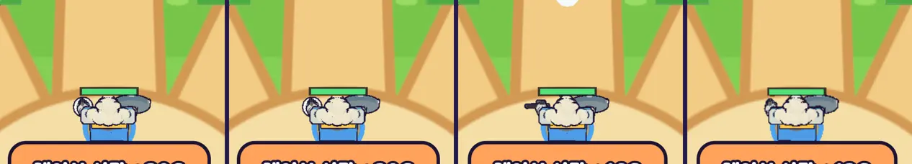

# 48회차: 렌더 톤·모델, 포포 손의 눈덩이가 탄 수를 보여 줌

| 항목 | 값 |
| --- | --- |
| 시각 | 2026-11-11 22:42 ~ 22:49 KST (예약 회차) |
| 기준 | `fac9de4` |
| 레인 | 렌더 톤·모델 (47회차 다음 후보, 41회차 한계) |
| 상태 | **완료** |
| 다음 레인 | 성능·모바일 |

## 문제

41회차에서 포포의 망치를 눈덩이로 바꿨다. 그런데 눈덩이가 팔 부품에 구워져 있어서 던진 뒤에도 손에 남는다. 날아가는 눈덩이와 손의 눈덩이가 잠깐 둘로 보인다. 탄(2발)을 다 써도 손에는 눈덩이가 있다.

## 범위

- 손의 눈덩이를 굽지 않고 **따로 메시**(본체 + 잉크 외곽선)로 같은 `hammer` 노드에 붙인다. 공격 동작 클립은 그대로 이 눈덩이를 휘두른다.
- **보이는 조건**: 탄이 1발 이상 있고, 막 던진 직후(다음 공격까지의 간격 0.45초)가 아닐 때다. 그래서 던지는 순간 손을 떠나고, 탄이 바닥나면 빈손으로 재장전을 기다린다. 손을 보면 탄이 있는지 알 수 있다.
- 다른 영웅과 규칙은 바꾸지 않는다. 드로콜은 포포일 때만 +2(눈덩이와 외곽선)다.

## 가설

던지는 순간 손의 눈덩이가 사라져, 날아가는 눈덩이만 하나 보인다. 탄 0일 때 빈손이 재장전 신호가 된다.

## 수용 기준

- [x] 서 있을 때(탄 2) 손에 눈덩이, 던진 직후·탄 0일 때 빈손(스크린샷 직접 확인, 상태값 확인)
- [x] 포포 전투 드로콜 전후(+2 이하), 다른 영웅은 변화 없음
- [x] `test:rush`, `tsc`, `build`, `smoke:rush` 통과

## 바꾼 것 (`render.ts`만)

- `HERO_PROPS`의 눈덩이는 이제 영웅 부품에 굽지 않는다. 따로 구운 메시(본체 + 잉크 외곽선 0.035)로 `hammer` 노드에 붙인다. 공격 클립이 그 노드를 휘두르므로 던지는 몸짓은 그대로다.
- 영웅 장비 표(`heroRigs`)에 `held`(손에 든 부품)를 더했다.
- 매 프레임 `held.visible = 탄 ≥ 1 && 다음 공격까지 남은 시간 ≤ 0`이다.
- 디버그 정보에 `heldProp`(손의 눈덩이가 보이는지)을 더했다. 측정용이다.
- 규칙 변경 없음.

## 결과 (휴대폰 가로, 포포 전투)

| 상태 | 탄 | 다음 공격까지 | 손의 눈덩이 |
| --- | ---: | ---: | --- |
| 서 있음 | 2 | 0 | **보임** |
| 막 던짐(탭 60ms 뒤) | 1 | 0.42 s | **안 보임** |
| 탄 다 씀 | 0 | 0 | **안 보임** |

- **드로콜**: 같은 모델 시트 프레임에서 손의 눈덩이를 감추면 24, 보이면 26이다(**+2**).
  - 전투 화면 전후 비교(46 → 50)는 프레임마다 효과·탄 표시가 달라 그대로 쓰지 않았다.
  - 손이 빈 때는 전과 같다(42 = 42).
  - 다른 영웅은 바뀌지 않았다(궁수 46 = 46).
- 던지는 순간 손에서 눈덩이가 사라지고, 날아가는 눈덩이 하나만 보인다. 탄이 다 떨어지면 다시 장전될 때까지 빈손이다.
- 두 번째 측정에서는 탭이 전투 준비 전에 들어가 던지지 않았다(탄 2 그대로). 측정 도구의 타이밍 문제이고, 그 경우 손에 눈덩이가 보이는 것도 규칙대로다.

## 검증

- `npm run test:rush`: 62개 통과.
- `npx tsc --noEmit`, `npm run build`: 통과.
- `npm run smoke:rush`: 31/31 통과.
- 서 있음·막 던짐·탄 0 화면을 직접 열어 확인했다.

## 다음

- **다음 레인: 성능·모바일.** 후보는 끝없는 도전 후반의 프레임 비용이다. 바퀴마다 적 수가 ×1.2로 늘어 3바퀴째에는 웨이브당 적이 1.44배다. 그때의 시뮬레이션 스텝 시간, 드로콜, 삼각형을 재서 한계를 찾는다. 시간(ms)은 Node 벤치(18회차 방식)로만 비교한다.
- 백로그 상위 3개
  1. (성능·모바일) 끝없는 도전 후반 비용 측정
  2. (렌더 톤·모델) 데스크톱 마을 표지가 상단 막대에 닿는 것(38회차)
  3. (킹덤 메타) 끝없는 도전 기록 구간 보상
