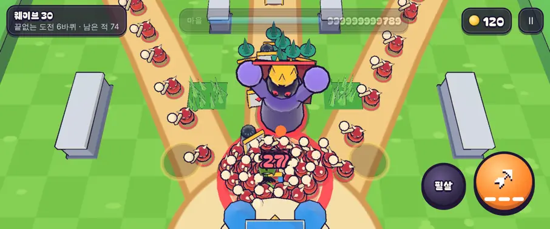

# 49회차: 성능·모바일, 끝없는 도전 후반의 비용과 그리기 한도

| 항목 | 값 |
| --- | --- |
| 시각 | 2026-11-11 23:42 ~ 23:48 KST (예약 회차) |
| 기준 | `8d424cf` |
| 레인 | 성능·모바일 (48회차 다음 후보) |
| 상태 | **완료** (한도에 닿지 않아 한도는 그대로, 넘침 계수만 더함) |
| 다음 레인 | 엔진 스파이크 |

## 문제

끝없는 도전(46회차)은 바퀴마다 적 수가 ×1.2로 는다. 지금까지 성능 측정은 스테이지 전투(최대 수십 마리)만 봤다. 그리고 전투 렌더는 인스턴스 배치의 **고정 한도**를 쓴다. 한도를 넘는 것은 조용히 그리지 않는다(`Batch.push`).

| 배치 | 한도 |
| --- | ---: |
| 적 본체·외곽선·피격 번쩍임·얼음 (종류별) | 160 (보스 4) |
| 적 그림자·발밑 고리·냉기 고리·체력바 (**모든 적 공용**) | 160 |
| 적 탄 | 120 |
| 영웅 화살 | 240 |

후반 바퀴에서 이 한도에 닿으면, 적이 있는데 그림자·체력바가 없거나 탄이 안 보이는 일이 생긴다.

## 범위

- **측정**: Node에서 끝없는 도전을 봇으로 돌린다. 마을 체력은 아주 크게 해서 바퀴가 계속 돌게 한다. 바퀴마다 다음을 잰다.
  - 동시에 살아 있는 적 수의 최대, 적 탄 수의 최대
  - 그 순간의 스텝 시간. 18회차처럼 Node 기준 상대 비교만 하고, 기기 성능은 주장하지 않는다.
- **고침(측정에서 한도에 닿을 때만)**: 닿는 배치의 한도를 실제 최대치에 여유를 둔 값으로 올린다. 바퀴가 아주 길어지는 경우를 위해, 넘치면 개발 콘솔에 한 번 경고한다.
- 규칙은 바꾸지 않는다.

## 가설

강화를 다 한 마을의 봇은 9~12웨이브(46회차)에서 끝나므로 실제 판은 한도에 닿지 않는다. 마을 체력을 무한으로 둔 극한(5바퀴 이상)에서는 공용 160에 닿을 수 있다.

## 수용 기준

- [x] 바퀴별 최대 적 수·적 탄 수·스텝 시간 표
- [x] 한도에 닿는 배치가 있으면 고치고, 그 바퀴의 전투 화면에서 그림자·체력바가 모두 그려지는지 확인 → 닿지 않음(아래). 6바퀴 화면에서 모두 그려짐을 확인
- [x] `test:rush`, `tsc`, `build`, `smoke:rush` 통과

## 결과 1: Node, 바퀴별 최대치 (강화·영웅 모두 최대, 마을·영웅 체력 사실상 무한, 시드 1)

| 바퀴 | 궁수: 동시 적 / 적 탄 / 스텝 평균·최악 | 브론 | 포포 |
| --- | --- | --- | --- |
| 1 | 41 / 6 / 0.05·9.3 ms | 44 / 5 / 0.03·3.5 | 42 / 5 / 0.03·2.0 |
| 2 | 47 / 7 / 0.03·2.7 | 47 / 8 / 0.04·1.6 | 49 / 4 / 0.03·2.9 |
| 3 | 56 / 5 / 0.04·2.5 | 54 / 7 / 0.06·1.5 | 54 / 7 / 0.03·0.8 |
| 4 | 65 / 7 / 0.03·0.4 | 63 / 9 / 0.04·1.5 | 59 / 8 / 0.03·1.8 |
| 5 | 73 / 7 / 0.05·1.7 | 71 / 7 / 0.05·1.4 | 81 / 11 / 0.04·0.6 |
| 6 | **90** / 12 / 0.06·2.3 | 85 / 16 / 0.08·1.1 | 81 / 13 / 0.05·3.5 |

- 6바퀴(웨이브 30)까지도 동시 적은 최대 90마리다. 공용 한도 160에 닿지 않는다. 적 탄은 최대 16발로 한도 120에 멀다.
  - 종류별 최대는 돌격병 62마리로, 종류별 한도 160에도 멀다.
  - 바퀴당 약 1.15~1.2배로 늘어나므로, 160에 닿으려면 9~10바퀴가 필요하다.
  - 실제 판은 다 키운 마을의 봇도 9~12웨이브(3바퀴 전)에서 끝난다(46회차).
- 스텝 시간 평균은 6바퀴에서도 0.03~0.08 ms다. 최악값(수 ms)은 첫 바퀴의 JIT·GC 같은 일회성이다. 시뮬레이션은 병목이 아니다(Node 상대값, 기기 성능 주장 아님).

## 결과 2: 브라우저 (휴대폰 가로, 높음 품질)

| 장면 | 적 | 드로콜 | 삼각형 | 그리지 못한 인스턴스 |
| --- | ---: | ---: | ---: | ---: |
| 6바퀴 보스 웨이브(난이도를 6바퀴 값으로 맞추고 웨이브 30으로 건너뜀) | 71 | 63 | **127,170** | 0 |
| 시험: 위에 돌격병 260마리를 더 넣음 | 360 | 59 | — | **1,352** (몇 프레임 합) |

- 드로콜은 적 수와 상관없이 그대로다(인스턴스 배치). 삼각형은 스테이지 전투(약 5만~7만, 37회차)의 거의 두 배다. 실기기 게이트에서 볼 항목으로 남긴다.
- 한도를 넘기는 시험에서 넘침이 계수되고, 개발 콘솔 경고가 배치마다 한 번 나왔다.

## 바꾼 것

- **`batch.ts`**: 배치가 가득 차 버린 인스턴스를 `Batch.dropped`에 센다. 개발 빌드에서는 배치마다 한 번 콘솔 경고를 낸다.
- **`render.ts`**: 디버그 정보에 `dropped`를 더했다. 넘침이 다시는 조용히 지나가지 않는다.
- 한도 값은 바꾸지 않았다(실제 판에서 닿지 않음). 규칙 변경 없음.

## 검증

- `npm run test:rush`: 62개 통과.
- `npx tsc --noEmit`, `npm run build`: 통과.
- `npm run smoke:rush`: 31/31 통과.
- 6바퀴 화면을 직접 열어 확인했다.

## 다음

- **다음 레인: 엔진 스파이크.** 후보는 적이 많을 때의 삼각형 수다(6바퀴 12.7만). 적 모델의 저세부(LOD) 판을 스크래치에서 만들어 삼각형과 화면 차이를 잰다. 측정만 한다.
- 백로그 상위 3개
  1. (엔진 스파이크) 적 모델 저세부 판 시험(측정만)
  2. (렌더 톤·모델) 데스크톱 마을 표지가 상단 막대에 닿는 것(38회차)
  3. (킹덤 메타) 끝없는 도전 기록 구간 보상
