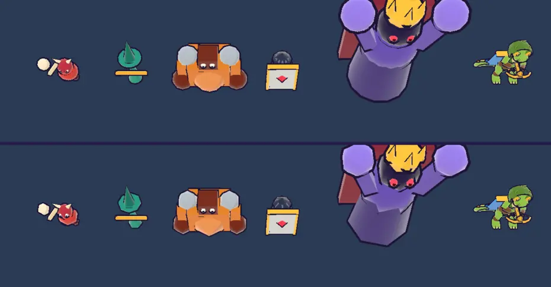

# 50회차: 엔진 스파이크, 적 모델 저세부 판 시험(측정만)

| 항목 | 값 |
| --- | --- |
| 시각 | 2026-11-12 00:42 ~ 00:48 KST (예약 회차) |
| 기준 | `0d5e3b6` |
| 레인 | 엔진 스파이크 (49회차 다음 후보) |
| 상태 | **완료** (측정만, 저장소 변경은 문서뿐) |
| 다음 레인 | 킹덤 메타 |

## 문제

49회차에서 끝없는 도전 6바퀴(적 71마리) 화면이 삼각형 12.7만 개였다. 스테이지 전투의 약 두 배다. 적 모델은 구·원뿔·원기둥 부품을 구워 만든다(11회차). 구는 가로 12 × 세로 10 조각, 원기둥은 12~16 조각이다. 위에서 내려다보는 작은 적에게 이만큼 둥근 면이 필요한지 확인한 적이 없다. 외곽선(뒤집은 껍데기)도 같은 삼각형 수를 한 번 더 그린다.

## 범위

- **측정만 한다.** 작업 트리에서만 시험 손잡이(`?lod=1`)를 넣어, 적 부품의 둥근 조각 수를 절반으로 줄인 판을 만든다. 구는 최소 6 × 4, 원뿔·원기둥은 최소 6이다. 측정 뒤에는 되돌린다. 커밋하지 않는다.
- 잴 것
  - 적 종류별 삼각형 수(본체, 껍데기 포함)
  - 모델 시트 전체 삼각형
  - 49회차 6바퀴 장면의 삼각형
  - 모델 시트 화소 차이와 실루엣 차이(11회차 방식의 외곽 상자). 스크린샷은 직접 확인한다.
- 결과로 ‘적이 많을 때만 저세부 판으로 바꾸기’를 채택할지 추천을 남긴다.

## 가설

조각을 절반으로 하면 적 삼각형이 약 60~70% 준다. 위에서 보는 작은 적은 외곽선이 각져 보이는 정도의 차이만 난다. 6바퀴 장면의 삼각형은 12.7만에서 약 6만 아래로 준다.

## 수용 기준

- [x] 종류별·장면별 삼각형 전후 표
- [x] 모델 시트 전후 스크린샷 직접 확인, 화소 차이
- [x] 저장소 변경은 문서뿐. `test:rush`, `tsc`, `build`, `smoke:rush` 통과
- [x] 채택 추천과 비용

## 결과

**종류별 적 본체 삼각형** (외곽선 껍데기가 같은 수만큼 더 그려진다)

| 종류 | 지금 | 조각 절반 | 줄어든 비율 |
| --- | ---: | ---: | ---: |
| 돌격병 | 1,032 | 384 | −63% |
| 투척병 | 640 | 296 | −54% |
| 거한 | 1,080 | 384 | −64% |
| 방패병 | 596 | 284 | −52% |
| 보스 | 1,404 | 506 | −64% |

**장면 삼각형 (휴대폰 가로, 높음 품질)**

| 장면 | 지금 | 조각 절반 | 줄어든 비율 |
| --- | ---: | ---: | ---: |
| 모델 시트(적 다섯 + 궁수) | 25,184 | 19,388 | −23% (영웅 GLB·바닥은 그대로) |
| 끝없는 도전 6바퀴, 적 78마리 | 138,394 | **78,002** | **−44%** |

- 가설(−60~70%)은 적 한 마리 기준으로 맞았다. 장면 전체는 바닥·탑·영웅·이펙트가 그대로라 −44%다. 6바퀴 장면은 스테이지 전투 수준(약 7~8만)으로 돌아온다.
- 드로콜은 같다(인스턴스 배치).

**화면 (모델 시트)**

- 다른 화소는 25,174개(화면의 1.2%)로, 거의 둥근 부품의 가장자리다. 적 실루엣 면적은 −3%(129,527 → 125,386화소)다.
- 작은 적(돌격병·투척병·방패병)은 차이가 거의 보이지 않는다. 거한의 어깨 구와 **보스의 두 팔**은 각진 면이 눈에 띈다. 보스는 화면에서 크게 보이므로 차이가 드러난다.

## 추천

- **보스를 뺀 네 종류는 늘 절반 조각으로 바꾼다**(‘적이 많을 때만’ 전환은 하지 않는다).
  - 위에서 보는 작은 적에서는 차이가 거의 안 보인다. 전환 규칙과 두 벌의 모델을 관리할 필요가 없다.
  - 6바퀴 장면 삼각형의 대부분(돌격병 수십 마리)이 여기서 준다.
- **보스는 지금 조각을 유지한다.** 한 마리뿐이라 삼각형 비중이 작고, 팔의 둥근 면이 보스의 인상이다.
- 비용: `enemyKit`의 부품 조각 수를 바꾸는 몇 줄과, 모델 시트 화소·실루엣 재확인이다. 렌더 톤·모델 레인의 한 회차로 하기에 알맞다. 11회차 실루엣 기준(IoU, 주색)이 바뀌지 않는지 함께 본다.

## 검증 (저장소)

- 시험 손잡이는 작업 트리에서만 쓰고 되돌렸다(스크래치에 패치 보관).
- `npm run test:rush`: 62개 통과.
- `npx tsc --noEmit`, `npm run build`: 통과.
- `npm run smoke:rush`: 31/31 통과.

## 다음

- **다음 레인: 킹덤 메타.** 후보는 끝없는 도전 기록 구간 보상이다. 10·15·20웨이브를 처음 넘을 때 한 번씩 조각을 준다. 기록을 갱신할 동기가 된다.
- 백로그 상위 3개
  1. (킹덤 메타) 끝없는 도전 기록 구간 보상
  2. (렌더 톤·모델) 보스를 뺀 적 모델 조각 절반(이번 추천)
  3. (렌더 톤·모델) 데스크톱 마을 표지가 상단 막대에 닿는 것(38회차)
