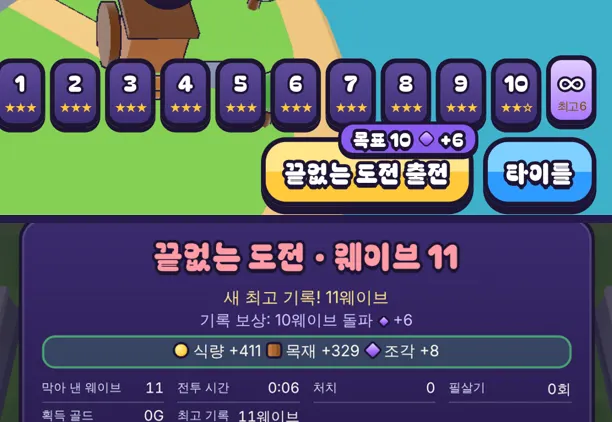

# 51회차: 킹덤 메타, 끝없는 도전 기록 구간 보상

| 항목 | 값 |
| --- | --- |
| 시각 | 2026-11-12 01:42 ~ 01:48 KST (예약 회차) |
| 기준 | `fbde847` |
| 레인 | 킹덤 메타 (50회차 다음 후보) |
| 상태 | **완료** |
| 다음 레인 | PvE 콘텐츠 |

## 문제

끝없는 도전(46회차)의 보상은 막아 낸 웨이브 수에 비례하고, 최고 기록은 숫자로만 남는다. 기록을 1~2웨이브 올려도 얻는 것이 거의 같다. 그래서 기록을 깨려고 다시 할 동기가 약하다. 킹샷식 진행은 ‘다음 목표’와 그 목표의 보상이 보여야 손이 간다.

## 범위

- **기록 구간**: 5·10·15·20웨이브. 처음 넘을 때 한 번씩 영웅 조각을 준다(3·6·10·15개, 합 34).
  - 따로 저장하지 않는다. 최고 기록에서 계산한다. 예전 최고와 이번 판 사이에 든 구간만 지급하므로, 한 판에 여러 구간을 넘으면 모두 준다.
  - 같은 판 id는 한 번만 지급한다(기존 규칙).
- **화면**
  - 마을에서 ∞를 고르면 출전 버튼에 다음 목표 표시 ‘목표 10 ◆+6’을 단다(일일 보상 표시와 같은 모양).
  - 결과 화면에 ‘기록 보상: 10웨이브 돌파 ◆+6’을 보여 준다.
- 예전 저장은 최고 기록이 이미 넘은 구간을 지급된 것으로 본다(소급하지 않음).

## 가설

다 키운 마을의 봇은 9~12웨이브(46회차)라 10웨이브 구간이 ‘조금만 더’ 목표가 된다. 15·20은 사람의 손 조준과 위치 선정이 필요한 목표다.

## 수용 기준

- [x] 규칙 테스트: 처음 넘을 때만 지급, 한 판에 여러 구간을 넘으면 모두 지급, 같은 기록·낮은 기록은 지급 안 함, 같은 판 두 번 지급 안 함
- [x] 마을 출전 버튼 표시·결과 화면 스크린샷 직접 확인(휴대폰 가로)
- [x] `test:rush`, `tsc`, `build`, `smoke:rush` 통과

## 바꾼 것

- **`kingdom.ts`**
  - `ENDLESS_MILESTONES`(5·10·15·20웨이브 → 조각 3·6·10·15)를 더했다.
  - `milestonesPassed(예전 최고, 이번 웨이브)`와 `nextMilestone(최고)`를 더했다. 따로 저장하지 않고 최고 기록에서 계산한다.
  - `settleEndless`가 넘은 구간의 조각을 보상에 더하고, `milestones`에 싣는다. 이미 지급한 판 id면 구간도 없다.
- **`town.ts`**: ∞를 고르면 출전 버튼에 보라 표시 ‘목표 n ◆+m’을 단다. 끝없는 도전은 이기는 판이 아니라 일일 첫 승리 보상을 받을 수 없으므로, 그 표시 대신이다. 읽기 프로그램용 이름도 붙였다.
- **`main.ts`**: 결과 화면 최고 기록 줄 아래에 ‘기록 보상: 10웨이브 돌파 ◆+6’을 보여 준다.
- **`rush.css`**: 보라 목표 표시, 기록 보상 줄.
- **부분 글꼴**: 328자, 51.9 KB.
- **테스트**
  - 1개 추가(62 → 63): 5 아래는 없음, 한 판에 5·10 둘 다, 같은 판 다시 없음, 같은 기록은 없음, 15 넘음, 다음 목표 20, 25 넘으면 없음, 낮은 기록은 없음.
  - 46회차 정산 테스트의 조각 기대값을 1에서 1 + 3으로 바꿨다. 7웨이브 판이 처음 5웨이브를 넘기 때문이다.

## 결과 (휴대폰 가로, 최고 기록 6인 마을)

- 최고 6인 마을에서는 출전 버튼에 ‘목표 10 ◆+6’이 뜬다.
- 11웨이브에서 끝나면 결과는 다음과 같다.
  - 조각 +8(5웨이브마다 1개 × 2 + 10웨이브 돌파 6)
  - 새 최고 기록 11 저장
  - 이후 다음 목표는 15웨이브
- 예전 저장은 소급하지 않는다. 이미 넘은 구간은 지급된 것으로 본다(최고 기록에서 계산하므로 자연히 그렇다).

## 검증

- `npm run test:rush`: 63개 통과.
- `npx tsc --noEmit`, `npm run build`: 통과.
- `npm run smoke:rush`: 31/31 통과.

## 다음

- **다음 레인: PvE 콘텐츠.** 후보는 끝없는 도전 중 바퀴마다 다른 변주다. 지금은 바퀴가 바뀌어도 같은 다섯 웨이브가 숫자만 커진다. 예를 들어 3바퀴째부터 ‘빠른 적’ 또는 ‘보스 둘’ 같은 변주를 하나씩 붙인다.
- 백로그 상위 3개
  1. (PvE 콘텐츠) 끝없는 도전 바퀴 변주
  2. (렌더 톤·모델) 보스를 뺀 적 모델 조각 절반(50회차 추천)
  3. (렌더 톤·모델) 데스크톱 마을 표지가 상단 막대에 닿는 것(38회차)
