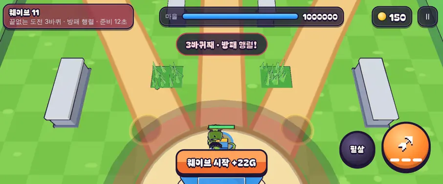

# 52회차: PvE 콘텐츠, 끝없는 도전 바퀴 변주

| 항목 | 값 |
| --- | --- |
| 시각 | 2026-11-12 02:45 ~ 02:51 KST (예약 회차) |
| 기준 | `e829abb` |
| 레인 | PvE 콘텐츠 (51회차 다음 후보) |
| 상태 | **완료** |
| 다음 레인 | 전투 손맛 |

## 문제

끝없는 도전은 바퀴가 바뀌어도 같은 다섯 웨이브의 숫자(체력·수·피해)만 커진다. 바퀴 전환 알림(47회차)은 위험이 커진다는 것만 알리고, 새로 판단할 거리는 주지 않는다.

## 범위

- **바퀴 변주**: 2바퀴부터 바퀴마다 변주 하나를 붙이고, 셋을 차례로 돈다. 변주는 그 바퀴에만 적용하고 쌓이지 않는다. 난이도 곱(46회차)은 그대로 쌓인다.
  1. **빠른 걸음**(2·5·8…바퀴): 모든 적 이동 속도 +20%. 탑 앞을 빨리 지나가므로 냉기탑과 길목 막기가 중요해진다.
  2. **방패 행렬**(3·6·9…바퀴): 방패병 수 ×2. 궁수 정면 화살이 막히므로 영웅 선택과 화염탑이 중요해진다.
  3. **쌍둥이 보스**(4·7·10…바퀴): 보스 웨이브에 보스가 둘 나온다. 둘 다 부르짖는다.
- **알림**: 바퀴 전환 알림에 변주 이름을 넣는다(‘3바퀴째 · 방패 행렬!’). 웨이브 아래 줄에도 변주 이름을 보여 준다.
- 스테이지 전투는 바뀌지 않는다(변주 없음).

## 가설

변주로 바퀴마다 대응이 달라진다. 다 키운 마을의 봇 기록(9~12웨이브, 46회차)은 2바퀴의 빠른 걸음 때문에 조금 줄 수 있다.

## 수용 기준

- [x] 규칙 테스트: 바퀴별 변주 순서, 빠른 걸음 이동 +20%, 방패 행렬 방패병 수 ×2, 쌍둥이 보스 2마리, 스테이지 전투는 변주 없음
- [x] 봇 기준 끝없는 도전 기록 전후(세 영웅, 다 키운 마을)
- [x] 바퀴 전환 알림·아래 줄 스크린샷 직접 확인
- [x] `test:rush`, `tsc`, `build`, `smoke:rush` 통과

## 바꾼 것

- **`sim.ts`**
  - `Difficulty.twist`, `LAP_TWISTS`, `TWIST`(빠른 걸음 ×1.2, 방패 ×2, 보스 2), `twistForLap(lap)`을 더했다.
  - 새 바퀴가 시작될 때 난이도와 함께 그 바퀴의 변주를 정하고, `lap` 이벤트에 싣는다.
  - `groupCount`가 방패 행렬(방패병 ×2)과 쌍둥이 보스(보스 2)를 반영한다. 둘째 보스는 1.5초 뒤 나온다(혼자 나오는 무리가 늘 때의 기존 간격 규칙).
  - 적 이동은 빠른 걸음이면 ×1.2다.
- **`main.ts`**
  - 바퀴 전환 알림이 변주 이름을 말한다(‘3바퀴째 · 방패 행렬!’).
  - 웨이브 아래 줄에 변주 이름이 붙는다(‘끝없는 도전 3바퀴 · 방패 행렬 · 준비 12초’).
- **부분 글꼴**: 334자, 53.0 KB.
- **테스트 1개 추가**(63 → 64)
  - 바퀴별 순서(1바퀴 없음, 2~7바퀴 swift·shields·twin 반복)를 확인한다.
  - 방패병 수 ×2, 보스 2마리, 빠른 걸음 이동 ×1.2(30틱 걸은 거리 비)를 확인한다.
  - 2바퀴 `lap` 이벤트의 변주가 swift인지, 스테이지 전투는 변주가 없는지 확인한다.

## 결과

**봇 끝없는 도전 기록 (시드 1~4, 막아 낸 웨이브)**

| 마을 | 영웅 | 46회차(변주 없음) | 52회차(변주) |
| --- | --- | --- | --- |
| 다 키움(강화 최대 + Lv10 + 특기 3 + 금고) | 궁수 | 9 9 9 9 | 9 9 9 8 |
| | 브론 | 11 12 11 11 | **9 9 8 9** |
| | 포포 | 9 9 9 9 | 9 **11** 9 9 |
| 강화 최대 | 궁수 | 8 4 3 8 | 8 4 3 8 |
| | 브론 | 9 9 8 9 | 9 8 8 9 |
| | 포포 | 8 9 8 9 | 8 9 8 8 |
| 강화 없음 | 세 영웅 | 1~3 | 1~3 (같음) |

- 2바퀴의 **빠른 걸음**이 근접 영웅 브론에게 가장 크게 작용했다. 다 키운 브론이 2바퀴 안(9웨이브 전후)에서 끝났다. 적이 영웅을 지나쳐 마을로 빨리 가기 때문이다.
- 포포는 한 시드에서 11까지 갔다. 범위 늦춤이 빠른 걸음을 상쇄한다. 변주에 따라 유리한 영웅이 달라진다는 뜻이다.
- 그래서 51회차의 10웨이브 구간은 다 키운 마을의 봇에게도 ‘조금 더’가 아니라 손 조준이 필요한 목표가 됐다. 사람 기준은 확인하지 않았다.

- 3바퀴로 바로 건너뛰어 찍었다. 그래서 그 장면의 체력 배율(2.835)은 한 바퀴분이다. 바퀴마다 쌓이는 것은 47회차 테스트가 확인한다.

## 검증

- `npm run test:rush`: 64개 통과.
- `npx tsc --noEmit`, `npm run build`: 통과.
- `npm run smoke:rush`: 31/31 통과.

## 다음

- **다음 레인: 전투 손맛.** 후보는 쌍둥이 보스 바퀴의 읽기다. 보스 둘이 동시에 부르짖으면 말풍선(35회차)과 경고가 겹칠 수 있다. 또는 빠른 걸음 바퀴에 적 발밑에 속도선 같은 표시를 붙여 변주가 눈에 보이게 한다.
- 백로그 상위 3개
  1. (전투 손맛) 변주가 전투 중 눈에 보이게(빠른 걸음 표시, 쌍둥이 보스 경고 겹침 점검)
  2. (렌더 톤·모델) 보스를 뺀 적 모델 조각 절반(50회차 추천)
  3. (렌더 톤·모델) 데스크톱 마을 표지가 상단 막대에 닿는 것(38회차)
