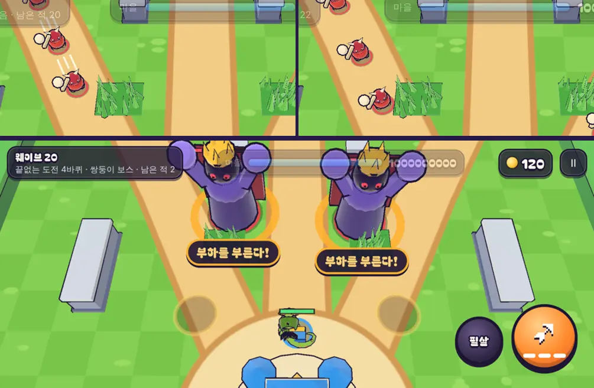

# 53회차: 전투 손맛, 바퀴 변주가 전투 중에 보이게

| 항목 | 값 |
| --- | --- |
| 시각 | 2026-11-12 03:43 ~ 03:49 KST (예약 회차) |
| 기준 | `44313a5` |
| 레인 | 전투 손맛 (52회차 다음 후보) |
| 상태 | **완료** |
| 다음 레인 | 렌더 톤·모델 |

## 문제

52회차의 바퀴 변주는 바퀴가 바뀔 때 알림과 웨이브 아래 줄로만 알 수 있다. 싸우는 동안에는 보이지 않는다.

- **빠른 걸음**: 적이 20% 빨라졌는데 모습은 같다. 플레이어는 ‘왜 이렇게 빨리 뚫리지’만 느낀다.
- **쌍둥이 보스**: 부르짖음 말풍선(35회차)은 한 번에 하나만 다룬다(`callout` 하나). 두 보스가 비슷한 때에 포효하면 둘째 말풍선이 첫째를 지운다.

## 범위

- **빠른 걸음 표시**: 빠른 걸음 바퀴에는 보스를 뺀 적의 뒤쪽 발치에 짧은 속도선 두 줄을 그린다. 연한 노랑이고, 바라보는 방향을 따라 돈다.
  - 별도 인스턴스 배치 하나라 드로콜은 그 바퀴에만 +1이다.
  - 파티클은 쓰지 않는다. 파티클은 360개가 넘으면 오래된 것부터 버리므로 전투 효과를 밀어낼 수 있다.
- **말풍선 여럿**: 포효하는 보스마다 말풍선 하나씩 붙인다(보스 id별). 각 보스의 포효가 끝나면 그 보스의 말풍선만 사라진다.
- 규칙은 바꾸지 않는다.

## 가설

빠른 걸음 바퀴에서 적 무리가 ‘달리는’ 것으로 읽힌다. 쌍둥이 보스가 겹쳐 포효해도 경고가 둘 다 남는다.

## 수용 기준

- [x] 빠른 걸음 바퀴 전투 스크린샷: 적 뒤 속도선이 보이고, 다른 바퀴에는 없음
- [x] 두 보스가 함께 포효할 때 말풍선 2개(스크린샷과 DOM 수 확인)
- [x] 드로콜 변화: 빠른 걸음 바퀴만 +1
- [x] `test:rush`, `tsc`, `build`, `smoke:rush` 통과

## 바꾼 것

- **`render.ts`**
  - 속도선 형상(`geo.streak`)을 더했다. 적 뒤쪽 바닥 근처에 연한 흰색 막대 셋(길이 1.6·1.2·1.6, 굵기 0.14, 반지름 1 기준)이다.
  - 인스턴스 배치 `streak`(한도 160)을 더했다.
  - 빠른 걸음 바퀴에는 보스를 뺀 적이 내려찍기 준비 중이 아닐 때 속도선을 그린다. 크기는 `max(0.6, 반지름)`이다.
  - 처음 크기(얇은 두 줄, 반지름에 맞춤)는 작은 적에서 머리 위 점처럼만 보였다. 그래서 키우고 바닥 쪽으로 내렸다.
- **`main.ts`**
  - 말풍선을 보스 id별 `Map`으로 바꿨다.
  - `roar` 이벤트 자리에서 가장 가까운, 포효 중인 보스에 말풍선을 단다. 그 보스가 화면 밖이면 예전처럼 위쪽 알림 띠다.
  - 각 보스의 포효가 끝나거나 쓰러지면 그 말풍선만 사라진다.
- 규칙 변경 없음.

## 결과 (휴대폰 가로, 높음 품질)

- 빠른 걸음 바퀴에서 적 무리 뒤에 흰 속도선이 보인다. 변주를 끄면 사라진다.
- 드로콜은 같은 장면에서 48 → 49(+1)이다. 빠른 걸음 바퀴에만 해당한다.
- 쌍둥이 보스 바퀴에서 두 보스를 함께 절반으로 깎자, 말풍선 2개(DOM 수 2)가 각 보스 아래에 섰다. 웨이브 아래 줄은 ‘끝없는 도전 4바퀴 · 쌍둥이 보스’다.
- 첫 측정은 자동 품질이 낮음으로 떨어져(소프트웨어 렌더링) 속도선이 더 작게 보였다. 그래서 높음 품질로 다시 찍었다.

## 검증

- `npm run test:rush`: 64개 통과(규칙 변경 없음).
- `npx tsc --noEmit`, `npm run build`: 통과.
- `npm run smoke:rush`: 31/31 통과.

## 다음

- **다음 레인: 렌더 톤·모델.** 50회차 추천을 적용한다. 보스를 뺀 적 모델의 둥근 조각을 절반으로 줄인다. 모델 시트 화소와 실루엣, 6바퀴 장면의 삼각형을 확인한다.
- 백로그 상위 3개
  1. (렌더 톤·모델) 보스를 뺀 적 모델 조각 절반(50회차 추천)
  2. (렌더 톤·모델) 데스크톱 마을 표지가 상단 막대에 닿는 것(38회차)
  3. (킹덤 메타) 마을 화면에서 끝없는 도전 최고 기록·다음 목표를 더 잘 보이게(예: 성 옆 기록 깃발)
