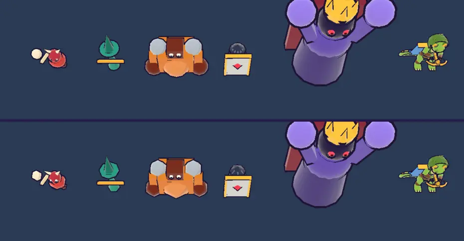

# 54회차: 렌더 톤·모델, 보스를 뺀 적 모델 조각 절반

| 항목 | 값 |
| --- | --- |
| 시각 | 2026-11-12 04:42 ~ 04:47 KST (예약 회차) |
| 기준 | `45a70a7` |
| 레인 | 렌더 톤·모델 (53회차 다음 후보, 50회차 추천 적용) |
| 상태 | **완료** |
| 다음 레인 | 성능·모바일 |

## 문제

50회차 측정에서 적 모델의 둥근 부품(구·원뿔·원기둥) 조각을 절반으로 하면, 적 한 마리 삼각형이 52~64% 준다. 끝없는 도전 6바퀴 장면도 13.8만에서 7.8만으로 준다. 작은 적은 위에서 보면 차이가 거의 없다. 보스는 팔이 각져 보인다. 추천은 ‘보스를 뺀 네 종류는 늘 절반’이었다.

## 범위

- `enemyKit`이 보스가 아닌 적(돌격병·투척병·거한·방패병)을 구울 때 둥근 부품의 조각을 절반으로 줄인다(구 최소 6×4, 원뿔·원기둥 최소 6).
- 보스는 그대로다.
- 규칙과 다른 모델(영웅·탑·마을)은 바꾸지 않는다.

## 가설

50회차 시험과 같은 숫자가 나온다(네 종류 −52~64%, 6바퀴 장면 약 −40%). 11회차 실루엣 기준(적끼리 겹침 IoU 최대 0.25 아래, 주색 hue 분리)은 그대로 유지된다.

## 수용 기준

- [x] 종류별 삼각형 전후(보스 그대로), 6바퀴 장면 삼각형 전후
- [x] 모델 시트 전후 스크린샷 직접 확인, 실루엣 지표(외곽 상자·주색)가 크게 바뀌지 않음
- [x] `test:rush`, `tsc`, `build`, `smoke:rush` 통과

## 바꾼 것 (`render.ts`만)

- `fewerSegments(geo)`: 구·원뿔·원기둥이면 같은 크기에 둥근 조각만 절반인 형상을 돌려준다. 구는 최소 가로 6·세로 4, 원뿔·원기둥은 최소 6이다. 다른 형상은 그대로다.
- `enemyKit`이 보스가 아니면 부품마다 `fewerSegments`를 거쳐 굽는다. 보스는 그대로다.
- 디버그 정보에 `enemyTris`(종류별 적 본체 삼각형)를 더했다. 측정용이다.

## 결과 (휴대폰 가로, 높음 품질)

**종류별 적 본체 삼각형**

| 종류 | 전 | 후 |
| --- | ---: | ---: |
| 돌격병 | 1,032 | 384 (−63%) |
| 투척병 | 640 | 296 (−54%) |
| 거한 | 1,080 | 384 (−64%) |
| 방패병 | 596 | 284 (−52%) |
| 보스 | 1,404 | 1,404 (그대로) |

**장면 삼각형**

| 장면 | 전 | 후 |
| --- | ---: | ---: |
| 모델 시트 | 25,184 | 21,184 (−16%, 보스·영웅은 그대로) |
| 끝없는 도전 6바퀴, 적 78마리 | 138,394 | **79,798 (−42%)** |

**실루엣 지표 (11회차 도구, 모델 시트)**

| 지표 | 전 | 후 |
| --- | --- | --- |
| 주색 hue (돌격병·투척병·거한·방패병·보스) | 349·165·25·41·256 | 같음 |
| 주색 최소 간격 | 16 | 16 |
| 외곽 상자 | 돌격병 124×68 / 투척병 96×126 / 거한 214×142 / 방패병 98×116 | 120×68 / 96×122 / 210×140 / 98×114 |
| 실루엣 겹침 IoU(쌍별) | 0.11~0.35 | 0.10~0.35 (차이 0.01 이하) |

- 50회차 시험과 같은 숫자가 나왔다. 실루엣 지표는 사실상 그대로다.
- 둥근 가장자리가 조금 각질 뿐이고, 크기·색·겹침은 바뀌지 않았다. 외곽 상자는 최대 4화소 줄었다.
- 보스는 원래대로 둥글다(아래 그림).

## 검증

- `npm run test:rush`: 64개 통과(규칙 변경 없음).
- `npx tsc --noEmit`, `npm run build`: 통과.
- `npm run smoke:rush`: 31/31 통과.
- 모델 시트 전후를 직접 열어 확인했다.

## 다음

- **다음 레인: 성능·모바일.** 후보는 영웅·탑·마을 쪽 삼각형 점검이다. 적을 줄이자 6바퀴 장면 약 8만 중 적이 아닌 몫(바닥, 탑, 영웅 GLB, 장식)이 커졌다. 그중 큰 덩어리를 찾아 같은 방식(조각 줄이기)이 통하는지 잰다.
- 백로그 상위 3개
  1. (성능·모바일) 적 밖의 삼각형 점검(탑·장식·영웅)
  2. (렌더 톤·모델) 데스크톱 마을 표지가 상단 막대에 닿는 것(38회차)
  3. (킹덤 메타) 마을 화면에 끝없는 도전 최고 기록·다음 목표 표시
