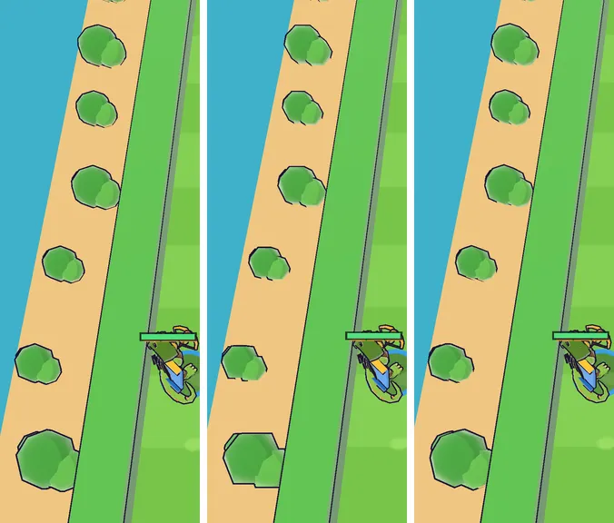

# 55회차: 성능·모바일, 적 밖의 삼각형 점검

| 항목 | 값 |
| --- | --- |
| 시각 | 2026-11-12 05:42 ~ 05:58 KST (예약 회차) |
| 기준 | `4f829f3` |
| 레인 | 성능·모바일 (54회차 다음 후보) |
| 상태 | 완료 |
| 다음 레인 | 엔진 스파이크 |

## 문제

54회차에서 적 모델을 줄여 6바퀴 장면이 13.8만에서 8.0만 삼각형이 됐다. 이제 적이 아닌 몫(바닥·섬 가장자리·장식, 탑, 영웅 GLB, 이펙트)이 상대적으로 커졌다. 어디가 큰지 잰 적이 없다.

## 범위

- **측정**: 작업 트리에서만 장면 객체를 열어 볼 수 있게 하고(되돌림), 한 프레임의 삼각형을 무리별로 나눈다. 무리는 적 배치, 탄·동전, 파티클, 영웅, 탑, 그 밖의 고정 장면이다. 고정 장면 안에서 삼각형이 큰 메시 상위 10개도 뽑는다.
  - 장면은 스테이지 전투(시드 3, 탑 몇 개)와 6바퀴 장면이다. 휴대폰 가로, 높음 품질이다.
- **줄이기(측정 결과 한 무리가 크게 차지할 때만)**: 54회차와 같은 방식(둥근 조각 줄이기)으로 그 무리를 줄이고 전후를 잰다. 화면 차이는 스크린샷으로 확인한다.

## 가설

고정 장면(섬 가장자리 장식·풀숲·벽)과 영웅 GLB가 큰 몫이다. 고정 장면은 한 번 구워 그리므로 드로콜이 아니라 삼각형으로만 무겁다.

## 수용 기준

- [x] 두 장면의 무리별 삼각형 표와 상위 메시 목록
- [x] 줄였다면 전후 삼각형과 스크린샷 확인
- [x] `test:rush`, `tsc`, `build`, `smoke:rush` 통과

## 결과

가설이 맞았다. 고정 장면과 영웅이 비슷하게 크다. 고정 장면의 거의 4분의 3이 **섬 가장자리 장식 한 덩어리**(6,948 + 외곽선 6,948)다. 그 밖의 고정 메시는 하나에 412 이하다. 장식의 대부분은 덤불(구 3개씩)이다. 덤불 구를 8×6에서 **8×4 조각**으로 줄였다.

**무리별 삼각형 (휴대폰 가로, 높음, 보이는 메시 합)**

| 무리 | 스테이지 전투 전 | 후 | 6바퀴(적 78~80) 전 | 후 |
| --- | ---: | ---: | ---: | ---: |
| 적 | 14,976 | 14,976 | 45,668 | 47,196¹ |
| 영웅(GLB + 외곽선) | 15,774 | 15,774 | 15,774 | 15,774 |
| 고정 장면 | 18,228 | **13,236** | 18,100 | **13,212** |
| └ 섬 가장자리 장식(본체 + 외곽선) | 13,896 | **8,904 (−36%)** | 13,896 | **8,904** |
| 탑 | 1,216 | 1,216 | 0 | 0 |
| 파티클 | 4,480 | 4,640¹ | 0 | 0 |
| 탄·동전 | 848 | 848 | 1,080 | 216¹ |
| 렌더러 집계(`info().triangles`) | 53,750 | **48,918** | 80,126 | 75,902 |

¹ 같은 순간을 잡아도 파티클·적 수·탄이 조금씩 다르다. 바뀐 몫은 고정 장면뿐이다. 무리 합과 렌더러 집계 차이는 화면 밖에서 잘린 작은 메시다.

- 고정 장면 −4,992는 스테이지 전투 프레임의 약 9%다(파티클을 뺀 무리 합 51,042 → 46,050, −9.8%).
- **장식은 화면에 안 보일 때도 그려진다.** 휴대폰 가로 기본 시점에서는 섬 가장자리가 화면 밖이다. 하지만 네 변을 한 메시로 구워 경계 구가 경기장 전체를 덮는다. 그래서 잘리지 않는다. 영웅이 가장자리로 가면 보인다(아래 그림).
- 이제 영웅이 가장 큰 단일 몫이다(전투 프레임의 약 32%). GLB 본체와 같은 크기의 외곽선 껍질이 반이다.

**조각 수 선택**

| 덤불 구 조각 | 구 1개 | 장식 본체 | 모습 |
| --- | ---: | ---: | --- |
| 8×6 (전) | 80 | 6,948 | 둥긂 |
| 6×4 (54회차 방식) | 36 | 3,516 | **육각형으로 보임**: 위가 납작한 보석 모양 |
| **8×4 (채택)** | 48 | 4,452 | 8×6과 거의 같음 |

54회차 방식(가로·세로 절반)은 덤불에서 통하지 않았다. 카메라가 위에서 가파르게 내려다봐서 덤불 윤곽은 가로 조각 수(적도 둘레)로 정해진다. 가로 8개를 두고 세로 고리만 줄였다.

## 검증

- `npm run test:rush`: 64개 통과. 첫 실행에서 글꼴 부분집합 시험이 주석의 ‘×’ 문자 때문에 실패했다. 주석을 ‘x’로 바꿨다.
- `npx tsc --noEmit`, `npm run build`: 통과.
- `npm run smoke:rush`: 31/31 통과.
- 측정용 `window.__view` 고리는 작업 트리에서만 썼고 지웠다.
- 삼각형 수만 적는다. 컨테이너는 소프트웨어 렌더라 기기 성능 주장은 하지 않는다.

## 다음

- **다음 레인: 엔진 스파이크.** 후보는 영웅 외곽선 껍질용 단순화 사본 시험이다(glTF-Transform `simplify`). 영웅이 전투 프레임의 약 3분의 1이고 그 반이 외곽선이다. 외곽선만 단순한 사본으로 그리면 얼마나 줄고 윤곽이 얼마나 바뀌는지 잰다.
- 백로그 상위 3개
  1. (엔진 스파이크) 영웅 외곽선 껍질 단순화 시험
  2. (킹덤 메타) 마을 화면에 끝없는 도전 최고 기록·다음 목표 표시
  3. (렌더 톤·모델) 데스크톱 마을 표지가 상단 막대에 닿는 것(38회차)
- 남은 후보(성능·모바일): 섬 가장자리 장식을 네 변으로 나눠 화면 밖 변은 잘리게 하기. 드로콜 +6과 휴대폰 기본 시점 삼각형 최대 약 −8,900을 맞바꾼다.
