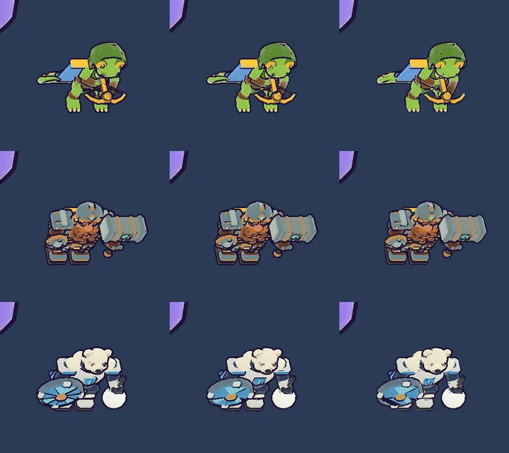

# 56회차: 엔진 스파이크, 영웅 외곽선 껍질 단순화 시험(측정만)

| 항목 | 값 |
| --- | --- |
| 시각 | 2026-11-12 06:42 ~ 06:52 KST (예약 회차) |
| 기준 | `cc3adc2` |
| 레인 | 엔진 스파이크 (55회차 다음 후보) |
| 상태 | **완료** (측정만, 저장소 변경은 문서뿐) |
| 다음 레인 | 킹덤 메타 |

## 문제

55회차 측정에서 영웅이 스테이지 전투 프레임 삼각형의 약 32%(15,774)였다. 그 반은 외곽선 껍질이다. 껍질은 본체 메시를 복제해 법선을 평균한 것(`hullGeometry`)이라 본체와 삼각형 수가 같다. 껍질은 검은 뒷면 테두리로만 보이므로 본체만큼 세밀할 필요가 없을 수 있다.

## 범위

- **측정만 한다.** 작업 트리에서만 시험 손잡이(`?hullSimplify=<비율>`)를 넣는다. 영웅 GLB를 구울 때 껍질만 메시 단순화기로 줄인다. 단순화기는 three.js에 이미 들어 있는 `examples/jsm/libs/meshopt_simplifier.module.js`이고, `package.json`은 바꾸지 않는다. 측정 뒤에는 되돌린다.
- 잴 것
  - 영웅 셋(궁수·브론·포포)의 본체·껍질 삼각형. 비율 1(지금), 0.5, 0.25
  - 모델 시트(`?sheet=1`, 영웅별) 전후 스크린샷과 화소 차이. 스크린샷은 직접 열어 확인한다.
  - 단순화에 걸린 시간(컨테이너 기준 상대값)과 번들 증가(gzip)
- 결과로 채택 여부와 방식(실행 중 단순화 대 미리 만든 껍질 사본)을 추천한다.

## 가설

껍질을 절반으로 줄여도 테두리 두께 차이는 1~2화소 안이다. 영웅 삼각형은 15,774에서 약 12,000 아래로 준다. 단순화기 번들 비용은 gzip 약 15 KB다. 미리 만든 사본은 번들 비용이 없지만 GLB 전송량이 는다.

## 수용 기준

- [x] 영웅별·비율별 삼각형 표
- [x] 모델 시트 전후 스크린샷 직접 확인, 화소 차이
- [x] 저장소 변경은 문서뿐. `test:rush`, `tsc`, `build`, `smoke:rush` 통과
- [x] 채택 추천과 비용

## 결과

가설이 맞았다. 껍질을 절반으로 줄여도 전투 크기에서는 차이가 보이지 않는다. 4분의 1부터는 가는 부품의 테두리가 빠진다.

**영웅별 삼각형 (본체는 그대로, 껍질만 줄임)**

| 영웅 | 본체 | 껍질 1(지금) | 껍질 0.5 | 껍질 0.25 | 단순화 추가 시간(0.5)¹ |
| --- | ---: | ---: | ---: | ---: | ---: |
| 궁수 | 7,804 | 7,804 | 3,900 | 1,948 | +18 ms |
| 브론 | 23,190 | 23,190 | 11,594 | 5,794 | +46 ms |
| 포포 | 8,564 | 8,564 | 4,282 | 2,138 | +18 ms |

¹ 영웅 모델을 받은 뒤 한 번만 든다. 소프트웨어 렌더 컨테이너의 상대값이라 기기 시간은 아니다.

- 단순화기는 목표 비율까지 그대로 줄였다(오차 상한 5%에 걸리지 않음).
- **스테이지 전투 프레임(궁수, 휴대폰 가로, 높음)**: 49,358 → **45,774 (−7.3%)**. 드로콜은 68로 같다.
- **브론이 가장 무겁다.** 본체만 23,190이라 껍질까지 4.6만이다. 브론을 고르면 전투 프레임이 궁수보다 약 3만 많다. 껍질 0.5로 −11,596이다.
- 모델 시트 화소 차이(밝기 차 40 넘는 화소, 2배 화면): 0.5에서 궁수 491, 브론 452, 포포 825이고 0.25에서 1,005, 926, 1,633이다.
- 직접 확인한 것
  - 0.5: 테두리 두께와 윤곽이 같다. 얼굴 안의 잔 검은 점이 조금 줄 뿐이다.
  - 0.25: 궁수 석궁 줄과 팔 안쪽 선, 포포 눈 주변 선이 빠진다.
  - 전투 화면 크기(휴대폰 가로)에서는 1과 0.5를 구별할 수 없다.

**비용**

| 항목 | 값 |
| --- | --- |
| 단순화기 모듈 | `three/addons/libs/meshopt_simplifier.module.js` 55,177 B, gzip 15,111 B(WASM 포함). three.js에 이미 있어 `package.json` 변경 없음 |
| 첫 화면 | 동적 import로 따로 받으면 0. 영웅 GLB를 받을 때 같이 받는다(첫 화면 약 342 KB 대비, 정적 import면 약 +4.4%) |
| 타입 | three 쪽 사본에 타입 선언이 없다. `tsc`가 TS7016을 낸다. 3줄짜리 선언 파일이 필요하다 |
| 실행 | 구운 메시가 색인 없는 형태라 위치만 남겨 정점을 합친 뒤(`mergeVertices`) 단순화한다. 위치만 쓰므로 색·법선 번짐 걱정은 없다 |

## 추천

- **채택 추천: 영웅 외곽선 껍질 0.5, 실행 중 단순화.** 단순화기는 동적 import로 받는다. 단순화는 마을에서 영웅을 미리 받을 때(42회차) 일어나므로 전투 중 멈칫이 없다. 단순화기를 못 쓰면 지금처럼 전체 껍질로 돌아간다.
- **미리 만든 껍질 사본(glTF-Transform `simplify`)은 비추천.** 껍질은 애니메이션 마디별로 구운 덩어리에서 만든다. 사본을 쓰면 같은 굽기를 한 번 더 해야 하고 GLB 전송량도 는다.
- 0.25는 비추천. 가는 부품의 테두리가 빠져 브롤스타즈풍 굵은 외곽선이 깨진다.
- 다음 후보: 브론 본체 자체가 23,190이다. 색이 정점마다 붙은 본체 단순화(`simplifyWithAttributes`)는 색 번짐을 따로 재야 하는 별도 스파이크다.

## 검증

- 시험 손잡이(`?hullSimplify`)는 작업 트리에서만 썼고 되돌렸다(`git checkout src/rush/render.ts`). 저장소 변경은 문서와 그림뿐이다.
- `npm run test:rush`: 64개 통과.
- `npm run build`(`tsc --noEmit` 포함): 통과.
- `npm run smoke:rush`: 31/31 통과.

## 다음

- **다음 레인: 킹덤 메타.** 마을 화면에 끝없는 도전 최고 기록과 다음 목표 구간을 보인다.
- 백로그 상위 3개
  1. (킹덤 메타) 마을 화면에 끝없는 도전 최고 기록·다음 목표 표시
  2. (렌더 톤·모델) 데스크톱 마을 표지가 상단 막대에 닿는 것(38회차)
  3. (성능·모바일) 영웅 외곽선 껍질 0.5 채택(이번 회차 추천)
