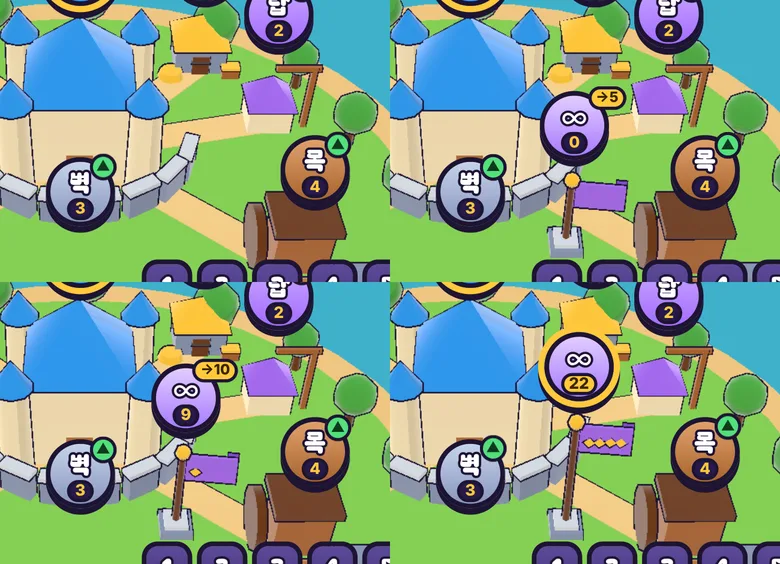
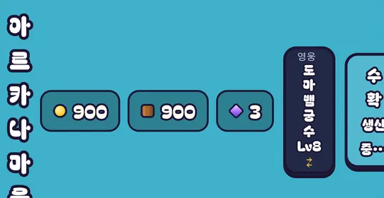

# 57회차: 킹덤 메타, 마을의 끝없는 도전 기록 깃발

| 항목 | 값 |
| --- | --- |
| 시각 | 2026-11-12 07:44 ~ 07:55 KST (예약 회차) |
| 기준 | `07882dd` |
| 레인 | 킹덤 메타 (56회차 다음 후보) |
| 상태 | 완료 |
| 다음 레인 | PvE 콘텐츠 (먼저 휴대폰 세로 상단 막대 버그) |

## 문제

끝없는 도전 최고 기록은 마을 아래 스테이지 줄의 ∞ 칩 글자(‘최고 9’)와, ∞를 골랐을 때 출전 단추의 목표 배지로만 보인다. 마을(3D 섬)에는 기록이 남지 않는다. 킹샷식 성장 느낌은 ‘판에서 한 일이 마을에 보이는 것’인데, 끝없는 도전은 그 고리 밖에 있다(53회차 제안: 성 옆 기록 깃발).

## 범위

- **3D 기록 깃발**: 섬의 빈자리에 깃대와 깃발을 둔다. 끝없는 도전이 열리기 전(스테이지 10 별 없음)에는 없다. 지난 기록 구간 수(51회차 `milestonesPassed`, 0~4)에 따라 깃대가 높아지고 금 띠가 늘어난다. 기존 건물처럼 구워 그리고 외곽선을 붙인다.
- **깃발 표지**: 건물 표지와 같은 모양의 표지에 ‘∞ 최고 기록’과 다음 목표(‘→10’)를 적는다. 누르면 스테이지 줄에서 ∞가 골라진다.
- 바꾸는 파일: `src/rush/townScene.ts`, `src/rush/town.ts`, `src/rush/rush.css`, 필요하면 `tools/rush-smoke.*`. 규칙(`kingdom.ts`)은 바꾸지 않는다.
- 표지의 ‘다 이룬 뒤’ 처리: 목표 표시 없이 기록만 남긴다.

## 가설

깃발이 마을에 있으면 기록이 마을 성장의 한 부분으로 읽힌다. 섬 앞쪽은 휴대폰에서 아래 HUD에 가리므로(20회차) 자리는 성 옆 중간 높이가 맞다. 표지 하나가 늘어도 휴대폰 표지 면적은 17회차 기준(약 4%) 근처에 머문다.

## 수용 기준

- [x] 잠김일 때 깃발·표지 없음, 열리면 보임. 기록 구간마다 깃발 모습이 다름(스크린샷)
- [x] 표지를 누르면 ∞가 골라지고 출전 단추가 목표 배지를 보임
- [x] 휴대폰 가로·세로, 데스크톱 스크린샷에서 깃발과 표지가 건물·다른 표지·HUD와 겹치지 않음
- [x] `test:rush`, `tsc`, `build`, `smoke:rush` 통과

## 결과

**마을 깃발**

- 성 앞 오른쪽 잔디밭에 둔다. 자리는 (2.7, 1.5)이고, 성–목재소 길과 성벽 호 사이다.
- 깃발 모습
  - 받침돌, 깃대, 금 구슬 꼭지, 보라 깃발(∞ 칩과 같은 색)로 되어 있다.
  - 기록 구간(5·10·15·20웨이브)을 하나 넘을 때마다 깃대가 0.35 높아지고 깃발에 금 별이 하나 붙는다.
  - 끝없는 도전이 잠겨 있으면 깃발도 표지도 없다.
- 깃발 표지(건물 표지와 같은 원형)
  - 가운데 ∞, 아래 알약에 최고 기록, 오른쪽 위 금 알약에 다음 목표(‘→10’)를 보인다. 마지막 구간까지 넘으면 금 알약은 사라진다.
  - 누르면 ∞가 골라지고 출전 단추에 목표 배지(‘목표 10 +6’)가 뜬다. 고른 동안 표지에 금 테가 생긴다(다른 표지와 같은 규칙).
- 처음 자리 (3.4, 0.3)은 성–목재소 길 위였다. 다음 자리 (3.2, 2.0)은 휴대폰 가로에서 받침이 스테이지 줄에 닿고 깃발이 목재소에 붙었다. 그래서 두 번 옮겼다.

**겹침 점검 (표지 상자, CSS 화소, 목표 알약 포함)**

| 화면 | 깃발 표지 | 다른 표지와 겹침 |
| --- | --- | --- |
| 휴대폰 가로 863×360 | 477,147 – 521,191 | 없음 |
| 휴대폰 세로 412×839 | 256,348 – 300,392 | 없음 |
| 데스크톱 1440×900 | 903,347 – 947,391 | 없음 |

- 스크린샷을 직접 확인한 결과
  - 휴대폰 가로: 받침이 스테이지 줄 위에 있고 깃발은 목재소와 떨어져 있다.
  - 세로·데스크톱: 건물과 HUD에 가리지 않는다.
  - 표지는 성 오른쪽 탑 끝에 조금 걸친다. 다른 건물 표지도 건물 위에 뜨므로 같은 규칙이다.

**찾은 버그(이번 범위 밖, 고치지 않음)**: 휴대폰 세로(412폭) 마을 상단 막대가 좁아서 넘친다. 제목 ‘아르카나 마을’, 영웅 단추, 수확 단추가 한 글자씩 세로로 접히고, 수확 단추는 화면 밖으로 잘린다. 이번 변경 전 스크린샷에도 똑같이 있다. 규약상 버그가 레인 순서보다 먼저이므로 다음 회차에 먼저 고친다.

## 검증

- `npm run test:rush`: 65개 통과. 새 시험은 깃발 단계다(잠김 −1, 0·4웨이브 0, 5웨이브 1, 14웨이브 2, 40웨이브 4).
- `npx tsc --noEmit`, `npm run build`: 통과.
- `npm run smoke:rush`: 32/32 통과. 새 검사는 ‘새 왕국에서 깃발 표지 숨김’이다.
- 표지의 새 글자(∞, →)는 이미 글꼴 부분집합에 있다(글꼴 시험 통과).

## 다음

- **다음 회차는 먼저 휴대폰 세로 상단 막대 버그**(규약: 버그가 레인 순서보다 먼저)다. 끝나면 레인 순서대로 **PvE 콘텐츠**로 간다.
- 백로그 상위 3개
  1. (버그, 성능·모바일) 휴대폰 세로 마을 상단 막대 넘침
  2. (렌더 톤·모델) 데스크톱 마을 표지가 상단 막대에 닿는 것(38회차)
  3. (성능·모바일) 영웅 외곽선 껍질 0.5 채택(56회차 추천)
