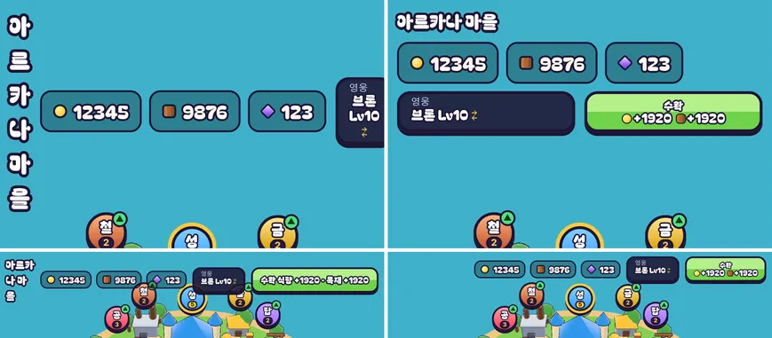

# 58회차: 성능·모바일(버그), 마을 상단 막대 넘침

| 항목 | 값 |
| --- | --- |
| 시각 | 2026-11-12 08:41 ~ 08:50 KST (예약 회차) |
| 기준 | `ffdc462` |
| 레인 | 버그 먼저(57회차 발견). 레인 순서상 다음은 PvE 콘텐츠 |
| 상태 | 완료 |
| 다음 레인 | PvE 콘텐츠 |

## 문제

57회차에서 휴대폰 세로 마을 상단 막대가 넘치는 것을 찾았다. 여섯 화면을 재 보니 범위가 더 넓다(왕국 자원 5자리, 브론 Lv10, 수확 대기 상태).

| 화면 | 막대 높이 | 접힌 글자 | 잘리거나 넘친 단추 |
| --- | ---: | --- | --- |
| 세로 360×780 | 222 | 제목, 영웅 이름, 수확량 | 영웅, 수확 |
| 세로 412×839 | 222 | 제목, 영웅 이름, 수확량 | 영웅, 수확 |
| 태블릿 세로 768×1024 | 74 | 제목 | 없음 |
| 작은 가로 667×375 | 81 | 제목 | 없음(막대 아래 끝 89가 가장 위 표지 53을 덮음) |
| 가로 863×360 | 44 | 없음 | 없음 |
| 데스크톱 1440×900 | 46 | 없음 | 없음 |

원인
- 막대는 한 줄 flex인데 줄바꿈 규칙이 없다. 그래서 자리가 모자라면 글자가 한 글자씩 접힌다.
- 수확 단추 글자(‘식량 +60 · 목재 +60 (창고 가득)’)가 길다.

## 범위

- 막대의 글자는 접히지 않게 한다(`white-space: nowrap`).
- **수확 단추를 영웅 단추처럼 두 줄 단추로** 바꾼다. 위에는 작게 ‘수확’, 아래에는 자원 아이콘과 수량을 둔다(‘가득’은 짧게). 화면 읽기 이름에는 전체 문장을 둔다.
- **세로 화면**: 막대가 여러 줄로 감긴다. 제목·자원이 첫 줄, 영웅·수확이 다음 줄이다(좁으면 자원이 둘째 줄로 가서 세 줄).
- 보상 안내(`#town-reward`)는 막대 바로 아래에 붙인다. 막대 안으로 옮기고 `top: 100%`로 둔다.
- **좁은 가로(폭 760 이하)**: 제목을 숨긴다. 막대를 한 줄로 유지해 표지를 덮지 않는다.
- 바꾸는 파일: `rush.html`, `src/rush/rush.css`, `src/rush/town.ts`.

## 가설

수확 단추를 줄이고 세로에서 감기게 하면 여섯 화면 모두 접힘·잘림이 0이 된다. 세로 막대는 2~3줄(약 100~150px)로, 가장 위 표지(세로 약 210~230px)보다 위에 있다. 가로 863과 데스크톱은 높이가 그대로다.

## 수용 기준

- [x] 여섯 화면에서 접힌 글자 0, 잘리거나 넘친 단추 0(측정 스크립트)
- [x] 막대 아래 끝이 가장 위 표지 위쪽에 있다(가로 863은 전부터 3px 겹침, 아래 참고). 가로 863·데스크톱은 전과 같은 높이
- [x] 보상 안내가 막대와 겹치지 않음(세로·가로 스크린샷)
- [x] `test:rush`, `tsc`, `build`, `smoke:rush` 통과

## 결과

가설이 맞았다. 여섯 화면 모두 접힌 글자와 잘린 단추가 0이 됐다.

| 화면 | 막대 아래 끝 전 → 후 | 접힘·잘림 전 → 후 | 가장 위 표지 |
| --- | ---: | --- | ---: |
| 세로 360×780 | 230 → **142** | 글자 3, 단추 2 → 0 | 209 |
| 세로 412×839 | 230 → **142** | 글자 3, 단추 2 → 0 | 228 |
| 태블릿 세로 768×1024 | 82 → 105 | 글자 1 → 0 | 288 |
| 작은 가로 667×375 | 89 → **52** | 글자 1 → 0 | 53 |
| 가로 863×360 | 52 → 52 | 0 → 0 | 49 |
| 데스크톱 1440×900 | 54 → 53 | 0 → 0 | 67 |

- 세로는 자원이 5자리일 때 세 줄(제목 / 자원 / 영웅·수확)이다. 새 왕국(자원 3자리)은 412폭에서 두 줄(제목·자원 / 영웅·수확), 막대 아래 끝 105다.
- 태블릿 세로는 두 줄이라 23px 높아졌지만 표지(288)와는 멀다.
- 작은 가로는 제목을 숨겨 한 줄로 돌아왔다. 막대가 표지를 덮던 36px이 없어졌다.
- 수확 단추는 영웅 단추와 같은 두 줄 모양이 됐다. 위는 ‘수확’, 아래는 아이콘과 수량(‘생산 중…’, 창고가 차면 ‘가득’)이다. 화면 읽기 이름은 ‘수확: 식량 +x, 목재 +y, 창고 가득’ 전체 문장이다.
- 보상·안내 줄은 막대 안으로 옮겼다. 몇 줄이든 막대 8px 아래에 뜬다(세로 412: 막대 105, 안내 113 / 가로 863: 52, 60).
- **남은 것(이번 범위 밖)**: 가로 863에서 가장 위 표지(성, 49)가 막대(52)에 3px 걸친다. 이번 변경 전에도 같았다. 백로그 33번(마을 표지가 상단 막대에 닿음)과 같은 문제라 그 항목으로 넘긴다.
- 스크린샷 직접 확인: 세로 360·412, 태블릿 세로, 작은 가로, 가로 863, 데스크톱. 세로·가로 안내 줄도 확인했다.

## 검증

- `npm run test:rush`: 65개 통과(규칙 변경 없음).
- `npx tsc --noEmit`, `npm run build`: 통과.
- `npm run smoke:rush`: 32/32 통과.

## 다음

- **다음 레인: PvE 콘텐츠.** 백로그에 열린 PvE 항목이 없어 다음 회차에 고른다. 후보는 끝없는 도전 6바퀴 이후 새 변주, 또는 스테이지 11~ 확장이다. 범위를 적을 때 하나만 고른다.
- 백로그 상위 3개
  1. (렌더 톤·모델) 마을 표지가 상단 막대에 닿는 것(가로 863에서 3px, 38회차부터)
  2. (성능·모바일) 영웅 외곽선 껍질 0.5 채택(56회차 추천)
  3. (성능·모바일) 섬 가장자리 장식 네 변 나누기(55회차)
