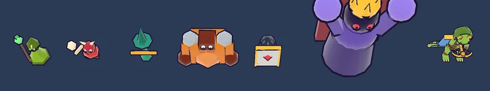

# 59회차: PvE 콘텐츠, 치유 주술사(우선 처치 대상)

| 항목 | 값 |
| --- | --- |
| 시각 | 2026-11-12 09:41 ~ 10:00 KST (예약 회차) |
| 기준 | `e0ac0bd` (main 병합 뒤, PR #106 열림·미병합) |
| 레인 | PvE 콘텐츠 (58회차 다음 레인) |
| 상태 | 부분 완료 (주술사는 끝없는 도전에만. ‘우선 처치’ 가설은 지지되지 않음) |
| 다음 레인 | 전투 손맛 |

## 문제

스테이지 6부터 방패병과 보스 소환이 붙고, 그 뒤 7~10은 수치만 오른다. 적 다섯 종은 모두 ‘가까운 것부터 쏘면 되는’ 적이다. 그래서 후반에 ‘누구를 먼저 잡을지’ 고르는 판단이 없다.

## 범위

- **새 적: 주술사(`shaman`)**. 스테이지 8부터 웨이브 3·4·5에 1~2마리 나온다(끝없는 도전 포함).
  - 체력이 낮고 느리다. 근접 공격은 약하다.
  - 2.5초마다 반경 3m 안의 다친 동료를 회복한다(자기 자신 제외). 회복량은 30이고, 스테이지 체력 배수를 곱한다.
  - 실제로 누군가를 회복했을 때만 초록 고리 이벤트(`heal`)를 낸다.
- 시뮬레이션·데이터(`data.ts`, `sim.ts`), 렌더 모델·고리 효과(`render.ts`), 모델 시트(`main.ts`)를 바꾼다.
- 봇은 가까운 적 대신 사거리 안의 주술사를 먼저 노리는 판을 시험한다. 결과가 좋으면 기본 봇에 넣는다.
- 테스트
  - 회복 범위·대상·자기 제외·이벤트를 확인하는 새 시험을 넣는다.
  - 스테이지 진행 시험(초반은 강화 없이 깸, 10은 큰 왕국 필요)은 그대로 통과해야 한다.

## 가설

주술사는 무리 속 거한·방패병을 계속 살려 둔다. 그래서 가까운 적부터 쏘는 봇은 스테이지 8~10 승률·별이 떨어진다. 주술사를 먼저 잡는 봇은 그 손실을 대부분 되찾는다. 이 차이가 ‘우선 처치’ 판단이 의미 있다는 증거다.

## 수용 기준

- [x] 주술사 시험 통과(범위 안 다친 동료만 회복, 자기 제외, 이벤트)
- [x] 스테이지 8~10 봇 결과: 주술사 없음 / 있음(가까운 적 우선) / 있음(주술사 우선) 표
- [x] 모델 시트에서 다른 적과 실루엣·색 구분(스크린샷 직접 확인)
- [ ] 회복 고리 스크린샷: **못 잡음**(아래 참고). 회복 자체는 실제 끝없는 도전 화면에서 체력 수치로 확인
- [x] `test:rush`, `tsc`, `build`, `smoke:rush` 통과

## 결과

**가설은 지지되지 않았다.** 주술사는 후반을 조금 어렵게 만들 뿐이고, 봇이 주술사를 먼저 쏴도 나아지지 않았다. 그래서 스테이지 8~10에서는 빼고 **끝없는 도전에만** 넣었다.

**스테이지 8~10, 궁수 봇, 시드 8개 (승리 수, 별 합, 판당 회복된 동료 수)**

| 왕국 | 스테이지 | 주술사 없음 | 있음·가까운 적 우선 | 있음·주술사 우선 |
| --- | ---: | --- | --- | --- |
| 다 키움 | 8 | 8/8 ★16 | 8/8 ★16 (회복 11) | 8/8 ★14 (11) |
| 다 키움 | 9 | 8/8 ★13 | 7/8 ★10 (15) | 6/8 ★10 (13) |
| 다 키움 | 10 | 6/8 ★6 | **5/8** ★6 (18) | 6/8 ★6 (18) |

- 강화 없음·중간 왕국은 세 경우 모두 8~10을 0/8로 진다. 주술사와 상관없다.
- 회복이 적다(판당 5~18명). 주술사는 느려서 무리 뒤에 처지는데, 그 주변 동료는 아직 다치지 않았다. 체력도 낮아 탑에 금방 죽는다.
- 주술사 우선 봇은 이득이 없었다. 마을 앞 위협을 두고 뒤쪽 주술사를 쏘는 동안 다른 적이 들어온다(스테이지 8 별 16 → 14).
- 더 센 설정 두 가지도 시험했다
  - 체력 110, 2초마다 반경 3.5에 50: 스테이지 10 가까운 적 우선 3/8, 주술사 우선 5/8
  - 체력 90, 1.6초마다 반경 4에 40: 6/8 대 5/8
  - 어려움은 늘었지만 우선 처치의 이득은 일정하지 않았다(시드 8개로는 잡음 범위).
- 약한 설정으로도 다 키운 왕국의 스테이지 10 승리가 5/8이 된다. 진행 시험의 기준(6/8 이상, 28회차)보다 낮다. 그래서 기준에 맞춰 수치를 깎는 대신 스테이지 8~10에서는 뺐다.

**끝없는 도전에만 넣음**

- 주술사 무리는 `minStage: 11`이다.
- 끝없는 도전은 지금까지 스테이지 10 수치에 `stage: 10`을 달고 있었다. 이제 같은 수치에 `stage: 11`(`ENDLESS_STAGE`)을 단다. `diff.stage`를 읽는 곳은 `minStage` 거르기와 보스 소환 조건뿐이라 다른 규칙은 그대로다.
- 끝없는 도전 봇 기록(웨이브 수, 시드 8개)
  - 다 키운 왕국: 평균 6.8 → 6.3, 판당 회복 20명
  - 강화 없음: 2.4 → 2.3
- 스테이지 1~10과 그 시험은 바뀌지 않는다(66개 통과).

**모델과 화면**

- 노란 연두색 종 모양 옷에 뼈 가면과 초록 눈을 달았다. 몸보다 긴 지팡이 끝에는 초록 구슬(회복 색)이 있다.
- 다른 적과 색(hue 약 82, 가장 가까운 투척병 165)과 윤곽(종 + 옆의 막대 ‘i’)이 다르다.
- 본체 삼각형은 308이다(보스 밖 적처럼 조각을 절반으로 줄인 판).
- 회복할 때는 초록 고리(잉크 띠 포함)가 회복 반경까지 퍼진다.
- 실제 끝없는 도전 화면에 주술사와 다친 거한·방패병을 넣어 확인했다.
  - 화면은 `stage 11`, `endless`였다. 거한 100 → 515, 방패병 30 → 178로 2.5초마다 63씩 회복했고, 주술사 자신은 그대로였다.
  - 다만 고리가 0.55초만 떠서, 찍은 장면들(약 1초 간격)에는 잡히지 않았다. 고리 모습은 아직 눈으로 확인하지 못했다.

## 검증

- `npm run test:rush`: 66개 통과. 새 시험은 주술사 회복이다(범위 안 다친 동료만, 자기 제외, 범위 밖·다치지 않은 동료 제외, 이벤트 1회).
- `npx tsc --noEmit`, `npm run build`: 통과.
- `npm run smoke:rush`: 32/32 통과.

## 다음

- **다음 레인: 전투 손맛.** 후보는 회복 고리를 화면에서 확인하고 읽기 쉽게 다듬는 것이다. 회복된 동료 위 초록 ‘+’ 숫자나 주술사 머리 위 예고 빛 같은 것이다.
- 주술사를 다시 스테이지에 넣으려면 설계가 바뀌어야 한다. 예를 들어 탑 사거리 밖 뒤쪽에 머물며 회복하면, 영웅이 들어가 잡을 이유가 생긴다. 백로그에 적었다.
- 백로그 상위 3개
  1. (전투 손맛) 주술사 회복 고리 화면 확인과 회복 표시
  2. (렌더 톤·모델) 마을 표지가 상단 막대에 닿는 것(가로 863에서 3px)
  3. (성능·모바일) 영웅 외곽선 껍질 0.5 채택(56회차 추천)
