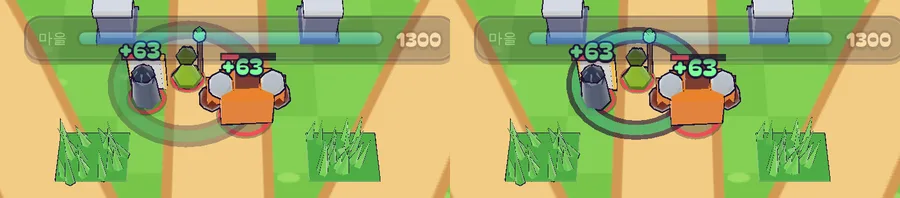

# 60회차: 전투 손맛, 주술사 회복을 눈으로 읽히게

| 항목 | 값 |
| --- | --- |
| 시각 | 2026-11-12 10:42 ~ 10:50 KST (예약 회차) |
| 기준 | `1c08123` (PR #106 열림·미병합) |
| 레인 | 전투 손맛 (59회차 다음 레인) |
| 상태 | 완료 |
| 다음 레인 | 렌더 톤·모델 |

## 문제

59회차의 주술사는 회복할 때 초록 고리만 낸다. 그런데 그 고리를 화면에서 확인한 적이 없다(0.55초만 떠서 스크린샷에 안 잡힘). 회복된 동료 쪽에는 아무 표시가 없다. 그래서 플레이어는 ‘거한 체력이 왜 다시 찼지’를 알 수 없다. 원인(주술사)과 결과(회복된 적)가 화면에서 이어져야 우선 처치 판단도 생긴다.

## 범위

- **회복 숫자**: 회복된 동료마다 그 위에 초록 ‘+63’ 같은 떠오르는 숫자를 띄운다. 피해 숫자(22회차)와 같은 층과 방식이고 색만 초록이다.
  - 시뮬레이션은 회복된 동료마다 `healed` 이벤트(id, 위치, 양)를 낸다. 결과 해시는 바뀌지 않는다(이벤트는 상태가 아님).
- **고리 확인**: 느린 배속(`?speed=0.25`)에서 회복 순간을 잡아 고리와 숫자를 스크린샷으로 확인한다. 휴대폰 가로 크기에서 보이는지 본다. 안 보이면 고리를 더 굵게, 더 오래 띄운다.
- 바꾸는 파일: `sim.ts`(이벤트), `main.ts`(숫자), `rush.css`, 필요하면 `render.ts`.

## 가설

회복 숫자가 붙으면 ‘주술사 고리 → 초록 숫자 → 체력 막대 증가’가 한 화면에서 이어진다. 휴대폰 가로에서 고리와 숫자가 둘 다 보인다.

## 수용 기준

- [x] 회복 순간 스크린샷에 고리와 초록 숫자가 보임(휴대폰 가로, 직접 확인)
- [x] `healed` 이벤트 시험(회복된 동료마다 하나, 양이 실제 회복량과 같음)
- [x] 결과 해시 시험 그대로 통과
- [x] `test:rush`, `tsc`, `build`, `smoke:rush` 통과

## 결과

가설이 맞았다. 휴대폰 가로(863×360)에서 ‘고리 → 초록 숫자 → 체력 막대’가 한 화면에 보인다.

- **회복 숫자**: 회복된 동료마다 초록 ‘+63’이 그 위에 뜬다(스테이지 체력 배수 2.1 × 30). 피해 숫자와 같은 층이고, 합치지 않는 떠오르는 숫자(`pop`)다. 최대 체력에서 멈춘 회복은 실제로 찬 만큼만 표시한다.
- **`healed` 이벤트**: 회복된 동료마다 하나씩 나오며, 양은 실제 회복량이다. 이벤트는 상태가 아니라서 결과 해시 시험은 그대로 통과했다.
- **고리 확인과 조정**
  - 잡는 방법: 4분의 1 배속으로 돌리고, 페이지 안에서 거한 체력이 오르는 순간을 기다렸다가 바로 찍었다. 59회차에는 이걸 못 했다.
  - 처음 화면(투명도 0.55): 잉크 띠가 이겨서 고리가 **회색 얼룩**으로 보였다. 회복으로 읽히지 않았다.
  - 투명도 0.9, 수명 0.55 → 0.7초로 바꿨다. 이제 초록 고리에 잉크 테두리가 보인다.
- 직접 확인한 장면(휴대폰 가로, 2배 화면)
  - 주술사를 가운데로 고리가 퍼진다.
  - 방패병과 거한 위에 ‘+63’이 뜨고, 거한 체력 막대가 100 → 163으로 오른다.
  - 두 번째 맥동도 같다(163 → 226).

## 검증

- `npm run test:rush`: 66개 통과. 주술사 시험을 넓혔다.
  - 거의 찬 동료는 찬 만큼만 회복된다(110 → 120, 이벤트 양 10).
  - `healed` 이벤트가 회복된 동료마다 하나씩 나온다.
- `npx tsc --noEmit`, `npm run build`: 통과.
- `npm run smoke:rush`: 32/32 통과.

## 다음

- **다음 레인: 렌더 톤·모델.** 마을 표지가 상단 막대에 닿는 것(가로 863에서 성 표지 3px)을 고친다.
- 백로그 상위 3개
  1. (렌더 톤·모델) 마을 표지가 상단 막대에 닿는 것(백로그 33)
  2. (성능·모바일) 영웅 외곽선 껍질 0.5 채택(백로그 35)
  3. (성능·모바일) 섬 가장자리 장식 네 변 나누기(백로그 34)
