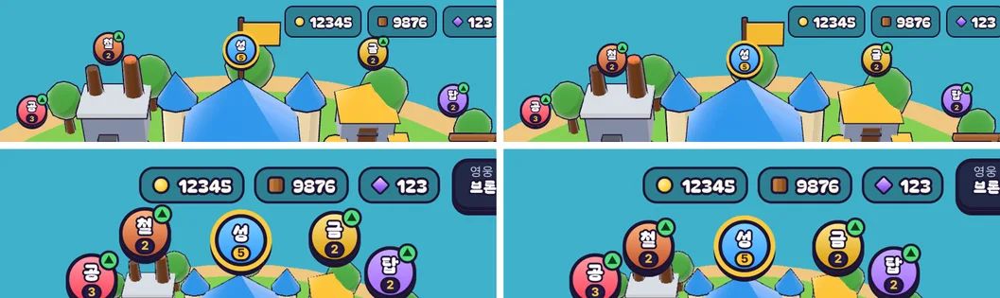

# 61회차: 렌더 톤·모델, 마을 표지가 상단 막대에 닿지 않게

| 항목 | 값 |
| --- | --- |
| 시각 | 2026-11-12 11:42 ~ 11:52 KST (예약 회차) |
| 기준 | `117eb39` (PR #106 열림·미병합) |
| 레인 | 렌더 톤·모델 (60회차 다음 레인, 백로그 33) |
| 상태 | 완료 |
| 다음 레인 | 성능·모바일 |

## 문제

마을 건물 표지는 3D 위치를 화면에 투영해 놓는다. 화면 비율에 따라 가장 위 표지(성·대장간·금고)가 상단 막대(자원·영웅·수확)에 닿거나 밑으로 들어간다. 12개 화면을 쟀다(왕국 자원 5자리, CSS 화소, 음수면 겹침).

| 화면 | 가장 위 표지 위 끝 | 막대 아래 끝 | 틈 |
| --- | ---: | ---: | ---: |
| 세로 360·412 | 209·228 | 142 | +67 이상 |
| 작은 가로 667×375 | 53 | 52 | +1 |
| 가로 740×360 | 49 | 52 | **−3** |
| 가로 844×390 | 57 | 52 | +5 |
| 가로 863×360 | 49 | 52 | **−3** |
| 가로 915×412 | 62 | 52 | +10 |
| 태블릿 세로 768×1024 | 288 | 105 | +183 |
| 태블릿 가로 1024×768 | 51 | 53 | **−2** |
| 데스크톱 1280×720 | 45 | 53 | **−8** |
| 데스크톱 1440×900 | 67 | 53 | +14 |
| 데스크톱 1920×1080 | 89 | 53 | +36 |

## 범위

- 표지 위치를 정할 때(`TownScreen.layout`) 위 끝이 막대 아래 끝 + 8px보다 위로 올라가지 않게 아래로 민다. 막대 아래 끝은 막대 크기가 바뀔 때만 다시 잰다(`ResizeObserver`). 매 프레임 레이아웃을 읽지 않는다(36회차 규칙).
- 카메라는 바꾸지 않는다. 섬 앞쪽이 아래 HUD에 가리는 문제(20회차)와 맞바꾸지 않기 위해서다.
- 기록 깃발 표지(57회차)도 같은 규칙을 따른다.
- 바꾸는 파일: `src/rush/town.ts`.

## 가설

밀린 표지는 많아야 10px 내려가 자기 건물 지붕에 조금 더 겹친다. 12개 화면 모두 틈이 +8 이상이 되고, 표지끼리는 새로 겹치지 않는다.

## 수용 기준

- [x] 12개 화면에서 가장 위 표지와 막대 사이 틈 ≥ 8px(측정)
- [x] 표지끼리 겹침 없음(측정), 밀린 화면 스크린샷 직접 확인
- [x] `test:rush`, `tsc`, `build`, `smoke:rush` 통과

## 결과

가설이 맞았다. 12개 화면 모두 틈이 8px 이상이 됐고, 표지끼리는 하나도 겹치지 않는다.

| 화면 | 틈 전 → 후 |
| --- | --- |
| 작은 가로 667×375 | +1 → **+8** |
| 가로 740×360 | −3 → **+8** |
| 가로 844×390 | +5 → **+8** |
| 가로 863×360 | −3 → **+8** |
| 태블릿 가로 1024×768 | −2 → **+8** |
| 데스크톱 1280×720 | −8 → **+8** |
| 가로 915×412, 데스크톱 1440·1920, 세로·태블릿 세로 | 그대로(+10 ~ +183, 밀 필요 없음) |

- 가장 많이 밀린 표지는 데스크톱 1280의 성 표지로 16px이다. 지붕에 조금 더 겹칠 뿐 건물은 그대로 읽힌다.
- 막대 아래 끝은 `ResizeObserver`가 막대 크기가 바뀔 때만 잰다. 매 프레임 쓰는 것은 기존의 표지 위치 쓰기뿐이다.
- 세로 화면처럼 막대가 여러 줄(58회차)일 때도 같은 규칙이다. 세로에서는 표지가 이미 멀어서 밀리지 않는다.
- 스크린샷 직접 확인: 1280×720과 863×360. 성·대장간·금고 표지가 막대와 떨어지고, 다른 표지 배치는 그대로다.

## 검증

- `npm run test:rush`: 66개 통과(규칙 변경 없음).
- `npx tsc --noEmit`, `npm run build`: 통과.
- `npm run smoke:rush`: 32/32 통과.
- 12개 화면 측정 스크립트로 틈과 표지끼리 겹침을 쟀다.

## 다음

- **다음 레인: 성능·모바일.** 56회차에서 추천한 영웅 외곽선 껍질 0.5 채택(백로그 35)을 한다.
- 백로그 상위 3개
  1. (성능·모바일) 영웅 외곽선 껍질 0.5 채택
  2. (성능·모바일) 섬 가장자리 장식 네 변 나누기
  3. (PvE 콘텐츠) 주술사를 스테이지에 다시 넣는 설계(백로그 37)
