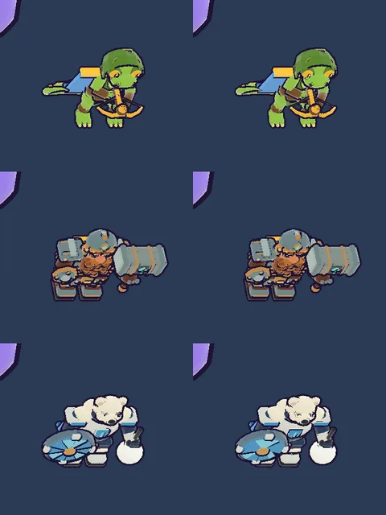

# 62회차: 성능·모바일, 영웅 외곽선 껍질 절반 채택

| 항목 | 값 |
| --- | --- |
| 시각 | 2026-11-12 12:43 ~ 12:53 KST (예약 회차) |
| 기준 | `95a75df` (PR #106 열림·미병합) |
| 레인 | 성능·모바일 (61회차 다음 레인, 백로그 35) |
| 상태 | 완료 (첫 화면 전송량 가설은 틀림, 아래) |
| 다음 레인 | 엔진 스파이크 |

## 문제

영웅의 검은 외곽선 껍질은 본체 메시를 그대로 복제한 것이다. 그래서 영웅 삼각형의 절반이 외곽선이다(궁수 7,804 + 7,804, 브론 23,190 + 23,190). 56회차 스파이크에서 껍질만 0.5로 단순화하면 전투 크기에서 차이가 보이지 않고, 궁수 전투 프레임이 7.3% 준다고 쟀다. 그때 추천은 ‘실행 중 단순화, 동적 import, 못 쓰면 전체 껍질’이었다.

## 범위

- 영웅 GLB를 받을 때 three.js에 든 meshopt 단순화기(`three/addons/libs/meshopt_simplifier.module.js`)를 **동적 import**로 같이 받는다. 영웅을 구울 때 껍질만 0.5로 줄인다. 본체와 손에 든 소품(눈덩이)은 그대로다.
- 단순화기를 못 받거나 WASM을 못 쓰면 지금처럼 전체 껍질로 굽는다.
- 타입 선언 파일 `src/rush/meshopt-simplifier.d.ts`를 둔다(three 쪽 사본에 타입이 없음). `package.json`은 바꾸지 않는다.
- 영웅 GLB 받기는 마을에서 영웅을 고를 때 미리 받는다(42회차). 단순화도 그때 일어나므로 전투 시작에는 비용이 없다.
- 바꾸는 파일: `src/rush/render.ts`, 새 `src/rush/meshopt-simplifier.d.ts`, `src/rush/main.ts`(디버그 정보가 필요하면).

## 가설

56회차와 같은 숫자가 나온다.
- 영웅별 껍질: 궁수 7,804 → 3,900, 브론 23,190 → 11,594, 포포 8,564 → 4,282
- 궁수 스테이지 전투 프레임: 약 −7%
- 첫 화면 전송량: 그대로. 단순화기는 따로 떨어진 묶음(gzip 약 15 KB)이고 영웅 모델을 받을 때만 받는다.

## 수용 기준

- [x] 영웅 셋의 껍질 삼각형 전후, 전투 프레임 삼각형 전후
- [x] 빌드에서 단순화기가 따로 떨어진 파일이다
- [ ] 첫 화면 요청에 없음: **틀림**. 영웅 GLB가 이미 타이틀에서 받아지므로 단순화기도 그때 같이 받는다(아래)
- [x] 모델 시트 영웅 셋 스크린샷 직접 확인(테두리 빠짐 없음)
- [x] 단순화기를 못 쓸 때 전체 껍질로 돌아감(실패 경로 확인)
- [x] `test:rush`, `tsc`, `build`, `smoke:rush` 통과

## 결과

삼각형은 56회차 숫자 그대로 나왔다.

| 영웅 | 본체 | 껍질 전 → 후 |
| --- | ---: | --- |
| 궁수 | 7,804 | 7,804 → **3,900** |
| 브론 | 23,190 | 23,190 → **11,594** |
| 포포 | 8,816¹ | 8,816 → **4,534** |

¹ 포포는 손에 든 눈덩이(본체·껍질 각 252)를 포함한다. 소품 껍질은 줄이지 않았다.

- **스테이지 전투 프레임**(궁수, 휴대폰 가로, 높음): 48,678 → **44,974 (−7.6%)**. 드로콜은 68로 같다.
- **모델 시트**: 궁수 21,800 → 17,896, 브론 52,572 → 40,976, 포포 23,824 → 19,542.
- 영웅 셋 테두리를 직접 확인했다. 굵기와 윤곽이 같고, 빠진 테두리도 없다.

**번들과 첫 화면 (가설 틀림)**

- 처음에는 동적 `import()`로 넣었다. 그런데 공유 Vite 설정(`vite.config.ts`의 `manualChunks`)이 `three/examples` 아래 모든 모듈을 첫 화면용 `three-tools` 묶음에 넣는다. 그래서 단순화기가 그 안에 들어갔다(three-tools 101 → 144 KB).
- 공유 설정은 사용자 승인 없이 바꾸지 않는다. 그래서 단순화기를 **파일 주소(`?url`)로 받아 실행 중에 불러오도록** 바꿨다. 이제 `meshopt_simplifier.module-*.js`(55 KB, gzip 15 KB)가 따로 떨어진 파일이고, three-tools는 101 KB로 돌아왔다.
- 하지만 빌드본(`vite preview`)의 요청을 보니 **타이틀 화면에서 이미 궁수 GLB를 받는다**. 단순화기도 그때 함께 받아진다. 첫 화면 전송량은 그대로가 아니라 **+55 KB(gzip 약 15 KB)**다.
- 이 파일은 모델과 나란히 받아지고 타이틀 화면 표시를 막지 않는다. 대신 전투마다 영웅 삼각형이 3,700~11,600 줄어든다. 맞바꿀 만하다고 판단해 유지한다.
- 타이틀에서 영웅 모델을 미리 받는 것 자체를 미룰지는 별도 항목으로 남긴다.

**실패 경로**

- `?hullSimplify=0`을 주면 단순화기를 받지 않고 전체 껍질(7,804/7,804)로 굽는다.
- 단순화기 요청을 막은 시험에서도 전체 껍질로 돌아왔고 페이지 오류는 0이었다.
- 처음 시험은 앱이 멈춘 것처럼 보였다. 원인은 앱이 아니었다. 개발 서버에서는 `?url` 가져오기 자체가 모듈 요청이라 그것까지 막았던 것이다. 실행 중 요청만 막아 다시 확인했다.

## 검증

- `npm run test:rush`: 66개 통과(규칙 변경 없음).
- `npx tsc --noEmit`(새 타입 선언 포함), `npm run build`: 통과.
- `npm run smoke:rush`: 32/32 통과.

## 다음

- **다음 레인: 엔진 스파이크.**
  - 후보 1: 타이틀에서 영웅 GLB와 단순화기를 받는 시점을 마을 진입 뒤로 미룰 때, 첫 화면 바이트와 마을·전투 시작 대기가 어떻게 바뀌는지 잰다.
  - 후보 2: 공유 Vite 설정의 `three-tools` 묶음 분리를 사용자 결정용으로 정리한다.
- 백로그 상위 3개
  1. (엔진 스파이크) 타이틀의 영웅 모델 받기 미루기 측정
  2. (성능·모바일) 섬 가장자리 장식 네 변 나누기(백로그 34)
  3. (PvE 콘텐츠) 주술사를 스테이지에 다시 넣는 설계(백로그 37)
