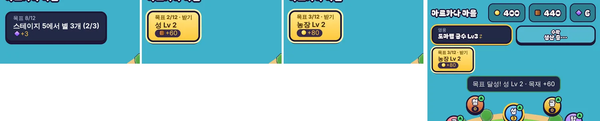

# 64회차: 킹덤 메타, 왕국 목표 사슬(한 번에 하나)

| 항목 | 값 |
| --- | --- |
| 시각 | 2026-11-12 14:42 ~ 14:56 KST (예약 회차) |
| 기준 | `8352bf5` (main `ae5cffd` + 63회차 문서) |
| 레인 | 킹덤 메타 (63회차 다음 레인) |
| 상태 | 완료 |
| 다음 레인 | PvE 콘텐츠 |

## 문제

마을에서 할 수 있는 일(건물·강화·훈련·특기·스테이지·끝없는 도전)은 많다. 그런데 ‘다음에 뭘 하면 좋은지’를 알려주는 것이 없다. 킹샷류는 화면 한쪽의 추천 임무 하나로 다음 판을 기대하게 만든다. 끝나면 보상을 받고 바로 다음 목표가 뜬다.

## 범위

- **목표 사슬 12개**(규칙, `kingdom.ts`): 순서가 정해진 목표다. 각 목표는 달성 조건(왕국 상태로 판단), 진행 표시, 보상(식량·목재·조각)을 가진다. 성·건물 레벨, 스테이지 별, 영웅 훈련, 대장간, 끝없는 도전 기록을 고루 섞는다.
- 왕국에 `goal`(다음 목표 번호)을 저장한다. 예전 저장은 0부터 시작한다(이미 이룬 목표는 바로 받을 수 있음).
- `claimGoal`: 지금 목표를 이뤘으면 보상을 주고 다음으로 넘어간다. 못 이뤘으면 그대로다(순수 함수, 시험).
- **마을 화면 목표 칸**: 상단 막대 아래 왼쪽에 둔다. 진행 중이면 ‘목표 n/12 · 설명 · 보상’을 보인다. 이루면 금색으로 빛나고 ‘받기’를 누를 수 있다. 다 끝나면 숨긴다. 보상 안내 줄은 그 옆에 둔다.
- 바꾸는 파일: `kingdom.ts`, `kingdom.test.ts`, `town.ts`, `rush.css`, `rush.html`, `tools/rush-smoke.cjs`, 글꼴 부분집합.

## 가설

목표 칸이 있으면 마을에 들어올 때마다 다음 행동이 하나로 정해진다. 보상(대부분 조각)이 훈련·특기로 이어진다. 사슬 12개는 봇 기준 성장 경로(스테이지 1→10, 성 Lv5)와 같은 순서라 막히는 목표가 없다.

## 수용 기준

- [x] 시험: 못 이룬 목표는 받을 수 없음, 이루면 보상·다음 목표, 마지막 뒤에는 없음, 예전 저장 이전, 복제가 `goal`을 옮김
- [x] 휴대폰 가로·세로 스크린샷: 진행 중, 받을 수 있음 두 상태. 막대·표지·보상 안내와 겹침 없음(직접 확인)
- [x] `test:rush`, `tsc`, `build`, `smoke:rush` 통과

## 결과

**목표 사슬 12개**

| # | 목표 | 보상 |
| ---: | --- | --- |
| 1 | 스테이지 1 승리 | 식량 60 |
| 2 | 성 Lv 2 | 목재 60 |
| 3 | 농장 Lv 2 | 식량 80 |
| 4 | 스테이지 3에서 별 | 조각 2 |
| 5 | 공격 강화 Lv 1 | 목재 80 |
| 6 | 영웅 Lv 2 | 조각 2 |
| 7 | 성 Lv 3 | 식량 150 · 목재 150 |
| 8 | 스테이지 5에서 별 3개 | 조각 3 |
| 9 | 대장간 Lv 1 | 조각 3 |
| 10 | 스테이지 10에서 별 | 조각 5 |
| 11 | 끝없는 도전 5웨이브 | 조각 5 |
| 12 | 성 Lv 5 | 조각 8 |

- 조각은 모두 28개다. 훈련 Lv3 이상과 특기(45회차: 3n개)로 이어진다.
- 진행이 여러 단계인 목표는 ‘(2/3)’처럼 보인다.

**마을 화면**

- 목표 칸은 상단 막대 아래 왼쪽, 섬이 없는 물 위에 있다.
- 진행 중일 때는 어두운 칸에 ‘목표 8/12’, 설명, 보상을 보인다.
- 이뤘을 때는 금색 칸으로 바뀌고 살짝 뛴다(동작 줄이기에서는 멈춤). 머리글은 ‘목표 n/12 · 받기’다.
- 누르면 보상이 들어오고 ‘목표 달성! 성 Lv 2 · 목재 +60’ 안내가 뜬다. 바로 다음 목표가 보인다.
- 금색 칸 위에서는 식량 아이콘(금색)이 빈 동그라미처럼 사라졌다. 보상 줄을 어두운 알약 위에 올렸다.
- 측정(휴대폰 가로 863×360·세로 412×839)
  - 목표 칸과 건물 표지 겹침 0
  - 막대 아래 8px
  - 안내 줄: 가로에서는 오른쪽, 세로에서는 목표 칸 아래로 옮겨 겹침 0(세로 처음 판은 1px 닿아 10px 내림)
- 받기를 누르면 목재 380 → 440, 목표 1 → 2이고 저장에도 반영된다(`localStorage` 확인).
- 예전 저장은 목표 1부터 시작한다. 이미 이룬 목표는 하나씩 바로 받을 수 있다(예: 성 3인 저장은 2·3번이 연달아 ‘받기’).

## 검증

- `npm run test:rush`: 95개 통과. 새 시험은 다음을 확인한다.
  - 못 이룬 목표는 그대로이고, 이루면 보상과 다음 목표로 넘어간다. 원본은 바뀌지 않는다.
  - 다 키운 왕국은 12개를 차례로 다 받고(조각 합 28), 그 뒤에는 목표가 없다.
  - 저장 왕복을 한다. 예전 저장은 0, 이상한 값도 0이다.
- 첫 실행에서 글꼴 부분집합 시험이 새 글자 ‘받·눌’로 실패했다.
  - 스크래치 가상환경에 fontTools를 설치해 `tools/rush-font-subset.py`를 다시 돌렸다.
  - 359자, 58,784 → 58,844 B.
- `npx tsc --noEmit`, `npm run build`: 통과.
- `npm run smoke:rush`: 33/33 통과. 새 검사는 ‘새 왕국은 첫 목표를 보이고 아직 받을 수 없음’이다.

## 다음

- **다음 레인: PvE 콘텐츠.** 후보는 주술사를 스테이지에 다시 넣는 설계(백로그 37)다.
- 백로그 상위 3개
  1. (PvE 콘텐츠) 주술사 재설계(탑 사거리 밖 뒤쪽에서 회복)
  2. (성능·모바일) 숲 마을 모델 meshopt 사본(백로그 40)
  3. (성능·모바일) 섬 가장자리 장식 네 변 나누기(백로그 34)
