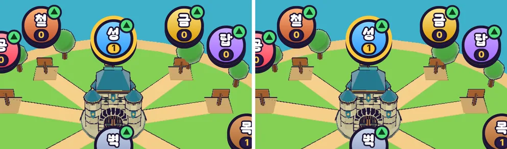

# 66회차: 성능·모바일, 숲 마을 모델 meshopt 웹 사본

| 항목 | 값 |
| --- | --- |
| 시각 | 2026-11-12 16:42 ~ 16:52 KST (예약 회차) |
| 기준 | `a128ca0` (main `ae5cffd` + 63~65회차) |
| 레인 | 성능·모바일 (백로그 40). **순서 변경**: 차례는 전투 손맛이지만 열린 항목이 없다. #107 통합으로 전투 HUD·알림이 사용자 결정에 따라 숨겨졌고, 마을 피격은 이미 흔들림·소리·마을 모델 맥동으로 알린다. 숨긴 HUD를 되살리지 않는 손맛 항목은 새로 점검한 뒤 고르기로 하고, 측정이 끝난 1순위를 먼저 한다 |
| 상태 | 완료 |
| 다음 레인 | 전투 손맛 (숨긴 HUD 결정 안에서 손맛 점검부터) |

## 문제

63회차 측정
- `forest-town.glb`(402 KB, 압축 없음)이 타이틀 화면 바이트의 약 절반이다.
- 전투 마을(`render.ts`)과 마을 화면 성(`townCastle.ts`)이 같은 파일을 따로 요청한다.
- 영웅 GLB와 같은 meshopt 단계로 만든 사본은 51.5 KB(−87%)다.

## 범위

- **원본은 그대로 둔다.** `forest-town.glb`는 Blender 빌드 결과물이다. 시험(`townView`·`townCastle`), `tools/check-rush-town.mjs`, 모델 작업실이 그것을 읽는다.
- **웹 사본** `src/rush/models/forest-town.web.glb`를 `tools/rush-glb.sh`로 만든다(prune → dedup → weld → meshopt high).
- 새 `src/rush/townModel.ts`
  - 사본을 meshopt 해독기로 **한 번만** 불러 두 곳이 나눠 쓴다(요청 2 → 1).
  - 양자화된 위치·법선은 float32로 되돌린다(31회차의 굽기 깨짐 방지, 영웅용 `toFloat32`를 이 모듈로 옮겨 같이 씀).
- 실패하면 지금처럼 절차형 마을·성으로 남는다.
- 시험: 원본과 사본을 둘 다 node에서 읽어 `townGeometry` 결과(삼각형 수, 경계 상자, 색)를 비교한다.
- 바꾸는 파일: `tools/rush-glb.sh`, `src/rush/models/forest-town.web.glb`(새 파일), `src/rush/townModel.ts`(새 파일), `render.ts`, `townCastle.ts`, `townView.test.ts`.

## 가설

- 첫 화면 바이트가 약 350 KB 준다(빌드본, 압축 없는 정적 서버 기준).
- 마을·전투 마을 모습은 화소 차이 없이 같다(양자화 오차는 화면에서 1px 아래).

## 수용 기준

- [x] 원본 대 사본 `townGeometry` 비교 시험 통과
- [x] 빌드본 첫 화면 요청: `forest-town` 요청 1개, 바이트 전후
- [x] 마을 화면·전투 화면 전후 스크린샷 직접 확인(화소 차이 수)
- [x] 사본을 못 불러오면 절차형으로 남음(실패 경로)
- [x] `test:rush`, `tsc`, `build`, `smoke:rush` 통과

## 결과

가설이 맞았다. 모습은 같고, 첫 화면 바이트는 44% 줄었다.

**느린 회선 첫 실행** (빌드본, 휴대폰 가로, 1.6 Mbps·150 ms, 63회차와 같은 스크립트)

| 항목 | 전(63회차) | 후 |
| --- | --- | --- |
| 타이틀 단계 받은 양 | 783 KB | **442 KB (−341 KB, −44%)** |
| 마을 모델 받기 끝 | 4.7초 | **2.7초** |
| 마을 모델 요청 수 | 2(둘째는 캐시) | **1** |
| 타이틀 화면 표시 | 2.2초 | 2.2초 |

- 웹 사본 `forest-town.web.glb`는 51,508 B(원본 402,460 B)다.
- 빌드 결과에 원본 402 KB 파일도 남는다. 모델 작업실 페이지(`model-lab`)가 원본을 쓰기 때문이고, 러시는 이제 원본을 받지 않는다.
- 원본 대 사본(node 시험, `townGeometry` 결과)
  - 삼각형 수가 같다.
  - 경계 상자는 0.5% 안이다.
  - 평균 색이 같다. 색이 정규화 정수로 저장될 수 있어 정규화 읽기로 비교했다.
- 화면 화소 차이(밝기 차 40 넘는 화소, 휴대폰 가로 2.6배 화면): 전투 454, 마을 1,595(전체 214만 중 0.02%·0.07%)다. 성 둘레 외곽선 몇 화소이고, 눈으로는 같다(아래 그림).
- 실패 경로: 사본 요청을 막아도 마을 화면이 뜨고(절차형 성), 페이지 오류는 0이다.
- `tools/check-rush-town.mjs`(원본 검사)는 그대로 통과한다(삼각형 4,374).

## 검증

- `npm run test:rush`: 96개 통과. 새 시험은 원본 대 웹 사본 굽기 비교다.
- `npx tsc --noEmit`, `npm run build`: 통과.
- `npm run smoke:rush`: 33/33 통과.
- `node tools/check-rush-town.mjs`: 통과.

## 다음

- **다음 레인: 전투 손맛.** #107 통합 결정(전투 HUD·알림 숨김)을 지키는 손맛 점검부터 한다.
  - 예: 웨이브 시작·보스 등장을 화면 글자 없이 알리는 소리·카메라·장면 신호가 충분한지 잰다.
- 백로그 상위 3개
  1. (전투 손맛) 숨긴 HUD 아래 웨이브·보스 신호 점검
  2. (PvE 콘텐츠) 주술사 보호막 설계 시험(백로그 37)
  3. (성능·모바일) 섬 가장자리 장식 네 변 나누기(백로그 34)
