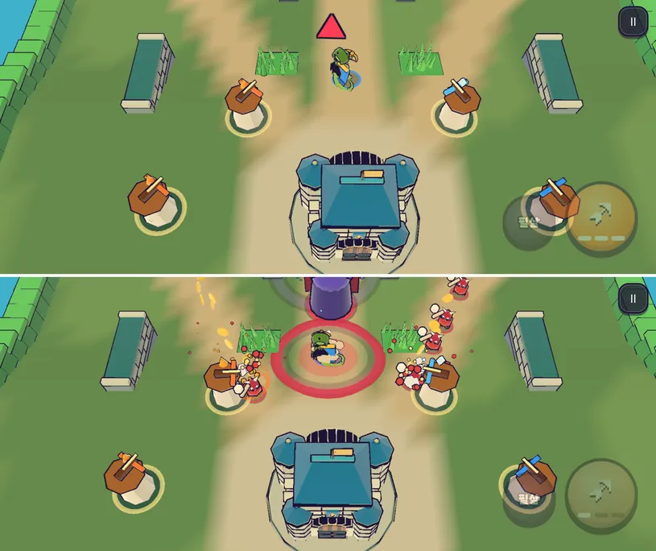

# 67회차: 전투 손맛, 글자 없는 보스 등장 신호

| 항목 | 값 |
| --- | --- |
| 시각 | 2026-11-12 17:41 ~ 17:50 KST (예약 회차) |
| 기준 | `6d5918e` (main `ae5cffd` + 63~66회차) |
| 레인 | 전투 손맛 (백로그 42) |
| 상태 | 완료 |
| 다음 레인 | 렌더 톤·모델 |

## 문제

#107 통합에서 사용자 결정으로 전투 HUD(웨이브·마을 체력·골드)와 알림 글(토스트)이 숨겨졌다. 그 뒤 전투 신호를 코드에서 점검했다.

| 사건 | 지금 신호 |
| --- | --- |
| 웨이브 시작 | 소리 ‘surge’ + 진동. 글은 숨김 |
| 웨이브 방어 성공 | 글뿐(숨김) → **신호 없음** |
| 보스 웨이브 시작 | 보통 웨이브와 **같은** 소리·진동. ‘보스 출현’ 글은 숨김 |
| 보스 포효(부하 부르기) | 주황 예고 원 + 보스에 붙는 말풍선 + 진동 |
| 마을 피격 | 작은 흔들림 + 소리 ‘breach’ + 마을 모델 주황 맥동(#107) |
| 준비 시간 | ‘웨이브 시작 +NG’ 단추가 보임 |

가장 큰 빈칸은 **보스 등장**이다. 판의 절정인데 보통 웨이브와 똑같이 들리고 보인다. 보스는 레인 끝(화면 위쪽 밖)에서 나오므로 처음에는 보이지도 않는다.

## 범위

- 시뮬레이션: 보스가 나올 때 `bossEnter` 이벤트(id, 위치)를 낸다. 이벤트는 결과 해시에 들어가지 않는다.
- 렌더: 보스가 나온 자리에 크고 붉은 잉크 고리가 퍼진다. 화면이 한 번 크게 흔들린다(동작 줄이기에서는 끔).
- 소리·진동: 보통 웨이브보다 무거운 소리와 강한 진동을 낸다.
- 화면 가장자리 화살표: 보스가 화면 밖에 있으면, 보스 쪽 가장자리에 붉은 갈매기 표시(글자 없음)가 2.5초 동안 보스 방향을 가리킨다. 화면 안이면 띄우지 않는다.
- 바꾸는 파일: `sim.ts`, `sim.test.ts`, `render.ts`, `main.ts`, `rush.css`, `rush.html`(필요하면).

## 가설

글 없이도 소리·진동·흔들림·고리·가장자리 화살표가 ‘보스가 왔다, 저쪽이다’를 전한다. 휴대폰 가로 화면에서 화살표가 보스의 실제 방향을 가리킨다.

## 수용 기준

- [x] 시험: 보스가 나올 때 한 번만 `bossEnter`, 다른 적은 없음, 결과 해시 그대로
- [x] 보스 등장 순간 스크린샷: 화면 밖이면 가장자리 화살표가 보스 쪽을 가리킴, 보스가 화면에 들어오면 사라짐(직접 확인)
- [x] `test:rush`, `tsc`, `build`, `smoke:rush` 통과

## 결과

가설이 맞았다. 글 없이 ‘보스가 왔다, 저쪽이다’가 보인다.

- **보스 등장 신호**(글자 없음)
  - 소리: 보통 웨이브의 ‘surge’ 대신 무거운 ‘cannon’
  - 진동: 강한 ‘breach’
  - 렌더: 나온 자리에 반경 5m 붉은 잉크 고리(1.1초), 큰 흔들림 0.55(동작 줄이기에서는 끔)
  - 가장자리 화살표: 보스가 화면 밖이면 붉은 갈매기 표시(잉크 테두리)가 보스 쪽 가장자리에서 깜빡이며 2.5초 동안 가리킨다
- 실제 시연 전투(휴대폰 가로)에서 확인했다.
  - 보스가 나온 순간: 보스는 레인 위쪽 끝(z −24.6)에 있다. 화살표는 화면 위 가운데(440, 34)에서 위를 가리킨다(회전 −1.51 rad ≈ 위쪽).
  - 1.2초 뒤: 보스가 화면에 들어왔고 화살표는 사라졌다.
- 나온 자리의 고리는 처음에는 화면 밖이라 보이지 않는다. 그래서 가장자리 화살표가 필요했다. 화면 안에서 보스가 나오는 경우(카메라가 위쪽에 있을 때)에는 고리와 흔들림이 신호다.
- 웨이브 방어 성공에는 아직 신호가 없다(점검 표). 다음 손맛 회차 후보로 남긴다.

## 검증

- `npm run test:rush`: 97개 통과. 새 시험은 보스 하나당 `bossEnter` 하나, 나온 자리 0.3m 안, 다른 적은 없음이다.
- `npx tsc --noEmit`, `npm run build`: 통과.
- `npm run smoke:rush`: 33/33 통과.

## 다음

- **다음 레인: 렌더 톤·모델.**
- 백로그 상위 3개
  1. (전투 손맛) 웨이브 방어 성공 신호(글 없음)
  2. (PvE 콘텐츠) 주술사 보호막 설계 시험(백로그 37)
  3. (성능·모바일) 섬 가장자리 장식 네 변 나누기(백로그 34)
