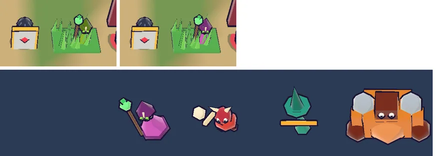

# 68회차: 렌더 톤·모델, 새 지형 위 적 색 대비 점검

| 항목 | 값 |
| --- | --- |
| 시각 | 2026-11-12 18:41 ~ 18:52 KST (예약 회차) |
| 기준 | `d71273c` (main `ae5cffd` + 63~67회차) |
| 레인 | 렌더 톤·모델 (67회차 다음 레인) |
| 상태 | 완료 |
| 다음 레인 | 성능·모바일 |

## 문제

아트 기준 1번은 ‘밝고 채도 높은 색, 땅은 한 단계 차분하게’다. 움직이는 것이 배경보다 먼저 보여야 한다는 뜻이다. #107 통합으로 전장이 바뀌었다(높낮이 있는 접근로, 정점 색 지형, 진한 잔디). 적 여섯 종의 주색이 새 땅 위에서 얼마나 떨어져 보이는지 잰 적이 없다. 초록 계열인 투척병(청록)과 주술사(연두)가 잔디에 묻힐 수 있다.

## 범위

- **측정**: 시연 전투를 멈춘 화면(휴대폰 가로, 높음)에 적 여섯 종을 잔디와 길 위에 하나씩 세운다.
  - 화면 위치에서 몸 가운데 화소와 발밑 둘레 바닥 화소를 뽑는다.
  - CIELAB 색 차이(ΔE)와 밝기 차이(ΔL)를 잰다.
- **기준**: ΔE ≥ 30(잔디·길 둘 다)이면 ‘먼저 보인다’로 본다. 그보다 낮은 종만 몸 주색을 조정한다(밝기·채도를 올림, 색상은 유지해 11회차 주색 분리를 지킴).
- 바꾸는 파일: 측정만이면 문서뿐. 조정하면 `render.ts`(`enemyKit` 색).

## 가설

투척병과 주술사가 잔디 위에서 ΔE 30 아래로 나온다. 나머지 넷은 넉넉하다.

## 수용 기준

- [x] 종별·바닥별 ΔE·ΔL 표(조정 전후)
- [x] 조정했다면 모델 시트 주색 hue 간격(11회차 기준 최소 16) 유지, 전투 화면 스크린샷 직접 확인
- [x] `test:rush`, `tsc`, `build`, `smoke:rush` 통과

## 결과

가설은 반만 맞았다. 주술사는 잔디에 거의 **사라졌다**(ΔE 8). 투척병은 길 위에서 경계선 근처였다. 나머지는 넉넉했다.

**측정 방법(두 번째 판)**

- 첫 판은 영웅을 옆으로 옮겨 카메라가 따라가는 바람에, 적이 벽·높은 풀과 겹쳐 ‘뒤 바닥’ 표본이 섞였다. 그래서 버렸다.
- 두 번째 판의 순서
  - 영웅을 가운데 두고 적 여섯 종을 한 줄로 세운다.
  - 같은 화면 전체에서 잔디·길 화소의 중앙값을 기준색으로 뽑는다(잔디 L53 a−24 b29, 길 L73 a−1 b29).
  - 각 적의 몸 가운데(9×9 화소 평균)와 비교한다.

| 적 | ΔE 잔디 전 → 후 | ΔE 길 전 → 후 | 비고 |
| --- | ---: | ---: | --- |
| 보스 | 91 | 85 | |
| 돌격병 | 56 | 49 | |
| 거한 | 55 | 52 | |
| 방패병(방패 면) | 46 | 28 | 길 위에서 경계선. 잉크 외곽선과 붉은 마름모가 있음 |
| 투척병 | 42 / 34¹ | 28 / 22¹ | 표본이 몸(청록)과 활(주황) 사이를 오감. 몸 청록만 계산하면 잔디 약 31·길 약 49 |
| **주술사** | **8 → 67** | **34 → 63** | 연두 옷이 #107 잔디색과 거의 같았다 |

¹ 같은 장면을 두 번 찍은 값이다. 몸짓 프레임에 따라 표본 위치의 부위가 바뀐다.

- **조정**: 주술사 옷 주색을 연두 `#8fbf2f` → 자홍 `#d65fcf`(hue 약 304)로 바꿨다. 옷단·두건은 `#7d2f86`, 처치 파편 색도 맞췄다. 뼈 가면, 초록 눈과 초록 구슬 지팡이(회복 색)는 그대로다.
- 주색 hue 간격(11회차 기준 최소 16°): 돌격병 349, 투척병 165, 거한 25, 방패병 41, 보스 256, 주술사 304. 가장 가까운 것은 돌격병(45°)과 보스(48°)다.
- 직접 확인
  - 전투 화면: 높은 풀 안에서도 자홍 옷이 보인다. 전에는 올리브색으로 풀에 묻혔다.
  - 모델 시트: 다른 적과 색·윤곽이 겹치지 않는다.
- 첫 시험 실행에서 글꼴 부분집합 시험이 주석의 ‘Δ’로 실패해 ‘dE’로 바꿨다(55회차 ‘×’와 같은 일).

## 검증

- `npm run test:rush`: 97개 통과(규칙 변경 없음).
- `npx tsc --noEmit`, `npm run build`: 통과.
- `npm run smoke:rush`: 33/33 통과.

## 다음

- **다음 레인: 성능·모바일.** 후보는 섬 가장자리 장식 네 변 나누기(백로그 34)다. #107 뒤에도 장식 구조가 그대로인지부터 확인한다.
- 백로그 상위 3개
  1. (성능·모바일) 섬 가장자리 장식 네 변 나누기(백로그 34)
  2. (전투 손맛) 웨이브 방어 성공 신호(백로그 43)
  3. (렌더 톤·모델) 투척병·방패병 길 위 대비(경계선, 표본 방법을 부위별로 다듬어 다시 잼)
