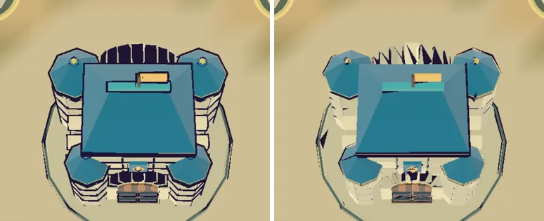

# 69회차: 성능·모바일, #107 뒤 전투 장면 삼각형 다시 재기

| 항목 | 값 |
| --- | --- |
| 시각 | 2026-11-12 19:41 ~ 19:50 KST (예약 회차) |
| 기준 | `23eedcf` (main `ae5cffd` + 63~68회차) |
| 레인 | 성능·모바일 |
| 상태 | **완료** (측정, 줄이기 시도는 기각·되돌림. 저장소 변경은 문서뿐) |
| 다음 레인 | 엔진 스파이크 |

## 문제

백로그 34(섬 가장자리 장식 네 변 나누기)는 대상이 없어졌다. #107 통합에서 `buildShoreDecor`가 사라지고, 높낮이 지형(`createGroundGeometry`·`createCliffGeometry`), 지형 굽기, 숲 마을 모델이 들어왔다. 55회차의 무리별 삼각형 표는 이제 맞지 않는다.

## 범위

- **측정**: 55회차 방법을 쓴다. 작업 트리에서만 장면 객체를 열어 보고, 측정 뒤 되돌린다.
  - 장면은 스테이지 전투(시드 3, 시연 프레임 7729)와 6바퀴 장면이다. 휴대폰 가로, 높음 품질이다.
  - 한 프레임의 삼각형을 무리별로 나눈다(적, 탄·동전, 파티클, 영웅, 탑, 고정 장면).
  - 고정 장면 안에서 큰 메시 상위 10개와 그 이름·역할을 뽑는다.
- **줄이기**(한 덩어리가 크게 차지하고, 같은 모습으로 줄일 방법이 분명할 때만): 전후 삼각형과 화면 차이를 잰다.
- 백로그 34는 ‘대상 없음’으로 닫는다.

## 가설

새 지면·절벽 메시가 고정 장면의 가장 큰 몫이다. 화면 밖까지 이어지는 지면은 잘리지 않아 늘 그려진다.

## 수용 기준

- [x] 두 장면의 무리별 삼각형 표와 고정 장면 상위 메시 목록
- [x] 줄였다면 전후 삼각형과 스크린샷 확인. 아니면 다음 후보와 근거
- [x] `test:rush`, `tsc`, `build`, `smoke:rush` 통과

## 결과

**무리별 삼각형** (휴대폰 가로, 높음, 보이는 메시 합. #107 + 62회차 영웅 껍질 절반 반영)

| 무리 | 스테이지 전투 | 6바퀴(적 80) |
| --- | ---: | ---: |
| 적 | 8,004 | 40,800 |
| 영웅(본체 + 절반 껍질) | 11,860 | 11,860 |
| **고정 장면** | **21,034** | **21,010** |
| 탑 | 1,216 | 0 |
| 파티클 | 5,000 | 120 |
| 탄·동전 | 792 | 432 |
| 렌더러 집계 / 드로콜 | 46,482 / 63 | 72,798 / 52 |

**고정 장면 상위 메시**

| 삼각형 | 메시 |
| ---: | --- |
| 4,374 + 4,374 | 숲 마을 모델(전투 마을) 본체 + 외곽선 껍질 — 고정 장면의 42% |
| 2,340 | 걸을 수 있는 접근로 지면(`rush-walkable-approach`) |
| 1,920 + 1,920 | 지형 굽기 덩어리(본체 + 껍질) |
| 1,416 + 1,416 | 지형 굽기 덩어리(본체 + 껍질) |
| 552 | 바위 토대(`rush-rock-foundation`) |
| 284 + 284 | 그 밖의 작은 굽기 |

- 가설과 달리 가장 큰 몫은 지면이 아니라 **숲 마을 모델**이다. 모든 고정 메시는 `frustumCulled`가 켜져 있다(늘 그려지는 지면 문제 없음).
- 백로그 34(섬 가장자리 장식 네 변 나누기)는 #107에서 장식 자체가 없어져 ‘대상 없음’으로 닫는다.

**줄이기 시도: 숲 마을 외곽선 껍질 절반 (기각)**

- 영웅처럼 마을 껍질을 meshopt로 절반 단순화했다(`TownView.accept`에 껍질 함수 인자, 전투에서만 단순화 껍질).
- 삼각형: 고정 장면 21,034 → 18,060(−2,974). 전투 프레임 46,482 → 43,108.
- **하지만 화면이 깨졌다.**
  - 지붕·탑 둘레 외곽선이 사라졌다.
  - 아치 자리에 검은 가시 삼각형이 튀어나왔다(마을 영역 화소 차이 27,787).
  - 원인: 숲 마을 모델은 329개 부품을 합친 건축물이다. 위치로 정점을 합치고(`mergeVertices`) 단순화하면 부품 경계를 넘어 껍질이 무너진다. 영웅 GLB는 부품이 적고 둥근 모양이라 괜찮았다.
- 코드는 되돌렸다. 마을 껍질을 줄이려면 부품별로 단순화하거나, Blender 원본에서 외곽선용 저세부 판을 따로 굽는 쪽이어야 한다. 이건 모델 소유 작업(#107 쪽) 영역이다.

## 검증

- 측정 고리(`window.__view`)와 시도 코드는 작업 트리에서만 썼고 되돌렸다.
- `npm run test:rush` 97개, `npx tsc --noEmit`, `npm run build`, `npm run smoke:rush` 33/33 통과.
- 숫자는 삼각형 수일 뿐 기기 성능 주장은 아니다.

## 다음

- **다음 레인: 엔진 스파이크.** 후보는 숲 마을 외곽선을 부품별 단순화로 만들 때 모습과 삼각형이 어떻게 되는지 시험하는 것이다(측정만).
- 백로그 상위 3개
  1. (엔진 스파이크) 숲 마을 껍질 부품별 단순화 시험
  2. (전투 손맛) 웨이브 방어 성공 신호(백로그 43)
  3. (렌더 톤·모델) 투척병·방패병 길 위 대비 다시 재기(백로그 45)
