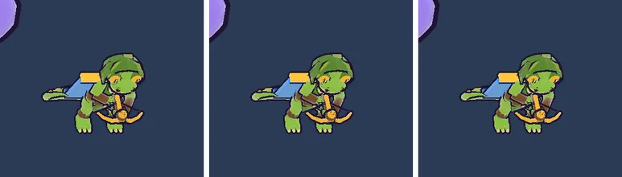

# 70회차: 엔진 스파이크, 새 영웅 GLB 질감 무게(측정만)

| 항목 | 값 |
| --- | --- |
| 시각 | 2026-11-12 20:42 ~ 20:50 KST (예약 회차) |
| 기준 | `f72adce` (main. 63~69회차가 #111로 병합돼 브랜치를 main에서 다시 시작) |
| 레인 | 엔진 스파이크. **후보 변경**: 백로그 46(숲 마을 껍질 부품별 단순화) 대신 이 항목을 먼저 한다. 이유는 아래 문제 |
| 상태 | **완료** (측정만, 저장소 변경은 문서뿐) |
| 다음 레인 | 킹덤 메타 |

## 문제

#111에서 영웅 세 명이 질감을 입힌 생산 모델(`characters-v2`)로 바뀌었다.

| 파일 | 전 | 후 |
| --- | ---: | ---: |
| `gecko-ranger.glb` | 75 KB | **892 KB** |
| `dwarf-guardian.glb` | 289 KB | **1,936 KB** |
| `polar-bear.glb` | 117 KB | **999 KB** |

- 궁수는 타이틀 화면에서 받는다(63회차). 그래서 첫 화면이 약 +817 KB다. 66회차에 숲 마을로 줄인 341 KB보다 크다.
- 궁수 GLB 안에는 1024² PNG 질감이 셋 있다: 법선 223 KB, 색 171 KB, ORM(금속·거칠기) 161 KB.
  - 러시의 툰 재질은 색과 법선만 쓴다. **ORM은 받기만 하고 쓰지 않는다.**
  - 풀린 크기는 장당 GPU 약 5.6 MB다.

## 범위

- **측정만 한다.** 사본에 glTF-Transform 단계를 적용해 크기를 잰다.
  - (a) ORM 제거(계산)
  - (b) 질감 WebP 변환
  - (c) 512²로 줄이기
  - (d) (b)+(c)
- 사본을 모델 시트에 넣어 영웅 화소 차이를 보고 스크린샷을 직접 확인한다(작업 트리에서만 바꾸고 되돌림).
- KTX2(GPU 메모리)는 해독기·변환기가 추가로 필요해서 비용만 적는다.
- 질감 모델은 #111 캐릭터 생산 작업의 결과물이다. 채택은 그쪽 생산 단계(`models:characters` → `tools/rush-glb.sh`)를 바꾸는 일이라 추천만 남긴다.

## 가설

전투 화면에서 영웅은 휴대폰 높이로 100화소 안팎이다. 512² WebP로 줄여도 모습 차이는 거의 없고, 궁수 GLB는 약 400 KB 아래로 준다.

## 수용 기준

- [x] 단계별 크기 표(영웅 셋 중 궁수는 반드시)
- [x] 모델 시트 영웅 화소 차이와 스크린샷 직접 확인
- [x] 저장소 변경은 문서뿐. `test:rush`, `tsc`, `build`, `smoke:rush` 통과
- [x] 추천과 비용·위험

## 결과

가설보다 더 줄었다. 질감을 WebP로 바꾸고 기하에 meshopt를 쓰면 영웅 GLB가 71~80% 준다. 모델 시트 크기에서 모습 차이는 거의 없다.

**크기** (사본에 glTF-Transform 4.5.1 적용)

| 영웅 | 지금 | WebP | 512² WebP | WebP + meshopt | 512² WebP + meshopt |
| --- | ---: | ---: | ---: | ---: | ---: |
| 궁수 | 891,740 | 385,736 | 350,044 | **262,716 (−71%)** | 226,936 (−75%) |
| 브론 | 1,935,780 | 1,367,872 | 1,341,096 | **394,332 (−80%)** | 367,528 (−81%) |
| 포포 | 998,920 | 494,464 | 472,356 | **261,048 (−74%)** | 238,908 (−76%) |

- meshopt 단계(prune → dedup → weld → meshopt)가 기하를 크게 줄인다. 브론은 `dedup`만으로 1.34 → 0.73 MB다(중복 버퍼). 지금 커밋된 생산 사본은 질감은 PNG 그대로이고 기하도 meshopt가 적용되지 않은 것으로 보인다.
- 512²로 줄이는 이득은 WebP 뒤에는 작다(궁수 36 KB). 그래서 질감 해상도는 그대로 두고 WebP + meshopt만 써도 된다.
- ORM 질감(금속·거칠기)은 러시의 툰 재질이 쓰지 않는다. 그런데 GLB에 남아 받아진다. WebP 512 기준 5 KB라 작지만, 원본 PNG 기준으로는 161 KB였다.
- **모습**(모델 시트, 2배 화면, 궁수 높이 약 110화소)
  - 원본 대비 화소 차이는 WebP 1024+meshopt와 512+meshopt 모두 137화소로 같다. 질감보다는 meshopt 위치 양자화 차이로 보인다.
  - 눈으로는 같다(아래 그림).
  - 확대한 근접 비교는 하지 않았다.
- 세 사본 모두 러시에서 오류 없이 불러와졌다(`heroReady`, 페이지 오류 0). three.js `GLTFLoader`는 `EXT_texture_webp`를 기본으로 읽고, 영웅 불러오기에는 이미 meshopt 해독기가 있다.
- 첫 화면 영향 추정: 궁수가 타이틀에서 받아지므로 약 −629 KB(892 → 263 KB)다. 63·66회차 타이틀 바이트 442 KB 기준선이 #111 뒤에는 약 1.26 MB로 커졌을 것이다. 이 사본이면 다시 약 0.63 MB가 된다(추정, 빌드본으로 재지 않음).

**KTX2(참고)**

- GPU 메모리(1024² 질감 장당 약 5.6 MB)를 줄이려면 KTX2(Basis)가 맞다.
- 대신 `KTX2Loader`와 변환기 WASM(약 수백 KB)이 첫 화면에 더해지고 질감 화질 점검이 필요하다. 영웅 셋이면 GPU 질감 약 34 MB(ORM 제외)라 실기기 메모리 측정 뒤에 정한다.

## 추천

- **채택 추천: `tools/rush-glb.sh`에 `webp` 단계를 넣는다(해상도 유지).** 영웅 사본을 WebP + meshopt로 만든다. 이 셸 파일의 영웅 부분은 #111 캐릭터 생산 쪽(`models:characters` 다음 단계)이 쓰고 있다. 그래서 그쪽과 맞춰 반영해야 하고, 백로그에 적었다.
- 함께: ORM을 쓰지 않으니 러시용 사본에서는 빼거나, 앞으로 툰 재질이 쓸 계획인지 생산 쪽에 확인한다.
- 위험: WebP는 손실 압축이다. 법선 질감의 띠·얼룩은 근접 화면에서 확인해야 한다(이번에는 시트 크기만 봄).

## 검증

- 사본 바꿔 넣기는 작업 트리에서만 했고 되돌렸다(`git checkout src/rush/models/gecko-ranger.glb`). 저장소 변경은 문서뿐이다.
- main(`f72adce`) 위에서: `npm run test:rush` 103개, `npx tsc --noEmit`, `npm run build`, `npm run smoke:rush` 33/33 통과.

## 다음

- **다음 레인: 킹덤 메타.**
- 백로그 상위 3개
  1. (성능·모바일) 영웅 GLB WebP + meshopt 사본(이번 추천, 첫 화면 약 −0.63 MB 추정, 생산 쪽과 맞춤)
  2. (엔진 스파이크) 숲 마을 껍질 부품별 단순화 시험(백로그 46)
  3. (전투 손맛) 웨이브 방어 성공 신호(백로그 43)
