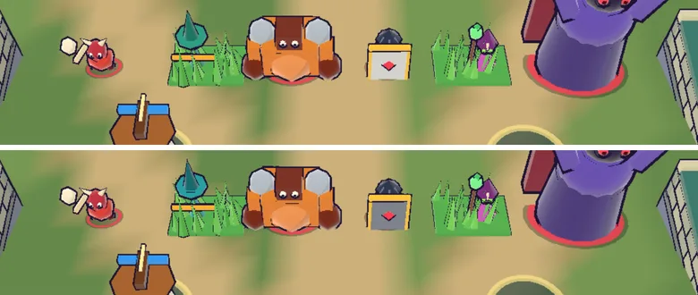

# 74회차: 렌더 톤·모델, 투척병·방패병 길 위 대비 다시 재기

| 항목 | 값 |
| --- | --- |
| 시각 | 2026-11-13 00:42 ~ 00:52 KST (예약 회차) |
| 기준 | `bfacb7d` (main `f72adce` + 70~73회차) |
| 레인 | 렌더 톤·모델 (백로그 45) |
| 상태 | 완료 |
| 다음 레인 | 성능·모바일 |

## 문제

68회차는 적 몸 가운데 한 점(9×9 화소)만 표본으로 썼다. 투척병은 몸(청록)과 활(주황) 사이를 오갔고 방패병은 방패 면이 잡혔다. 그래서 길 위 ΔE가 22~28로 흔들렸다. 진짜 ‘몸 주색’ 대비를 다시 재야 조정할지 정할 수 있다.

## 범위

- **측정 방법을 바꾼다**
  - 68회차와 같은 장면(영웅 가운데, 적 여섯 종 한 줄)을 쓴다. 한 판은 잔디 위, 한 판은 길 위에 세운다.
  - 빈 화면과 적 있는 화면의 차이로 적 화소만 고른다.
  - 그 화소를 색으로 묶어(간단한 k-평균, 3묶음) 가장 큰 묶음을 ‘주색’으로 본다. 그 주색과 그 자리 뒤 바닥(빈 화면)의 ΔE를 잰다.
  - 외곽선(잉크) 화소는 어두운 값(L < 20)으로 빼고 센다.
- **기준**: 주색 ΔE ≥ 30. 낮은 종만 주색의 밝기·채도를 조정한다(색상 유지).
- 바꾸는 파일: 측정만이면 문서뿐. 조정하면 `render.ts`.

## 가설

방패병 주색(은색 방패)은 길(모래색)과 명도는 다르지만 색 차이는 30 근처다. 투척병 청록 몸은 길 위에서 넉넉하고, 잔디 위에서 30 근처다.

## 수용 기준

- [x] 종별·바닥별 주색 ΔE 표(묶음 크기 비율 포함)
- [x] 조정했다면 전후 표와 스크린샷 직접 확인, 주색 hue 간격 유지
- [x] `test:rush`, `tsc`, `build`, `smoke:rush` 통과

## 결과

가설과 반대로 나온 부분이 있다.
- 방패병은 30 근처가 아니라 **훨씬 아래**(16~26)였다.
- 투척병은 길 위가 아니라 **잔디 위**에서 30 아래(28)였다.

**측정**: 적 화소만 골라 색 묶음(3개) 중 가장 큰 묶음을 주색으로 봤고, 그 자리 뒤 바닥과 비교했다. 두 배치(한 줄 / 길 위)에서 쟀고, 화면 밖으로 나간 적은 뺐다.

| 적 | 바닥 | 주색 ΔE 전 → 후 | 주색(렌더) 전 → 후 |
| --- | --- | --- | --- |
| 방패병 | 길(한 줄) | **16.1 → 45.5** | L81 a5 b30(모래빛 은색) → L45 a1 b−7(쇠색) |
| 방패병 | 길(길 위) | **25.7 → 36.9** | L80 a0 b6 → L54 a2 b−1 |
| 투척병 | 잔디 | **28.2 → 37.2** | L55 a−33 b5 → L59 a−28 b−6 |
| 거한 | 길 | 34.8 → 34.2 | 그대로 |
| 돌격병 | 길 | 55.6 / 55.7 | 그대로 |
| 주술사 | 잔디 / 길 | 95.5 / 75.3 | 그대로(68회차 자홍) |

- **원인**: 방패의 은색(`#d8dee9`)은 따뜻한 주광(`#fff3dc`)을 받아 렌더에서 모래빛(b +30)이 됐다. 그래서 길과 색이 같아졌다. 밝은 무채색은 이 조명에서 땅색으로 기운다.
- **조정**
  - 방패 면: `#d8dee9` → 쇠색 `#7c869c`. 금 테두리와 붉은 마름모는 그대로 둔다.
  - 투척병 몸·머리·모자: 청록에서 청록-시안으로 옮겼다(`#2fa38f` → `#1fa6b0` 등, hue 170 → 184). 처치 파편 색도 맞췄다.
- 주색 hue 간격(11회차 기준 16° 이상)
  - 투척병 184와 가장 가까운 것: 방패병 약 221(37°), 아군 파랑 210(26°)
  - 투척병은 여전히 청록으로 읽히고 아군 파랑과 섞이지 않는다(스크린샷 확인).
- 직접 확인: 같은 장면 전후에서 방패가 모래 길에서 분명히 떨어져 보인다. 투척병은 변화가 작다(조금 더 차가운 청록).

## 검증

- `npm run test:rush`: 104개 통과(규칙 변경 없음).
- `npx tsc --noEmit`, `npm run build`: 통과.
- `npm run smoke:rush`: 33/33 통과.

## 다음

- **다음 레인: 성능·모바일.** 후보는 영웅 GLB WebP + meshopt 사본(백로그 47)이다. 생산 쪽 단계(`tools/rush-glb.sh`)와 맞춰야 하므로 범위를 적을 때 영향 범위부터 정한다.
- 백로그 상위 3개
  1. (성능·모바일) 영웅 GLB WebP + meshopt 사본(백로그 47)
  2. (PvE 콘텐츠) 보호막 다음 시도(백로그 37)
  3. (전투 손맛) 웨이브 방어 성공 신호(백로그 43)
