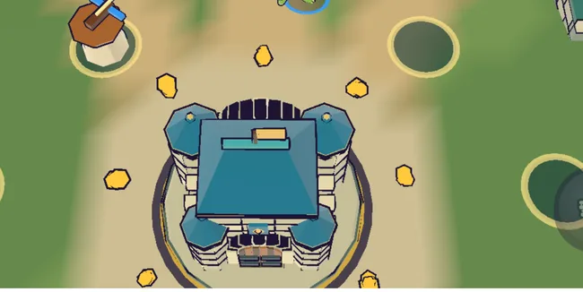

# 79회차: 전투 손맛, 글자 없는 웨이브 방어 성공 신호

| 항목 | 값 |
| --- | --- |
| 시각 | 2026-11-13 05:42 ~ 05:52 KST (예약 회차) |
| 기준 | `623ab74` (main `f72adce` + 70~78회차) |
| 레인 | 전투 손맛 (백로그 43) |
| 상태 | 완료 (‘+30’ 숫자는 빼고 고리·불꽃·소리로) |
| 다음 레인 | 렌더 톤·모델 |

## 문제

67회차 점검: 웨이브를 막아내면 ‘웨이브 N 방어 성공 · +30G’ 알림 글만 나오는데, 그 글은 #107 결정으로 숨겨져 있다. 그래서 한 웨이브를 막아낸 순간에 아무 신호가 없다. 준비 시간 단추가 다시 뜰 뿐이다. 판 안의 작은 성취 고리(막았다 → 보상 → 다음 준비)가 끊겨 있다.

## 범위

- **화면**(`render.ts`): 방어 성공 때 마을 둘레에 금색 잉크 고리가 퍼지고, 금 불꽃이 위로 솟는다.
- **보상 숫자**(`main.ts`): 마을 위에 금색 ‘+30’이 떠오른다. 동전을 주울 때 쓰는 떠오르는 숫자와 같은 방식이고, 숨긴 알림 글과는 다르다.
- **소리·진동**: 밝은 소리(`skill`)와 가벼운 진동을 낸다. 공용 소리 목록(`src/lib/sound.ts`)은 캠페인과 함께 쓰는 파일이라 고치지 않고, 있는 소리를 다시 쓴다.
- 동작 줄이기에서는 불꽃 수를 줄인다. 고리와 숫자는 남긴다.
- 끝없는 도전의 다섯째 웨이브 뒤에는 바퀴 알림(47회차)이 이어진다. 그 앞에 이 신호가 짧게 먼저 나온다.
- 바꾸는 파일: `render.ts`, `main.ts`.

## 가설

글 없이 금 고리 + ‘+30’ + 소리가 ‘막았다, 보상 받았다’를 전한다. 휴대폰 가로 화면에서 마을과 숫자가 함께 보인다.

## 수용 기준

- [x] 방어 성공 순간 스크린샷: 금 고리·불꽃이 마을에 보임(직접 확인). ‘+30’은 #107 결정으로 숨겨져 뺐다(아래)
- [x] `test:rush`, `tsc`, `build`, `smoke:rush` 통과

## 결과

**신호**(글자 없음)

- 렌더: 마을 둘레(반경 4.5m)에 금색 잉크 고리가 퍼진다(0.9초). 고리 위 여덟 곳에서 금 불꽃이 솟는다.
  - 높은 지형 위 마을(높이 1.2)에서도 고리는 지형에 붙어 보인다(`conformDecal`).
  - 동작 줄이기에서는 불꽃이 점마다 1개다.
- 소리 `skill`과 진동 `cast`를 낸다. 공용 소리 목록은 고치지 않고 있는 것을 다시 썼다.
- 처음 판에서는 불꽃을 성 위(높이 +1.6)에서 뿜었는데, 지붕 뒤에 가려 보이지 않았다. 그래서 고리 위 여덟 곳으로 옮겼다.

**‘+30’ 숫자를 뺀 이유(찾은 사실)**

- #107 통합 CSS에 `.pop { display: none; }`이 있다. 화면 위 **떠오르는 숫자가 모두 숨겨져 있다**.
  - 피해 숫자(22회차), 회복 숫자(60회차), 보스 말풍선(35·53회차), 동전 ‘+N’이 모두 해당한다.
  - 전투 HUD를 숨긴 사용자 결정의 연장으로 보고 따른다. 그래서 ‘+30’도 띄우지 않는다.
- 60회차 회복 숫자와 보스 말풍선은 지금 보이지 않는다. 기록만 남긴다(사용자 결정을 되돌리지 않음).

**확인**: 시연 전투에서 첫 웨이브를 막은 순간을 잡았다(2배속, 휴대폰 가로).
- 성 둘레에 금 고리와 원형으로 솟는 금 불꽃이 보인다.
- 0.35초 뒤에는 사라진다. 짧고 분명한 터짐이다.

## 검증

- `npm run test:rush`: 104개 통과(규칙 변경 없음).
- `npx tsc --noEmit`, `npm run build`: 통과.
- `npm run smoke:rush`: 33/33 통과.

## 다음

- **다음 레인: 렌더 톤·모델.**
- 백로그 상위 3개
  1. (성능·모바일) 영웅 GLB 1단계(분리 배치 + WebP) 적용(백로그 47)
  2. (PvE 콘텐츠) 보호막 2~3개 또는 근접 한정 넓게 깨기(백로그 37)
  3. (렌더 톤·모델) 떠오르는 숫자가 모두 숨겨진 상태(#107)에서 피해·회복이 화면에 어떻게 읽히는지 점검(글 없이)
