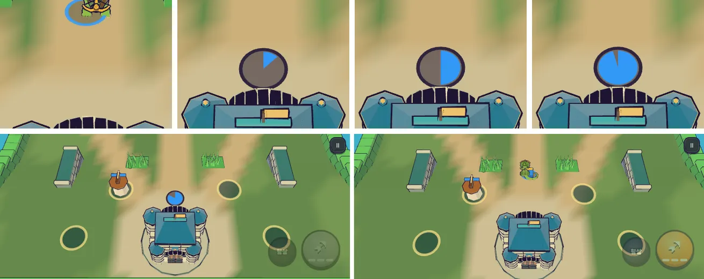

# 80회차: 렌더 톤·모델, 글 없는 영웅 부활 표시

| 항목 | 값 |
| --- | --- |
| 시각 | 2026-11-13 06:42 ~ 06:55 KST (예약 회차) |
| 기준 | `d616898` (main `f72adce` + 70~79회차) |
| 레인 | 렌더 톤·모델 (백로그 51: 떠오르는 숫자·알림이 모두 숨겨진 상태 점검) |
| 상태 | 완료 (넓은 고리 대신 영웅 크기 원판으로) |
| 다음 레인 | 성능·모바일 |

## 문제

#107은 전투 HUD, 알림 글, 떠오르는 숫자(`.pop`)를 모두 숨겼다. 사건별 신호를 점검하면 다음과 같다(코드 기준).

| 사건 | 숨기 전 글 | 남은 신호 |
| --- | --- | --- |
| 적 피격 | 피해 숫자 | 파편·불꽃, 적 번쩍임 |
| 처치 | — | 종류색 파편 |
| 영웅 피격 | 붉은 숫자 | 영웅 재질 맥동(#111) |
| 마을 피격 | 막대 | 흔들림·소리·마을 맥동 |
| 보스 포효 | 말풍선 | 주황 예고 원 |
| 필살 준비 | 알림 글 | 필살 단추 `ready` 표시 |
| 웨이브 방어 | 알림 글 | 금 고리·불꽃(79회차) |
| **영웅 쓰러짐 → 부활** | ‘쓰러졌다! 4초 뒤 마을에서 복귀’ | 쓰러지는 순간 고리·파편뿐. **언제·어디서 돌아오는지 신호가 없다.** 쏘기·필살 단추만 회색 |

## 범위

- 영웅이 쓰러져 있는 동안 부활 자리(`HERO_SPAWN`, 마을 앞)에 아군 파랑 고리를 그린다. 남은 시간에 따라 시계 방향으로 차오른다.
  - 어두운 바탕 고리 위에 파랑 채움 고리를 그리고, 잉크 테두리를 두른다.
  - 채움 단계는 24칸으로 나누고 칸별 기하를 미리 만들어 둔다(매 프레임 새로 만들지 않음).
- 지형 높이(#107 높낮이)에 맞춰 띄운다. 부활하면 사라진다.
- 바꾸는 파일: `render.ts`.

## 가설

글 없이도 ‘어디서, 얼마 뒤 돌아오는지’가 보인다. 휴대폰 가로에서 카메라가 마을을 볼 때 고리가 보인다(쓰러지면 카메라가 마을 쪽을 비춤, `battleFocus`).

## 수용 기준

- [x] 쓰러진 동안 부활 자리 고리가 차오르는 스크린샷 2장(초반·후반), 부활 뒤 사라짐(직접 확인)
- [x] `test:rush`, `tsc`, `build`, `smoke:rush` 통과

## 결과

가설이 맞았다. 다만 처음 모양(반지름 1.25 고리)은 두 가지 문제로 바꿨다.

- **채움이 안 보였다.** 시계 방향으로 돌리려고 호 길이를 음수로 줬더니 면의 감김 방향이 뒤집혀 뒷면으로 잘렸다. 호 길이는 양수로 두고, 시작점을 12시에서 시계 방향으로 옮기는 식으로 고쳤다.
- **성이 고리 아래쪽을 가렸다.** 부활 자리(z 6.1)는 성(z 10, 반지름 2.6) 바로 뒤라, 전투 카메라에서 성 뒤쪽 탑이 고리의 아래 3분의 1을 덮었다(데스크톱·휴대폰 가로 모두). 화면에서 재 보니 성 탑 끝이 땅 기준 약 z 6.9에 닿는다. 그래서 반지름을 줄이고(0.66 + 잉크 테 0.11), 고리 대신 **차오르는 원판**으로 바꿨다. 작은 크기에서는 원판이 고리보다 잘 읽힌다.

**모양**

- 어두운 원판(잉크 50%) 위에 아군 파랑 부채꼴이 12시부터 시계 방향으로 차오르고, 잉크 테두리를 두른다.
- 부채꼴은 24칸 기하를 처음 쓰러질 때 한 번 만들고, 그 뒤에는 칸만 바꿔 끼운다. 땅 높이(#107 지형)에 맞춰 띄운다.
- 부활하는 틱에 사라진다. 실제 판(멈춤 없음)에서 쓰러짐 → 부활을 돌려 확인했다. 부활 뒤 원판이 없고, 영웅이 부활 자리에서 나와 움직이며, 쏘기 단추 회색이 풀린다.

| 화면 | 원판 지름(화소) | 성에 가림 |
| --- | ---: | --- |
| 휴대폰 가로 863×360 | 약 44 | 없음 |
| 데스크톱 1440×900 | 약 90 | 없음 |

- 스크린샷 직접 확인: 두 화면에서 살아 있음(없음) · 초반(10%) · 중반(50%) · 후반(92%), 그리고 실제 판의 쓰러짐·부활 직후.
- 비용: 쓰러져 있는 동안만 메시 3개(드로콜 +3), 삼각형 130 이하. 살아 있을 때는 숨김이라 0이다.

## 검증

- `npm run test:rush`: 104개 통과(규칙 변경 없음).
- `npx tsc --noEmit`, `npm run build`: 통과.
- `npm run smoke:rush`: 33/33 통과.

## 다음

- 백로그 51(글 없는 신호 점검)은 이번 회차로 닫는다. 점검 표의 빈칸은 부활뿐이었다(회복은 60회차 고리, 보스는 67회차 소리·진동·예고 원이 남아 있음).
- **다음 레인: 성능·모바일.**
- 백로그 상위 3개
  1. (성능·모바일) 영웅 GLB 사본 1단계: `--vertex-layout separate`로 prune→dedup→weld→webp(47)
  2. (엔진 스파이크) 숲 마을 외곽선 껍질 부품별 단순화 시험(46)
  3. (PvE 콘텐츠) 보호막 주술사 막 2~3개 시도(37)
