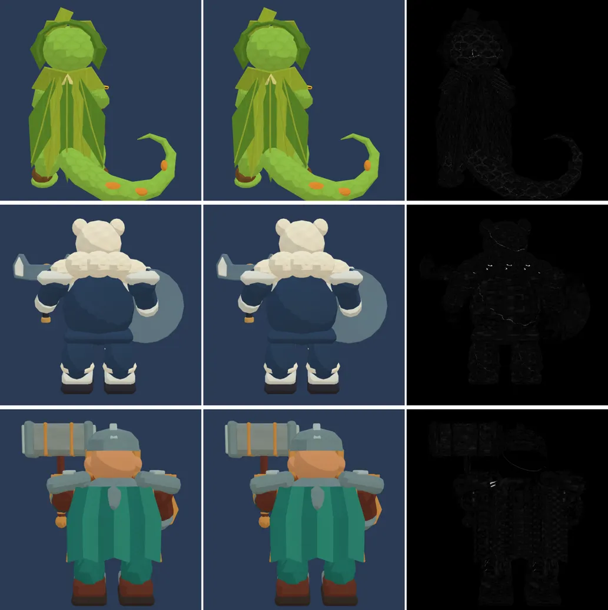

# 81회차: 성능·모바일, 영웅 GLB 1단계 사본(분리 배치 + WebP)

| 항목 | 값 |
| --- | --- |
| 시각 | 2026-11-13 07:42 ~ 07:55 KST (예약 회차) |
| 기준 | `8d44f49` (main `f72adce` + 70~80회차) |
| 레인 | 성능·모바일 (백로그 47, 1단계) |
| 상태 | 완료 (1단계. meshopt 2단계는 생산 쪽 결정으로 남김) |
| 다음 레인 | 엔진 스파이크 |

## 문제

러시는 #111 생산 단계(`models:characters`)가 복사해 둔 영웅 GLB를 그대로 받는다(궁수 891,740 B, 브론 1,935,780 B, 포포 998,920 B). 질감이 PNG이고 기하는 압축하지 않았다. 궁수는 타이틀 화면에서 받는다. 76회차에서 원인을 찾았다. glTF-Transform이 정점을 교차 배치로 다시 쓰는 것이 문제였고, `--vertex-layout separate`를 쓰면 계약 시험(`heroAssets.test.ts`)이 통과한다.

## 범위

- `tools/rush-glb.sh` 영웅 부분을 ‘prune → dedup → weld → webp’로 바꾸고, 모든 명령에 `--vertex-layout separate`를 붙인다. meshopt는 빼고 2단계(계약 시험을 정규화 읽기로 바꾸는 생산 쪽 결정)로 남긴다.
- 영웅 셋 사본(`src/rush/models/{gecko-ranger,dwarf-guardian,polar-bear}.glb`)을 다시 만든다.
  - 원본(`public/defense/models/characters-v2/`)과 숲 마을 사본은 건드리지 않는다.
  - 생산 단계를 다시 돌리면 원본 복사본으로 덮인다. 그 뒤에 이 도구를 다시 돌린다는 주석을 남긴다.
- 러시는 색 질감과 **법선 질감**을 쓴다(`render.ts` 494~495행). 손실 WebP 때문에 법선 질감에 띠나 얼룩이 생기면 법선만 무손실로 두거나 품질을 올린다.
- 바꾸는 파일: `tools/rush-glb.sh`, 영웅 GLB 셋, 기록.

## 가설

크기는 76회차 측정대로 나온다(궁수 −54%, 브론 −37%, 포포 −51%, 합 3.83 MB → 2.13 MB). 계약 시험·모델 시트·전투 화면은 그대로다. 빌드본 타이틀 바이트는 궁수 몫만큼(약 −478 KB) 준다.

## 수용 기준

- [x] `heroAssets.test.ts` 포함 `test:rush` 통과
- [x] 영웅 셋 크기 전후. 모델 시트 화소 차이, 근접 스크린샷 직접 확인(법선 질감 띠·얼룩)
- [x] 빌드본 타이틀 첫 화면 바이트 전후
- [x] `tsc`, `build`, `smoke:rush` 통과

## 결과

가설이 맞았다. 크기는 76회차 측정과 바이트까지 같다. 계약 시험은 영웅 셋 모두 통과하고, 화면 차이는 눈으로 구별되지 않는다.

**크기 (B)**

| 영웅 | 전 | 후 | 질감 전 → 후 (PNG → WebP 3장) |
| --- | ---: | ---: | ---: |
| 궁수 | 891,740 | **413,476 (−54%)** | 555,356 → 58,128 |
| 브론 | 1,935,780 | **1,226,764 (−37%)** | 596,135 → 40,232 |
| 포포 | 998,920 | **485,088 (−51%)** | 530,369 → 34,152 |
| 합 | 3,826,440 | **2,125,328 (−44%)** | |

- 줄어든 몫은 거의 질감이다. 브론이 아직 1.2 MB인 것은 기하(삼각형 23,190) 때문이다. 기하는 meshopt 2단계에서 준다(76회차 참고값 합 0.92 MB).
- 영웅 삼각형(본체·외곽선)은 셋 다 그대로다(궁수 7,948·3,962, 브론 23,190·11,594, 포포 8,700·4,476).

**빌드본 첫 화면 (휴대폰 가로, 1.6 Mbps·150 ms 흉내 회선, 66회차 측정 스크립트)**

| 항목 | 전 | 후 |
| --- | ---: | ---: |
| 타이틀 단계 받은 바이트 | 1,242 KB | **775 KB (−467 KB)** |
| 궁수 GLB 받기 끝 | 8.4초 | **4.6초** |
| 타이틀 3초 뒤 영웅 준비 | 아니오 | **예** |
| 타이틀 → 마을 → 전투로 바로 갈 때 자리표시 모델 시간 | 1.16초 | **0.01초** |

흉내 회선의 컨테이너 측정이라 기기 시간은 아니다.

**모습 확인**

- 근접(1024화소, 러시와 같은 툰 재질 + 색·법선 질감, 영웅별 두 방향)
  - 전경 화소 평균 차이는 1.5~2.3(RGB 합, 최대 765)이다.
  - 가장 큰 차이는 72로, 질감 이음매 몇 곳(포포 등 털 테두리, 브론 등판)에서만 난다.
  - 나란히 놓고 직접 보면 구별되지 않는다. 법선 질감에 띠나 얼룩이 없다.
- 모델 시트(2배 화면): 밝기 차 40 넘는 화소가 궁수 1, 브론 0, 포포 6이다.

**같이 고친 것: 스모크 자동 품질 검사**

- 첫 스모크에서 ‘auto quality at 54fps → low’가 실패했다.
- 자동 품질은 한 번 낮음으로 떨어지면 돌아오지 않는다(`quality.ts` 39행). 컨테이너는 소프트웨어 렌더라 매번 앞에서 떨어진다. 그런데 이번에는 검사 순간의 fps가 54로 읽혀 ‘높음이어야 함’ 쪽에 걸렸다.
  - 지난 스모크 기록에서는 같은 검사가 ‘50fps → low’까지 모두 통과했다.
  - 이번 변경과 무관한 검사의 빈틈이다.
- 그래서 검사를 ‘이미 떨어졌으면 낮음’으로 고쳤다(`tools/rush-smoke.cjs`). 다시 돌려 33/33 통과했다(‘43fps → low (dropped earlier)’).

**찾은 것(이번 범위 밖)**

- `tools/rush-glb.sh`는 숲 마을 웹 사본도 같이 다시 만든다. 오늘 다시 돌리면 결과가 **71,732 B**다. 커밋된 사본(66회차)은 51,508 B다.
- 도구가 ‘quantize: TEXCOORD_0 0~1 밖이라 건너뜀’ 경고를 낸다.
- 커밋된 사본은 되돌려 두었다(`git checkout`). 같은 명령인데 결과가 다른 원인은 백로그 52로 넘긴다.

## 검증

- `npm run test:rush`: 104개 통과. `heroAssets.test.ts` 영웅 셋 통과.
- `npx tsc --noEmit`, `npm run build`: 통과.
- `npm run smoke:rush`: 33/33 통과(위 검사 수정 뒤).

## 다음

- **다음 레인: 엔진 스파이크.**
- 백로그 상위 3개
  1. (엔진 스파이크) 숲 마을 웹 사본 재현 안 됨(51.5 KB → 다시 돌리면 71.7 KB) 원인 찾기(52)
  2. (성능·모바일) 영웅 GLB 2단계: 계약 시험을 정규화 읽기로 바꾸고 meshopt(47, 생산 쪽 결정)
  3. (PvE 콘텐츠) 보호막 주술사 막 2~3개 시도(37)
