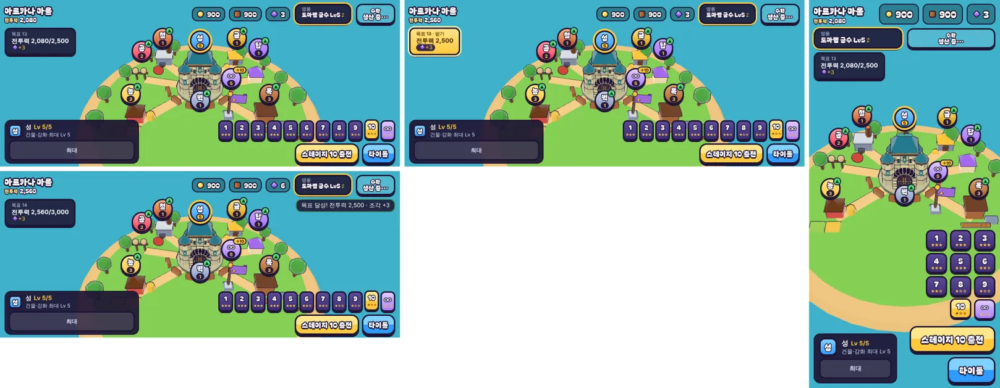

# 83회차: 킹덤 메타, 목표 사슬 뒤의 전투력 목표

| 항목 | 값 |
| --- | --- |
| 시각 | 2026-11-13 09:42 ~ 09:53 KST (예약 회차) |
| 기준 | `aba6487` (main `f72adce` + 70~82회차) |
| 레인 | 킹덤 메타 (82회차 후보: 목표 사슬을 다 받은 뒤) |
| 상태 | 완료 |
| 다음 레인 | PvE 콘텐츠 |

## 문제

왕국 목표 사슬(64회차)은 12개다. 마지막 ‘성 Lv 5’를 받으면 `currentGoal`이 `null`이 되어 마을 왼쪽 위 목표 칸이 **그냥 사라진다**. 킹샷식 마을 성장에서 ‘다음에 할 일’이 늘 보이는 것이 고리의 핵심인데, 사슬을 마친 뒤에는 그 칸이 없다.

그 시점의 왕국 전투력(71회차 `kingdomPower`)을 재 보았다(작업 스크립트).

| 왕국 | 전투력 |
| --- | ---: |
| 새 왕국 | 280 |
| 사슬을 막 마친 흔한 왕국(성 5, 밭 3·3, 강화 6, 영웅 Lv 5·2·2, 특기 1, 별 22, 끝없는 5) | 2,080 |
| 끝없는 도전을 뺀 최대(성·밭·강화·영웅·특기·별 모두 최대) | 4,970 |
| 끝없는 도전 | 웨이브마다 +10, 끝없음 |

## 범위

- **전투력 사다리**: 12번째 목표 다음부터 ‘전투력 2,500’, ‘전투력 3,000’처럼 500씩 오르는 목표가 끝없이 이어진다. 보상은 칸마다 조각 3개다.
  - 사다리 목표는 저장된 `goal` 번호로 정해진다(13번째는 2,500, 14번째는 3,000 …). 따로 저장할 것이 없다.
  - 이미 전투력이 높으면 여러 칸을 연달아 받을 수 있다(따라잡기). 받을 때 전투력이 바뀌지 않으므로 보상이 다시 진행을 만들지는 않는다.
- 목표 칸 머리글: 사슬은 지금처럼 ‘목표 5/12’, 사다리는 분모 없이 ‘목표 13’이다.
- 저장값 검사: `goal` 상한을 12에서 사다리 칸까지 넓힌다(12 + 1,000). 범위 밖이나 이상한 값은 지금처럼 0이다.
- 바꾸는 파일: `src/rush/kingdom.ts`, `src/rush/town.ts`, `src/rush/kingdom.test.ts`.

## 가설

사슬을 마친 왕국(전투력 약 2,000)은 2,500 칸까지 영웅 훈련·특기·별 몇 개면 닿는다. 그래서 다음 할 일이 끊기지 않는다. 끝없는 도전을 뺀 최대(4,970)까지 사다리 다섯 칸, 조각 15개다. 특기 전체 비용(54)보다 훨씬 작아 성장 속도를 크게 바꾸지 않는다.

## 수용 기준

- [x] 시험: 사슬 다음 목표가 사다리, 전투력이 모자라면 못 받음, 넘으면 받고 다음 칸, 저장·불러오기, 이상한 `goal` 값은 0
- [x] 휴대폰 가로·세로, 데스크톱 마을 스크린샷: 사다리 목표 칸(진행 중·받기) 직접 확인, 막대·표지와 안 겹침
- [x] `test:rush`, `tsc`, `build`, `smoke:rush` 통과

## 결과

가설이 맞았다. 사슬 12번째를 받으면 목표 칸이 사라지지 않고 ‘목표 13 · 전투력 2,080/2,500’으로 이어진다.

**규칙** (`kingdom.ts`)

- `goalAt(i)`
  - 0~11번은 기존 사슬이다.
  - 12번부터는 사다리 칸 `r = i − 12`이고, 목표는 ‘전투력 2,500 + 500r’, 보상은 조각 3개다.
  - 1,000칸(전투력 50만 근처)에서 끝난다. 실제로 닿을 일은 없고, 저장값 상한을 정하려고 둔 끝이다.
- 진행은 `kingdomPower`를 그대로 읽는다. 받아도 전투력은 바뀌지 않는다(조각만 늘어남).
- 저장값 `goal` 상한은 12 + 1,000이다. −1, 2.5, 글자, 100만은 0으로 돌린다.
  - 64회차 시험에서 ‘99는 0’ 확인은 바꿨다. 99는 이제 유효한 사다리 칸이다.
  - 64회차 시험의 ‘사슬 뒤에는 목표 없음’ 확인은 ‘사슬 뒤에는 사다리’로 바꿨다.

**계산 확인 (새 시험)**

| 왕국 | 전투력 | 결과 |
| --- | ---: | --- |
| 사슬을 막 마친 흔한 왕국 | 2,080 | 13번 ‘2,080/2,500’, 못 받음 |
| 위 + 특기 6 더 | 2,560 | 받기 → 조각 +3, 14번 ‘3,000’ |
| 끝없는 도전 빼고 전부 최대 | 4,970 | 연달아 다섯 번 받음(15조각), 다음 5,000 |

**화면** (`town.ts`)

- 머리글: 사슬은 ‘목표 12/12’, 사다리는 분모 없이 ‘목표 13’이다.
- 진행 중에는 ‘전투력 2,080/2,500’, 다 되면 ‘전투력 2,500’과 금색 ‘받기’ 칸이다. 누르면 안내 줄에 ‘목표 달성! 전투력 2,500 · 조각 +3’이 뜬다.
- 휴대폰 가로·세로, 데스크톱 모두 목표 칸이 상단 막대·표지와 겹치지 않는다.
  - 진행 중 칸 폭은 154px로, 사슬 칸(106~110px)보다 넓다. 휴대폰 가로에서 가장 가까운 표지(‘공’)까지 약 100px 남는다.
  - 받기 칸은 110px다.
- 스크린샷 직접 확인: 세 화면의 진행 중, 휴대폰 가로의 받기 전·후, 사슬 마지막(‘목표 12/12 · 받기’).

## 검증

- `npm run test:rush`: 105개 통과(새 시험 ‘전투력 사다리’ 1개, 64회차 시험 두 줄 조정). 진행 기둥 시험은 그대로 통과했다(전투 규칙 변경 없음).
- `npx tsc --noEmit`, `npm run build`: 통과.
- `npm run smoke:rush`: 33/33 통과.
- 새 글자 없음(‘전투력’, 쉼표, 숫자는 이미 글꼴 부분집합에 있음, 글꼴 시험 통과).

## 다음

- **다음 레인: PvE 콘텐츠.**
- 백로그 상위 3개
  1. (PvE 콘텐츠) 보호막 주술사 막 2~3개 시도(37)
  2. (성능·모바일) 영웅 GLB 2단계: 계약 시험을 정규화 읽기로 바꾸고 meshopt(47, 생산 쪽 결정)
  3. (엔진 스파이크) 숲 마을 외곽선 껍질 부품별 단순화 시험(46)
